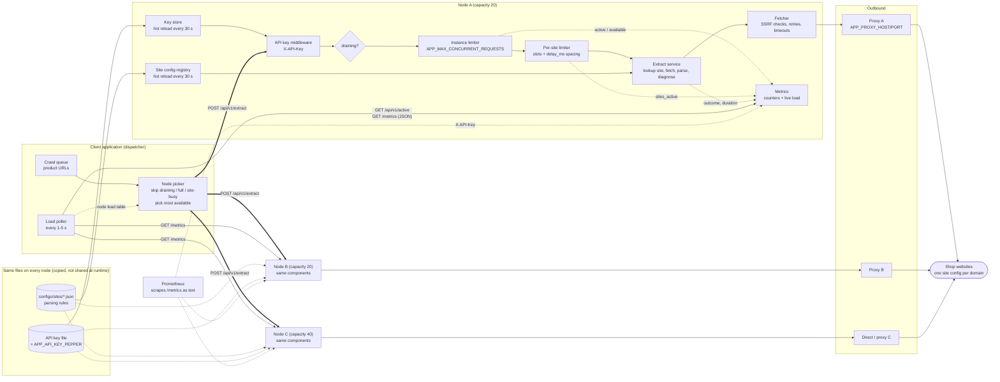
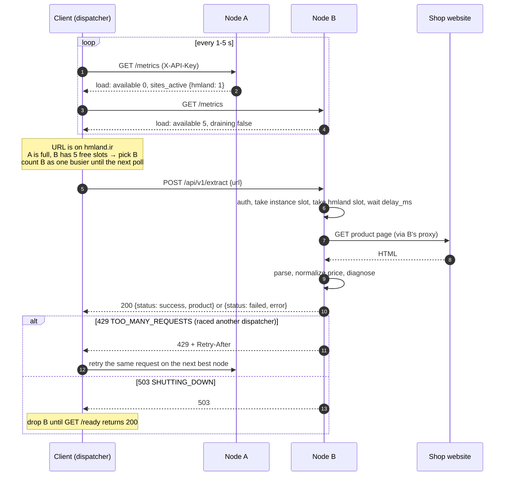

# go-wordpress-extraction: product extraction service

A stateless HTTP service that extracts one product from one product page. A client application sends a product URL with an API key. The service finds that site's parsing rules in a JSON file, fetches the page, and returns either the product or a structured root cause with evidence, in the same response.

For sites behind bot protection that the service does not get past (fergusonhome.com, hafele.com.de), a search engine (`duckduckgo` or `brave`) builds the product from the search result instead, without contacting the site. Whatever is found is returned, and every field that could not be found is listed in `unavailable_fields`. See [Search engines](#search-engines-duckduckgo-brave) and [Responsible use](#responsible-use).

There is no database and no Redis. Site configs and API keys are files that are re-read every 30 seconds. The design is in [md/SYNC_EXTRACTION_PROPOSAL.md](md/SYNC_EXTRACTION_PROPOSAL.md).

Because nodes share nothing, you can run as many as you like. Each node reports how busy it is, so the client can act as the dispatcher and spread requests across nodes. See [Run distributed](#run-distributed-client-side-load-balancing).

```text
POST /api/v1/extract   X-API-Key        {"url": "...", "request_id": "..."}
GET  /api/v1/sites     X-API-Key        enabled sites available for extraction
GET  /api/v1/active    X-API-Key        {"extract_active_requests": N}, extractions running now
GET  /metrics          X-API-Key        instance load + counters as JSON; Prometheus text for Accept: text/plain
GET  /health, /ready   public
GET  /swagger/index.html   operator credentials (HTTP Basic); off unless configured
```

## Layout

```text
docs/                   Swagger 2.0 doc generated by swag from the handler annotations (do not edit)
cmd/server              HTTP service
cmd/apikey              Key generation (single and bulk), listing, revocation
cmd/sitectl             Site config validation, live checks, fixtures
configs/                schema/, templates/ (woocommerce, woodmart, prestashop), sites/
internal/apikey         Key format, HMAC hashing, .env and JSON key files, reload, middleware
internal/siteconfig     Loader, template merge, validation, registry with hot reload
internal/extract        Pipeline (config, fetch, page_check, extract, normalize, validate) and handler
internal/fetch          Fetch engines (http/Colly, browser, search) and router; SSRF-safe dialer, retries, redirects, size limit
internal/fetch/search   DuckDuckGo and Brave providers, URL matching, query building
internal/normalize      Digits, prices (ranges, rial to toman), text, URLs
internal/diagnose       Failure codes, page checks, selector trace, HTML samples
internal/limiter        Per-instance and per-site concurrency, per-site request spacing
internal/metrics        Prometheus text metrics
testdata/sites/         Saved HTML and expected output per site
testdata/search/        Saved DuckDuckGo result pages (real) and a Brave response (synthetic)
test/e2e/               End-to-end tests against the real server and a fake shop
```

## Run locally

```bash
# 1. Create a development key with the pepper from .env.development
APP_API_KEY_PEPPER=$(grep '^APP_API_KEY_PEPPER=' .env.development | cut -d= -f2-) \
APP_API_KEYS_FILE=secrets/api_keys.json \
  go run ./cmd/apikey generate --name local-dev   # prints the key once

# 2. Start the service
go run ./cmd/server


# 2.2 
sudo apt-get install -y xvfb
xvfb-run -a go run ./cmd/server


# 3. Call it
curl --max-time 190 -X POST http://127.0.0.1:4000/api/v1/extract \
  -H "X-API-Key: gwp_..." -H 'Content-Type: application/json' \
  -d '{"url": "https://badomjip.com/product/example/"}'
```

Both extraction outcomes return HTTP 200. Always read the `status` field. Only `HTTP_NOT_FOUND` means the product is gone.

## API keys

Step-by-step setup of every key from scratch (pepper, API keys, operator login, TLS): [md/SETUP_KEYS.md](md/SETUP_KEYS.md).

Keys look like `gwp_<id>_<secret>`. Only an HMAC-SHA-256 of each key, keyed with `APP_API_KEY_PEPPER`, is stored. Files ending in `.json` are read as JSON; anything else is read as `.env` (production default: `secrets/.env.apikeys`).

```bash
apikey generate-pepper                                   # once; set it on every instance
apikey generate --name catalog-service --expires-in 8760h
apikey generate-bulk --count 100 --name-prefix app --plain-output /secure/app-keys.csv
apikey generate-bulk --names-file clients.txt --plain-output /secure/client-keys.csv
apikey list
apikey revoke --id k7f3a9c2
apikey revoke --name-prefix app
echo 'operator password' | apikey hash-ops-password     # value for APP_OPS_PASSWORD_HASH
```

- With `--plain-output`, full keys go only to that CSV (permission 0600, never overwritten), not to stdout.
- A bulk run is all or nothing: if the key file cannot be updated, the CSV is deleted.
- Copy the key file to every instance. Each instance logs the key count and file checksum on every reload; compare checksums across instances.
- A bad key file stops startup; during a reload it is rejected and the previous keys stay active.

## Site configs

One file per site in `configs/sites/`, usually extending a template in `configs/templates/`. Objects merge deeply; a site's arrays replace the template's.

```bash
go run ./cmd/sitectl validate                          # schema and references
go run ./cmd/sitectl check --url <product url>         # live extraction with full diagnostics
go run ./cmd/sitectl fixture --url <product url> --name product-sale   # save HTML + expected output
go run ./cmd/sitectl test                              # run all fixtures offline
go run ./cmd/sitectl coverage                          # sites, status, version, template, fixtures
```

Every command accepts `--json`. Every enabled site needs at least one fixture; `sitectl test` fails otherwise.

The two fixture sets in `testdata/sites/` were written by hand from typical WoodMart and PrestaShop markup. Replace them with real pages using `sitectl fixture` before relying on the selectors.


You can run it any of these three ways:

With Go, straight from the repo (nothing to install):

```bash
go run ./cmd/apikey generate-pepper
Install it once so plain apikey works:

```

```bash
go install ./cmd/apikey
apikey generate-pepper
```


This builds the program into ~/go/bin. That folder is already on your PATH, since swag runs from there.

With Docker, using the program inside the image:

```
docker compose run --rm apikey generate-pepper
```

## Responsible use

This service downloads product pages from shop websites. When a search engine is enabled, it also sends queries to third-party search services. Whoever runs an instance decides which websites and services it contacts, and is responsible for that use.

**The license covers this code only.** The MIT license ([LICENSE](LICENSE)) lets you use, copy and change the code in this repository. It gives you no rights to the websites listed in `configs/sites/` or their content, or to the services of DuckDuckGo, Brave or any other provider. Those rights can only come from the website owners and the providers, under their own terms.

**Before you enable a site or an engine, check that your use is allowed by:**

- **The website's terms of use.** A config in this repository shows how a site's pages are built. It does not mean the site allows automated extraction.
- **DuckDuckGo's [Terms of Service](https://duckduckgo.com/terms) and [Acceptable Use Policy](https://duckduckgo.com/acceptable-use)**, for the `duckduckgo` engine. DuckDuckGo offers no API for web results and has not approved this project. The engine is off by default.
- **Brave's terms for your [Brave Search API](https://brave.com/search/api) plan**, for the `brave` engine, including whether you may store results. Use your own API key. The engine is off by default.
- **The laws that apply to you**, for example on copyright, databases and personal data.

**What each engine does:**

| Engine | Contacts the website | Notes |
|---|---|---|
| `http` | Yes, with plain HTTP requests | Follows the site's `robots.txt` unless the site config sets `respect_robots_txt` to `false` |
| `browser` | Yes, in a real Chrome browser | Runs the page's JavaScript like a normal visitor's browser. This can get past some anti-bot checks, for example Cloudflare's "Just a moment..." page. Some websites' terms forbid this, so check before you use it for a site |
| `duckduckgo`, `brave` | No | Sends search queries to the provider only, and builds the product from the search result |

**No affiliation.** DuckDuckGo, Brave, and the shop names used in `configs/sites/` are trademarks of their owners. This project is not affiliated with or endorsed by any of them.

**Not legal advice.** This section is general information, not legal advice. If you are unsure whether your use is allowed, ask a lawyer. As [LICENSE](LICENSE) states, the software is provided "as is", without warranty of any kind.

## Run with docker compose

```bash
docker compose down                          # stop the restart loop
sudo rm -rf secrets && mkdir secrets         # replace the root-owned empty folder (or: sudo chown $USER: secrets)
docker compose run --rm apikey generate --name my-client   # prints the key once
docker compose up --build
```

## Run distributed (client-side load balancing)

The service is stateless, so it can run on many nodes at once: different machines, containers, or exit IPs. The nodes do not talk to each other and share no state. The client is the dispatcher. It asks each node how busy it is and sends each crawl to the node best able to take it.

### Architecture



- **Client (dispatcher).** It owns the crawl queue and decides which node gets each URL. It is the only part that knows about every node.
- **Nodes.** They are identical and independent. Each one runs the whole pipeline (auth → drain check → instance limiter → per-site limiter → extract → fetch) and reports its own load. Nodes never call each other.
- **Shared files.** The site configs and the key file are copied to every node. Each node reloads them on its own every 30 seconds. Nothing is shared at runtime, so there is no single point of failure.
- **Outbound traffic.** Each node can fetch through its own proxy, so the cluster crawls from several IP addresses.

### One request, end to end



### Set up the nodes

Every node needs the same:

- `APP_API_KEY_PEPPER`, so one client key works on all nodes.
- Key file (`APP_API_KEYS_FILE`). Copy it to each node, then compare the checksum each node logs on reload.
- Site configs (`APP_SITE_CONFIG_DIR`). Use `GET /api/v1/sites` to check that each node serves the same versions.

Limits are per node. `APP_MAX_CONCURRENT_REQUESTS` caps a single node, so the cluster's total capacity is the sum over all nodes. Nodes can have different capacities. Give larger machines a higher value.

### Endpoints for the dispatcher

All of them need the client `X-API-Key` and respond with `Cache-Control: no-store`.

| Endpoint | Returns | Use it for |
|---|---|---|
| `GET /api/v1/active` | `{"extract_active_requests": N}` | Cheapest check: how many extractions this node is running now |
| `GET /metrics` | JSON `load` block plus counters | Full picture: capacity, free slots, busy sites, draining |
| `GET /ready` | 200, or 503 while draining (public) | Taking a node out of rotation during a deploy |

The `load` block of `GET /metrics`:

```jsonc
"load": {
  "draining": false,          // true: the node is shutting down; send it nothing
  "capacity": 8,              // APP_MAX_CONCURRENT_REQUESTS
  "active": 3,                // same number as /api/v1/active
  "available": 5,             // capacity - active; 0 means the next request gets 429
  "utilization": 0.375,       // active / capacity
  "per_site_limit": 1,        // APP_MAX_CONCURRENT_PER_SITE
  "sites_active": {"hmland": 1} // busy sites on this node
}
```

`active` includes requests that are waiting for a busy site's slot on this node, not only requests that are fetching.

### Choosing a node

1. Poll every node every 1–5 seconds, and also after each response. Use `/metrics` if the nodes have different capacities. If they are all the same size, `/api/v1/active` is enough.
2. Remove any node that is `draining`, that fails to answer, or that has `available` at 0.
3. For a URL on site X, prefer nodes where `sites_active[X]` is below `per_site_limit`. On any other node the request waits up to `APP_SITE_WAIT_TIMEOUT`, then gets a 429.
4. From the rest, pick the node with the most `available` slots, or the lowest `utilization` when capacities differ. Break ties at random so the dispatchers don't all pick the same node.
5. Between polls, add one to the chosen node's count yourself, so a burst of requests doesn't all land on one node.
6. The numbers can change between your poll and your request. On a 429, read `Retry-After` and try another node. On a 503 (`SHUTTING_DOWN`), drop the node until `/ready` returns 200 again.

```go
func pick(nodes []Node, site string) *Node {
	var best *Node
	for i := range nodes {
		n := &nodes[i]
		l := n.Load // from the last GET /metrics, plus requests sent since
		if n.Down || l.Draining || l.Available <= 0 || l.SitesActive[site] >= l.PerSiteLimit {
			continue
		}
		if best == nil || l.Available > best.Load.Available {
			best = n
		}
	}
	return best // nil: every node is busy; wait and poll again
}
```

### Things to know

- **Politeness is per node.** Each node keeps its own `delay_ms` spacing and per-site limit. Three nodes crawling the same site can hit it three times as often. To stay gentle, send each site to one node, or lower the per-site settings.
- **Retry the same request.** An extraction stores nothing, so you can resend the same request to another node after a 429, a 503, or a network error.
- **Different exit IPs.** Give each node its own `APP_PROXY_HOST` and `APP_PROXY_PORT` to crawl from different addresses.
- **Prometheus.** Scrape every node's `/metrics` with the `X-API-Key` header. Prometheus asks for the text format, so it gets the `extract_*` series. Labelled with `instance`, they show load per node.

## Environment variables

| Variable | Default | Purpose |
|---|---|---|
| `APP_ENV` | none | `development`, `test`, or `production` |
| `APP_HTTP_PORT` | `4000` | Listen port |
| `APP_HTTP_ADDRESS` | all interfaces | Listen address |
| `APP_SITE_CONFIG_DIR` | `configs` | Config root |
| `APP_API_KEYS_FILE` | `secrets/.env.apikeys` in production, otherwise `secrets/api_keys.json` | Key file |
| `APP_API_KEY_PEPPER` | none, required (32+ chars) | HMAC secret |
| `APP_OPS_USER`, `APP_OPS_PASSWORD_HASH` | none | Operator credentials for Swagger UI; it returns 404 when unset |
| `APP_TLS_CERT_FILE`, `APP_TLS_KEY_FILE` | none | Serve HTTPS directly |
| `APP_MAX_REQUEST_DURATION` | `3m` | Hard limit per request |
| `APP_SITE_WAIT_TIMEOUT` | `30s` | Wait for a busy site's turn before 429 |
| `APP_MAX_CONCURRENT_REQUESTS` | `20` | Per-instance capacity |
| `APP_MAX_CONCURRENT_PER_SITE` | `1` | Per-site capacity |
| `APP_RELOAD_INTERVAL` | `30s` | How often config and key files are checked |
| `APP_PROXY_HOST`, `APP_PROXY_PORT` | none (direct) | HTTP proxy for every page fetch, for example `127.0.0.1` and `3067`. Destinations are still checked for blocked ports and private addresses before being sent to the proxy. `sitectl` reads the same variables |
| `APP_BROWSER_ENABLED` | `false` | Turn on the `browser` fetch engine (real Chrome via Playwright) for sites with `"fetch": {"engine": "browser"}`. Chrome launches at startup; the app does not start if it cannot. Without it, such sites fail with `ENGINE_UNAVAILABLE` |
| `APP_BROWSER_CHANNEL` | `chromium` | `chromium` (Playwright's bundled build) or `chrome` (installed Google Chrome). `sitectl` reads it too |
| `APP_BROWSER_HEADLESS` | `true` | Run Chrome without a window; `false` needs a display (or Xvfb) |
| `APP_BROWSER_MAX_PAGES` | `3` | Browser pages open at once per instance (each uses 100-300 MB) |
| `PLAYWRIGHT_DRIVER_PATH` | user cache | Where the Playwright driver (node + `playwright-core` 1.57.0) is installed |
| `APP_SEARCH_USER_AGENT` | `go-wordpress-extractor/1.0` | Honest client name sent to the search providers. Do not put personal contact details in it unless you mean to share them |
| `APP_SEARCH_CACHE_TTL` | `6h` | How long a matched search result is kept in memory. `0` turns the cache off |
| `APP_SEARCH_NO_RESULT_CACHE_TTL` | `1h` | How long a `SEARCH_NO_RESULT` answer is kept, so repeated requests for an unindexed product do not query the provider again |
| `APP_DUCKDUCKGO_ENABLED` | `false` | Turn on the `duckduckgo` engine. No key. Without it (and without an enabled alternate), such sites fail with `ENGINE_UNAVAILABLE` |
| `APP_DUCKDUCKGO_MIN_INTERVAL_MS` | `2000` | Minimum time between two DuckDuckGo queries from this instance, across all sites |
| `APP_BRAVE_ENABLED` | `false` | Turn on the `brave` engine. Needs a key; the app does not start without one |
| `APP_BRAVE_API_KEY` | none | **Secret.** Your Brave Search API key, sent as `X-Subscription-Token`. Never logged. Never put it in `.env.development` or `.env.test`: they are committed |
| `APP_BRAVE_API_KEY_FILE` | none | A file holding only the key (for example `secrets/brave_api_key`; `secrets/` is git-ignored). Used when `APP_BRAVE_API_KEY` is empty |
| `APP_BRAVE_MIN_INTERVAL_MS` | `1000` | Minimum time between two Brave queries. `1000` fits the free tier's 1 query per second |

### Fetch engines

Each site picks how its pages are fetched with `fetch.engine` in its config (Strategy pattern: `fetch.Engine` is the interface, `fetch.Router` picks the engine per request):

| `fetch.engine` | Engine | Use for |
|---|---|---|
| `http` (default) | `fetch.Fetcher`: Colly over Go's HTTP client | Server-rendered pages. Fast (under 1 s), small memory |
| `browser` | `fetch.BrowserFetcher`: Playwright drives Chrome | Pages rendered by JavaScript (`JS_RENDERED_PAGE`). 3-10 s per page |
| `duckduckgo` | `fetch.SearchFetcher` with DuckDuckGo's HTML results page | Sites behind bot protection that should not be fetched at all. Never contacts the site. About 1-3 s |
| `brave` | `fetch.SearchFetcher` with the Brave Search API | The same, through a paid, licensed API with your own key |

A site can also list `alternate_engines` (search engines only). The router uses the first engine from `[engine, ...alternate_engines]` that is enabled on the instance. That choice is made once per request: a failed fetch is never retried on another engine, and a request never switches from `http` or `browser` to search.

All of Chrome's traffic goes through an in-process egress proxy that dials with the same SSRF checks and outbound proxy as the `http` engine. Build the image with Chrome with `docker build --target runtime-browser .`. See [md/browser-engine.md](md/browser-engine.md) for how to run, start and stop it, and [md/real-chrome-playwright.md](md/real-chrome-playwright.md) for the design. For local development without a Chrome window on screen, start the server with `./deploy.sh dev` (`xvfb-run -a go run ./cmd/server`).

### Search engines (duckduckgo, brave)

For a site behind bot protection (Cloudflare, Akamai, ...) that the service should not get past, set a search engine. The service then never contacts the site: it looks the product URL up in the search engine and builds the product from the matching result. Used today by `fergusonhome.com` and `hafele.com.de`. The design and the tests behind it are in [md/SEARCH_ENGINE_PROPOSAL.md](md/SEARCH_ENGINE_PROPOSAL.md).

```json
"fetch": {
  "engine": "duckduckgo",
  "alternate_engines": ["brave"],
  "timeout_seconds": 20,
  "search": {
    "region": "us-en",
    "title_strip": [" | Ferguson Home"],
    "ignore_params": ["uid"],
    "queries": ["site_slug", "url"]
  }
}
```

| Key | Default | Meaning |
|---|---|---|
| `search.region` | `wt-wt` (none) | `<country>-<lang>`, for example `us-en`, `de-de`. Sent as `kl` to DuckDuckGo and as `country` + `search_lang` to Brave |
| `search.title_strip` | `[]` | Suffixes or prefixes removed from the result title |
| `search.ignore_params` | `[]` | Query parameters ignored when comparing a result URL with the requested URL (Ferguson's variant `uid`) |
| `search.queries` | `["site_slug", "url"]` | Queries tried in order, at most 2: `site_slug` = `site:<domain> <words of the URL slug>`, `url` = the product URL in quotes |

**How a request runs.** The engine sends the first query, and the second only if the first had no match. A result is used only if its URL is exactly the requested URL (lowercase host without `www.`, no scheme, no trailing `/`, no tracking or ignored parameters), so a similar product (another size, another colour) is never returned instead. Queries to one provider are spaced by `APP_DUCKDUCKGO_MIN_INTERVAL_MS` / `APP_BRAVE_MIN_INTERVAL_MS`, and answers are cached in memory.

**What comes back.** A search result has a title, a URL and a snippet, so a search response is almost always `"completeness": "partial"`:

| Field | From search |
|---|---|
| `title` | The result title, without `title_strip` and without the `...` a search engine adds to a long title (warning `SEARCH_TITLE_TRUNCATED`) |
| `url` | The matched result URL |
| `description` | The result snippet (warning `SEARCH_SNIPPET`: shortened, maybe out of date) |
| `image_url`, `price`, `specs` | Never. Listed in `unavailable_fields` with reason `NOT_IN_SEARCH_RESULTS`; `price.state` is `unknown` and `PRICE_MISSING` is warned as before |

`source` says which engine answered (`"site_contacted": false`, the query, the result's rank, and `cached`). Search indexes do not hold every product: on 2026-11-13 DuckDuckGo had the Ferguson sample product at rank 1 but not the Häfele one. When no result matches, the request fails with `SEARCH_NO_RESULT` (not retryable; retry in a few days), and `evidence.search` lists the queries, how many results each returned, and up to 3 `closest` product URLs on the site for a person to check. They are never used as the product.

| Failure code | Meaning |
|---|---|
| `SEARCH_NO_RESULT` | No result is the requested product URL |
| `SEARCH_PROVIDER_BLOCKED` | DuckDuckGo answered with a rate-limit or bot-check page. The service does not work around it |
| `SEARCH_QUOTA_EXCEEDED` | Brave answered 429 (per-second limit or plan quota) |
| `SEARCH_PROVIDER_AUTH_FAILED` | Brave answered 401/403: wrong or revoked key, or the plan lacks web search |
| `SEARCH_PROVIDER_ERROR` | Network error, 5xx, or a response the parser cannot read |

**Turning them on.** Both are off by default; see [Responsible use](#responsible-use) first.

```bash
sudo ./deploy.sh search                     # status (never shows the key)
sudo ./deploy.sh search enable duckduckgo   # no key; shows DuckDuckGo's terms and asks
sudo ./deploy.sh search enable brave        # asks for your Brave API key without echoing it
sudo ./deploy.sh search disable brave
sudo ./deploy.sh restart
```

Locally, `.env.development` turns `duckduckgo` on. For Brave, put the key alone in `secrets/brave_api_key` (git-ignored) and set `APP_BRAVE_ENABLED=true`, or export `APP_BRAVE_API_KEY` in your shell. `.env.example` lists every search setting.

Unit tests never send real queries: they use the saved pages in `testdata/search/`. To query the real providers once:

```bash
SEARCH_LIVE_TEST=1 go test ./internal/fetch/search/ -run Live -v                        # DuckDuckGo
SEARCH_LIVE_TEST=1 APP_BRAVE_API_KEY=... go test ./internal/fetch/search/ -run Live -v   # also Brave
```

### Response: completeness and unavailable_fields

For every engine, the response returns whatever product data was found and lists every field that was not in `unavailable_fields` (an array in the JSON body; the HTTP status stays 200). The fields checked are `image_url`, `description`, `price`, `availability` and `specs` (and `title` when a failed result carries `partial.product`):

| Reason | Meaning |
|---|---|
| `NOT_ON_PAGE` | The page was fetched, but the field was not on it (`http`, `browser`) |
| `NOT_IN_SEARCH_RESULTS` | The search result does not include it (`duckduckgo`, `brave`) |
| `NOT_CONFIGURED` | The site config does not extract it for this site |

`completeness` is `full` when the list is empty and `partial` otherwise. The existing `FIELD_MISSING` and `PRICE_MISSING` warnings are unchanged.

### Installing Playwright (browser engine)

The browser engine needs three things on the machine that runs the server: Node.js (it runs the Playwright driver), the Playwright driver at the version `go.mod` pins (`playwright-go v0.5700.1` = Playwright **1.57.0**), and a browser build that matches that driver. Servers without a site that sets `"engine": "browser"` need none of this.

Do not use `go run github.com/playwright-community/playwright-go/cmd/playwright install`: the driver zip it downloads is no longer hosted (HTTP 404), and newer playwright-go releases (`@latest`) cannot be used because their `go.mod` declares a different module path. Install the driver from npm instead, as below.

If the machine reaches the internet through a proxy, export it first. Node.js, npm, Go and the browser download all use it:

```bash
export https_proxy=http://127.0.0.1:3067
export http_proxy=http://127.0.0.1:3067
```

**On a server, with deploy.sh (recommended).** `install` asks whether to enable the browser engine; on an existing server use `browser enable`. It installs Node.js, the driver and Chromium into `/opt/go-wordpress-extractor-playwright`, installs Chromium's system libraries (Debian/Ubuntu), writes `APP_BROWSER_*`, `PLAYWRIGHT_DRIVER_PATH` and `PLAYWRIGHT_BROWSERS_PATH` into `.env.production`, and checks that the browser starts as the service user. `-E` keeps the proxy variables through sudo.

```bash
sudo -E ./deploy.sh browser enable    # install Playwright + Chromium and turn the engine on
sudo -E ./deploy.sh restart           # apply
sudo ./deploy.sh browser              # status: enabled?, driver version, installed browsers
sudo -E ./deploy.sh browser install   # reinstall or update without changing settings
sudo ./deploy.sh browser disable      # turn off (files stay)
```

**Server without a screen (Xvfb).** Some pages only load in Chrome with a window, because headless Chrome is detected more often (for example, it stays on Cloudflare's "Just a moment..." page). On a server, that window is drawn on Xvfb, a virtual display in memory (no monitor or GPU, about 20-50 MB RAM). `browser enable` asks "Run Chrome in a window on Xvfb?" (default yes). With yes it sets `APP_BROWSER_HEADLESS=false`, installs Xvfb (`apt-get install -y xvfb`), checks that Chrome starts in a window on a temporary display, and adds a second systemd unit, `go-wordpress-extractor-xvfb`, that runs the display `:99`. The server unit requires it and gets `DISPLAY=:99`. Xvfb runs as its own unit instead of `xvfb-run` around the server, so a stop still sends SIGTERM to the server and running requests finish. To do the same by hand:

```bash
sudo apt-get install -y xvfb
# .env.production
APP_BROWSER_ENABLED=true
APP_BROWSER_CHANNEL=chrome
APP_BROWSER_HEADLESS=false
# then let deploy.sh write both units and restart
sudo ./deploy.sh service && sudo ./deploy.sh restart
sudo ./deploy.sh browser              # shows "window: Chrome runs in a window on Xvfb :99 (service ...: active)"
```

`sudo ./deploy.sh run` (foreground, no systemd) starts the server under `xvfb-run` when there is no display. Cloudflare also scores the server's IP address: a data-center address can still be challenged where a home connection passes, so test the site from the server itself.

`sudo -E ./deploy.sh update` also updates the driver when `go.mod` moves to a new playwright-go version. Use `APP_BROWSER_CHANNEL=chrome` (asked by `browser enable`) to install and use Google Chrome instead of Playwright's Chromium (x86_64 only).

**On a development machine, by hand.** Needs Node.js 18 or newer (`node --version`). This puts the driver where playwright-go looks by default, so tests and `go run ./cmd/server` find it without extra variables:

```bash
PW_VERSION=1.57.0
D=~/.cache/ms-playwright-go/$PW_VERSION
mkdir -p "$D" && cd "$(mktemp -d)"
npm pack "playwright-core@$PW_VERSION" --silent
tar -xzf "playwright-core-$PW_VERSION.tgz" -C "$D"
ln -sf "$(command -v node)" "$D/node"
"$D/node" "$D/package/cli.js" --version                          # Version 1.57.0
"$D/node" "$D/package/cli.js" install chromium chromium-headless-shell
sudo "$D/node" "$D/package/cli.js" install-deps chromium         # system libraries, Debian/Ubuntu
cd -
```

Then run the server with the engine on, and the browser tests (they skip when Playwright is missing):

```bash
APP_BROWSER_ENABLED=true go run ./cmd/server
go test ./internal/fetch/ ./test/e2e/ -run 'Browser|Gate|Router|Engine' -v
```

With Google Chrome already installed you can skip the Chromium download and set `APP_BROWSER_CHANNEL=chrome`.

**In Docker.** `docker build --target runtime-browser -t go-wordpress-extractor:browser .` builds an image with all of the above. Behind a proxy on the host:

```bash
docker build --network=host \
  --build-arg https_proxy=$https_proxy --build-arg http_proxy=$http_proxy \
  --target runtime-browser -t go-wordpress-extractor:browser .
```

## Swagger

Swagger UI: http://127.0.0.1:4000/swagger/index.html (operator credentials required). The doc is generated from the `@` annotations on the handlers and the struct tags of the request and response types, as before:

```bash
go install github.com/swaggo/swag/cmd/swag@latest
swag init --parseInternal -g cmd/server/main.go -o docs
```

Regenerate after changing an annotation or an API type. Generate a client from `docs/swagger.json`:

```bash
openapi-generator-cli generate -i docs/swagger.json -g typescript-axios -o ./extract-client
```

How set admin for swagger

APP_OPS_USER=admin
APP_OPS_PASSWORD_HASH=<the hash from step 1>


```bash
echo 'choose-a-long-password' | APP_API_KEY_PEPPER=$(grep '^APP_API_KEY_PEPPER=' .env.development | cut -d= -f2-) go run ./cmd/apikey hash-ops-password
```

## Tests

```bash
go test ./...                       # unit, fixture, contract, and end-to-end tests
go test -race ./test/e2e/           # end-to-end only
go test -coverpkg=./internal/... -coverprofile=coverage.out ./... && go tool cover -func=coverage.out
```

The end-to-end suite starts the real Fx application on a free port with temporary config and key files, and points it at a local fake shop. A test resolver maps hostnames such as `shop.test` to that shop, so redirects, SSRF checks, TLS errors, and DNS failures are all exercised without the internet. It covers every failure code, every price state, request validation, authentication, capacity and per-site limits, per-site delay, cancellation, deadlines, draining, operator endpoints, HTTPS, hot reload of keys and sites, and the `apikey` CLI. Every response in the suite is validated against the generated Swagger doc, and properties missing from it fail the test. `TestSwaggerDocsUpToDate` fails when `docs/` was not regenerated after an annotation or type change (it is skipped if `swag` is not installed).

## Docker

```bash
export APP_API_KEY_PEPPER=...            # the pepper used to hash secrets/.env.apikeys
docker compose up --build                 # service on :4000; configs/ and secrets/ are mounted read-only
docker compose --profile tools up sonar   # optional SonarQube
```

The key file is mounted rather than passed with `--env-file`, so revocations apply without a restart. `stop_grace_period` is 190s so running requests can finish.

## Sonar

```bash
go test -coverprofile=coverage.out -coverpkg=./internal/... ./...
sonar-scanner -Dsonar.host.url=http://localhost:9000 -Dsonar.token=<token>
```
