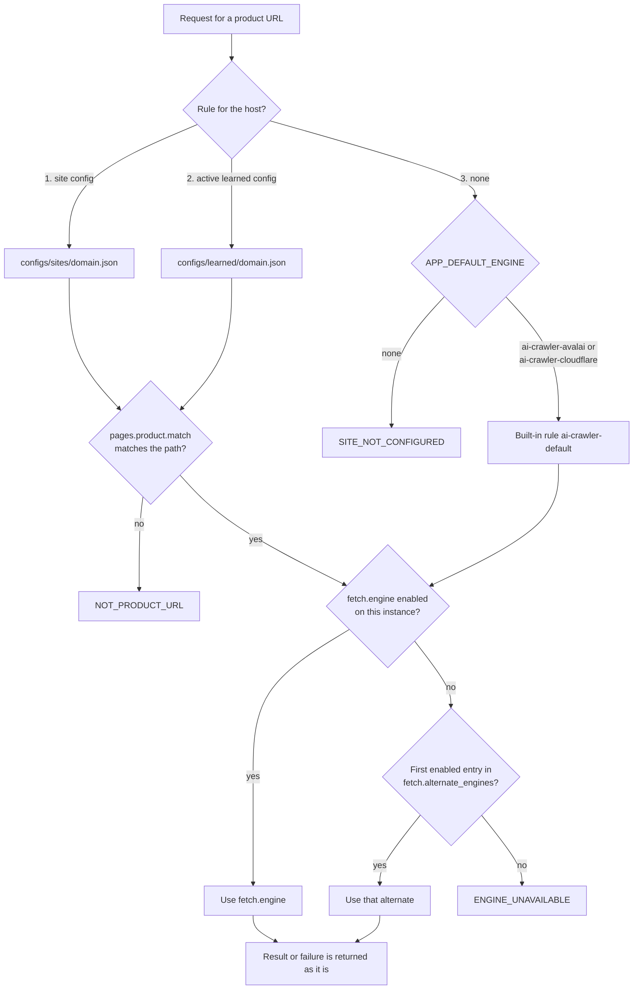

# Rules and fetch engines

This page is the reference for how the product extractor decides **which rule** serves a URL and **which engine** fetches it, with every setting each engine reads. It reflects the code and the site configs as of 2026-11-22.

- A **rule** says how to read one host: a site config in `configs/sites/`, a learned config in `configs/learned/`, or the built-in default rule.
- An **engine** gets the product data for a rule: it fetches the page (`http`, `browser`), asks a search engine (`duckduckgo`, `brave`, `mojeek`, `yahoo`, `yandex`), or asks an LLM (`ai-crawler-avalai`, `ai-crawler-cloudflare`). A site config can also set `fetch.engine` to `default`, which follows `APP_DEFAULT_ENGINE` (one of the two AI engines).

Settings come from two places:

- **Site config:** JSON per host, in `configs/sites/<domain>.json`. It is reloaded every `APP_RELOAD_INTERVAL` (default 30 s) without a restart.
- **Instance settings:** `APP_*` variables in the env file. The server reads only the first env file it finds (`.env.<APP_ENV>`, then `.env`). A change needs a restart.

History: `mojeek`, `yahoo` and `yandex` were added on 2026-11-14 ([METAWEBSEARCH_ENGINE_PROPOSAL.md](METAWEBSEARCH_ENGINE_PROPOSAL.md)), `ai-crawler-avalai` on 2026-11-17 ([AI_CRAWLER_AVALAI_PROPOSAL.md](AI_CRAWLER_AVALAI_PROPOSAL.md)), and `ai-crawler-cloudflare`, `APP_DEFAULT_ENGINE` and `ai_fetch: "web_search"` on 2026-11-19 ([AI_CRAWLER_CLOUDFLARE_PROPOSAL.md](AI_CRAWLER_CLOUDFLARE_PROPOSAL.md)).

---

## 1. Overview

| Engine | Kind | Contacts the site? | Product data | Needs a key | Speed | Turned on by |
|---|---|---|---|---|---|---|
| `http` (default) | Page fetch + selectors | Yes | Full | No | Under 1 s | Always on |
| `browser` | Page fetch in Chrome + selectors | Yes | Full, including JavaScript pages | No | 3–10 s | `APP_BROWSER_ENABLED` |
| `ai-crawler-avalai` | Page fetch + LLM (AvalAI) | Yes, except with `ai_fetch: "web_search"` | Full, every value checked against the page (unverified with `web_search`) | AvalAI key | 3–15 s, tokens | `APP_AI_CRAWLER_ENABLED` + key |
| `ai-crawler-cloudflare` | Page fetch + LLM (Cloudflare AI Gateway) | Yes | Full, every value checked against the page | Cloudflare account id + token | 3–15 s, tokens | `APP_AI_CRAWLER_ENABLED` + account id + token |
| `duckduckgo` | Search results page | **No** | Partial: title, URL, snippet | No | About 1 s | `APP_DUCKDUCKGO_ENABLED` |
| `brave` | Brave Search API | **No** | Partial | Brave API key | About 1 s | `APP_BRAVE_ENABLED` + key |
| `mojeek` | Search results page | **No** | Partial | No | About 1 s | `APP_MOJEEK_ENABLED` |
| `yahoo` | Search results page (Bing index) | **No** | Partial | No | About 1 s | `APP_YAHOO_ENABLED` |
| `yandex` | Search results page | **No** | Partial | No | About 1 s | `APP_YANDEX_ENABLED` |

There are three kinds of engine:

- **Page fetch engines** (`http`, `browser`) download the page and run the site config's CSS selectors on it. They can return every field, but each site needs selectors.
- **Search engines** never send a request to the shop. They look the product URL up and build the product from the matching result: title, URL and snippet only. The response is `"completeness": "partial"`, and price, image and specs are listed in `unavailable_fields` with reason `NOT_IN_SEARCH_RESULTS`.
- **AI engines** need no selectors. They fetch the page, clean it and ask an LLM for the product as JSON. Every value must appear on the page, or it is dropped (`AI_NOT_GROUNDED`). With `ai_fetch: "web_search"` the site is never contacted: the provider's search model looks the product up instead, and the values are unverified (`AI_UNVERIFIED`).

---

## 2. Rules: which config serves a URL

### 2.1 Lookup order

For each request, the host of the URL (`www.` included or not, as listed in `domains`) is looked up in this order. The first match wins:

| # | Rule | Where | `config_origin` | Engine |
|---|---|---|---|---|
| 1 | **Site config** | `configs/sites/<domain>.json`, written by a person | `config` | `fetch.engine` (default `http`; `default` = `APP_DEFAULT_ENGINE`) |
| 2 | **Active learned config** | `configs/learned/<domain>.json`, written by the AI crawler, with `learned.status: "active"` | `learned` | `http` or `browser`, with learned selectors |
| 3 | **Default rule** `ai-crawler-default` | Built in | `default` | `APP_DEFAULT_ENGINE` |
| — | Nothing | — | — | Fails with `SITE_NOT_CONFIGURED` (`APP_DEFAULT_ENGINE=none`) |



- A site config with `"enabled": false` answers `SITE_DISABLED`. A config that fails validation answers `CONFIG_INVALID`. In both cases the request does not fall through to a learned config or the default rule.
- `configs/active_sites.json` only decides which sites `GET /api/v1/sites` lists. A site that is not listed there is still served.
- The engine is chosen once, before the fetch. A failure is returned as it is and is never retried on another engine. The one exception is a learned config whose selectors fail: that request is answered again by an AI engine (section 2.4).
- The response says which rule and engine served it: `site_id`, `config_version`, `config_origin`, and `source.engine`.

### 2.2 Site configs (`configs/sites/`)

One JSON file per site, checked against [configs/schema/site-config.v1.json](../configs/schema/site-config.v1.json) and validated on load. Check every file with `go run ./cmd/sitectl validate`.

**Top-level keys:**

| Key | Required | Meaning |
|---|---|---|
| `schema_version` | Yes | Always `1` |
| `site_id` | Yes | Stable id, returned as `site_id` |
| `version` | Yes | Your version string, returned as `config_version`. Change it with every edit, for example `2026-11-19.1` |
| `enabled` | No (default `true`) | `false` answers `SITE_DISABLED` |
| `extends` | No | A template in `configs/templates/` (`woocommerce`, `woodmart`, `prestashop`). The site's keys are merged over the template's |
| `domains` | Yes | Hostnames this config serves, for example `["hmland.ir", "www.hmland.ir"]` |
| `fetch` | No | How the page is fetched: the engine and its settings (section 2.3) |
| `locale` | No | Price unit and words (below) |
| `pages.product` | Yes | Which URLs are products, and the selectors |
| `validation.required_fields` | No (default `["title"]`) | Fields that must be found, or the request fails with `REQUIRED_FIELD_MISSING` |
| `$comment` | No | Free text. Use it to record why the config looks the way it does |

**`locale`:**

| Key | Default | Meaning |
|---|---|---|
| `price_unit` | `toman` | `toman` or `rial` (returned as `IRT` in toman; rial is divided by 10), `usd` or `eur` (returned in cents), or `auto` (AI engines only: the currency is read from each page) |
| `currency_words` | — | Words and signs that mark a price, for example `["$", "USD"]` or `["ریال", "تومان"]` |
| `call_for_price_words` | — | Texts that mean "call for price" (`price.state: call_for_price`) |

**`pages.product`** (selectors are used by `http`, `browser` and learned configs; AI engines and search engines need only `match`):

| Key | Meaning |
|---|---|
| `match` | Regular expressions on the URL path. A URL that matches none fails with `NOT_PRODUCT_URL`. Required |
| `root` | CSS selector of the product block. Every other selector is searched inside it. Required for `http` and `browser` |
| `price_area` | Optional element that holds the prices, to tell them apart from other amounts |
| `fields.<name>` | `title`, `image_url`, `price_current`, `price_regular`, `description`. Each has `selector`, `attr` (an attribute name or a list of them, tried in order; omit it for the text), `pick` (`first` default, `last`, or `join`) and `separator` (for `join`) |
| `availability` | `out_of_stock` (selector present = out of stock) and `order_button` (selector present = can be ordered) |
| `specs` | Name/value pairs. `layout` is `rows` (default: each `row` holds a `name` and a `value`) or `siblings` (as in `<dt>`/`<dd>`). `group` and `title` read grouped tables, `separator` joins list values, and `exclude` drops text such as tooltips |
| `features.selector` | Short bullet points, one per matched element |

Every value is normalized (digits, spaces, prices parsed by the Go price parser), and every field that was not found is listed in `unavailable_fields`.

### 2.3 The `fetch` block

Each key applies to some engines only. A key that does not apply to the selected engine is rejected when it is meant to change behaviour (`alternate_engines`, `search`, `ai_fetch`, `price_unit: auto`), and ignored otherwise.

| Key | Default | Applies to | Meaning |
|---|---|---|---|
| `engine` | `http` | All | `http`, `browser`, `duckduckgo`, `brave`, `mojeek`, `yahoo`, `yandex`, `ai-crawler-avalai`, `ai-crawler-cloudflare`, or `default` (follows `APP_DEFAULT_ENGINE`) |
| `alternate_engines` | — | Search engines only | Other search engines, used in order **only when `engine` is not enabled on the instance**. Not a retry |
| `search` | see 3.5 | Search engines only | `region`, `queries`, `title_strip`, `ignore_params` |
| `ai_fetch` | `http` | AI engines only | How the AI engine gets the page: `http`, `browser` or `web_search` (section 3.7) |
| `user_agent` | `ProductExtractor/1.0` | `http`, `browser`, AI engines when they fetch | The User-Agent sent to the shop |
| `user_agents` | — | Same | Replaces `user_agent`: each fetch picks one at random and keeps it for its retries |
| `delay_ms` | `1000` | Every engine that contacts the site | Minimum gap between two fetches of this site from one instance (0–60000) |
| `timeout_seconds` | `30` | All | Time limit for one fetch (1–120) |
| `retries` | `2` | `http`, `browser` | Retries of a failed fetch, with backoff and `Retry-After` (0–5) |
| `respect_robots_txt` | `true` | `http`, `browser`, AI engines when they fetch | Follow the site's `robots.txt`. Set `false` only with the site owner's permission. The default rule and learned configs always follow it |

`engine: "default"` makes a site config follow `APP_DEFAULT_ENGINE`, the same AI engine the built-in rule uses for hosts without a config. The registry replaces it with `ai-crawler-avalai` or `ai-crawler-cloudflare` when it loads the site, so changing the instance's default engine changes every such site too. Only AI engines are allowed, so `ai_fetch` and `price_unit: auto` work as they do for the resolved engine. With `APP_DEFAULT_ENGINE=none` (or the AI crawler off) the site keeps `default`, and a request for it fails with `ENGINE_UNAVAILABLE`.

Examples:

```json
"fetch": { "engine": "http", "delay_ms": 1500, "timeout_seconds": 20 }
```

```json
"fetch": { "engine": "browser", "timeout_seconds": 60 }
```

```json
"fetch": {
  "engine": "duckduckgo",
  "alternate_engines": ["brave"],
  "search": { "region": "us-en", "title_strip": [" | Ferguson Home"], "ignore_params": ["uid"], "queries": ["site_slug", "url"] }
}
```

```json
"fetch": { "engine": "ai-crawler-avalai", "ai_fetch": "browser" },
"locale": { "price_unit": "auto" }
```

```json
"fetch": { "engine": "ai-crawler-avalai", "ai_fetch": "web_search", "timeout_seconds": 30 }
```

### 2.4 Learned configs (`configs/learned/`)

When an AI engine extracts a product on a host **served by the default rule**, it asks the model once for CSS selectors for that host. The selectors are kept only if the normal selector pipeline gives the same product on the same page. They are written to `configs/learned/<domain>.json` with a `learned` block:

| Key | Meaning |
|---|---|
| `learned.status` | `candidate` (runs in shadow next to the AI engine, serves nothing), `active` (serves the host with no LLM call), `demoted` (failed too often; the host is learned again), `rejected` (a person rejected it; never relearned) |
| `learned.engine` | The AI engine that learned it (`ai-crawler-avalai` when absent) |
| `learned.model`, `learned.prompt_version` | The model and prompt that learned it |
| `learned.learned_from`, `learned.learned_at` | First page and time |
| `learned.shadow_matches` | Different product URLs on which the selectors gave the same product as the AI engine |
| `learned.failures_in_a_row` | Failures while active; a success resets it |

Life cycle:

1. A **candidate** runs in shadow on later AI requests for the host. After `APP_AI_CRAWLER_LEARN_PROMOTE_AFTER` (3) different pages match, it becomes **active**.
2. An **active** config serves the host with `config_origin: learned` and the warning `LEARNED_CONFIG`.
3. When its selectors fail on a page, that request is answered by an AI engine instead (warning `LEARNED_CONFIG_FAILED`). This uses the default engine, or, with `APP_DEFAULT_ENGINE=none`, the engine in `learned.engine`. After `APP_AI_CRAWLER_LEARN_DEMOTE_AFTER` (3) failures in a row the config is **demoted**.

A learned config may use only `http` or `browser` and must follow `robots.txt`. Pages fetched with `ai_fetch: "web_search"` teach nothing, because there is no HTML.

Review learned configs with `go run ./cmd/sitectl learned list|show <domain>|activate <domain>|reject <domain>|adopt <domain>`, or `sudo ./deploy.sh learned ...`. `adopt` moves a config into `configs/sites/`, where it becomes a normal site config.

| Variable | Default | Meaning |
|---|---|---|
| `APP_AI_CRAWLER_LEARN_SELECTORS` | `true` | Learn selectors |
| `APP_AI_CRAWLER_LEARN_DIR` | `<APP_SITE_CONFIG_DIR>/learned` | Where learned configs are written. Must be writable by the service |
| `APP_AI_CRAWLER_LEARN_PROMOTE_AFTER` | `3` | Pages that must match in shadow before a config serves its host |
| `APP_AI_CRAWLER_LEARN_DEMOTE_AFTER` | `3` | Failures in a row that demote an active config |
| `APP_AI_CRAWLER_LEARN_MAX_ATTEMPTS_PER_DAY` | `3` | Learning calls per host per day |

### 2.5 The default rule (`ai-crawler-default`)

A host with no site config and no active learned config is served by the built-in rule `ai-crawler-default`, with the engine `APP_DEFAULT_ENGINE` names.

| Variable | Default | Meaning |
|---|---|---|
| `APP_DEFAULT_ENGINE` | `ai-crawler-avalai` when `APP_AI_CRAWLER_ENABLED=true`, otherwise `none` | `ai-crawler-avalai`, `ai-crawler-cloudflare`, or `none` (unknown hosts fail with `SITE_NOT_CONFIGURED`) |
| `APP_AI_CRAWLER_DEFAULT_DELAY_MS` | `2000` | Gap between two fetches of the same host under the default rule |

- Only AI engines are allowed: every other engine needs a site's selectors or search settings.
- The rule has `site_id: ai-crawler-default` and `config_origin: default`. Its `config_version` is `builtin-1` with `ai-crawler-avalai` and `builtin-1+cloudflare` with `ai-crawler-cloudflare`.
- It matches every path, requires only `title`, reads the currency from each page (`price_unit: auto`), always follows `robots.txt`, and throttles each host separately.
- `GET /api/v1/sites` lists it last with `domains: ["*"]`, the engine and its model. It also sets `accepts_any_domain: true` and `default_ai_engine`.
- **The server does not start** when `APP_DEFAULT_ENGINE` names an unknown engine, an engine that needs selectors, or an AI engine that is not configured. It also does not start while the replaced variable `APP_AI_CRAWLER_DEFAULT_RULE` is still set (`true` became `ai-crawler-avalai`, `false` became `none`). `deploy.sh` and `menu.sh` rewrite that variable automatically.
- To set it: `sudo ./deploy.sh default-engine`, which lists the engines in recommended order and asks; or `./menu.sh`, item 9.

---

## 3. Engines

The code follows the Strategy pattern. `fetch.Engine` ([internal/fetch/engine.go](../internal/fetch/engine.go)) is the interface: `Name()` and `Fetch(ctx, site, target)`. `fetch.Router` ([internal/fetch/router.go](../internal/fetch/router.go)) holds the engines enabled on the instance and picks one per request. Every engine returns the same `Page` and `Failure` types, so page checks, normalization and error reporting don't depend on the engine.

Every engine that contacts a site or a provider follows the same egress rules. Private, loopback and metadata addresses and blocked ports are refused. The outbound proxy is used when one is set:

| Variable | Default | Meaning |
|---|---|---|
| `APP_PROXY_HOST`, `APP_PROXY_PORT` | — | HTTP proxy for every outbound fetch (shop pages, Chrome, search providers, LLM providers) |
| `APP_MAX_REQUEST_DURATION` | `3m` | Time limit for a whole request, whatever the engine |
| `APP_SITE_WAIT_TIMEOUT` | `30s` | How long a request waits for a free per-site slot |
| `APP_MAX_CONCURRENT_REQUESTS` | `20` | Requests processed at once on the instance |
| `APP_MAX_CONCURRENT_PER_SITE` | `1` | Requests to the same site at once |

### 3.1 `http` (default)

- **What it does:** fetches the product page with [Colly](https://github.com/gocolly/colly) over Go's HTTP client, then runs the site's selectors on the HTML. Code: [internal/fetch/fetch.go](../internal/fetch/fetch.go).
- **Use it for:** most sites. It is the fastest and lightest engine.
- **Behaviour:**
  - Follows `robots.txt` unless the site sets `respect_robots_txt: false`.
  - Retries `retries` times with backoff, and follows `Retry-After` when the next attempt still fits in the deadline.
  - Caps the body size and detects the charset.
  - Refuses redirects outside the config's `domains` (`REDIRECT_NOT_ALLOWED`).
  - Builds a new collector per request, so history and robots caches don't leak between requests.
- **Site config:** `user_agent` / `user_agents`, `delay_ms`, `timeout_seconds`, `retries`, `respect_robots_txt`, and the selectors in `pages.product`.
- **Instance settings:** none; it is always on.
- **Can't do:** run JavaScript or pass anti-bot challenges. A page that needs JavaScript fails with `JS_RENDERED_PAGE`. A site that blocks it gives `ACCESS_DENIED` or `BOT_PROTECTION`.

### 3.2 `browser`

- **What it does:** loads the page in real Google Chrome or Chromium, driven by [Playwright](https://github.com/playwright-community/playwright-go), then runs the same selectors on the rendered HTML. Code: [internal/fetch/browser.go](../internal/fetch/browser.go). Full guide: [browser-engine.md](browser-engine.md).
- **Use it for:** pages rendered by JavaScript, and sites that the `http` engine can't read.
- **Behaviour:**
  - One browser per instance, and a fresh, isolated browser context per request.
  - Cookies are kept per site, never across sites.
  - All of Chrome's traffic goes through the in-process egress gate, with the same address, port and proxy rules as `http`.
  - Redirects to other domains are refused, and `robots.txt` is followed.
  - After loading, it waits for `pages.product.root`, so a challenge page that reloads into the product is reported as the real page. For AI engines, which have no root, it waits until the network is quiet.
- **Site config:** the same keys as `http` (`retries` too).
- **Instance settings:**

  | Variable | Default | Meaning |
  |---|---|---|
  | `APP_BROWSER_ENABLED` | `false` | Start the browser engine. Without it, a site with `engine: browser` or `ai_fetch: browser` gets `ENGINE_UNAVAILABLE` |
  | `APP_BROWSER_CHANNEL` | `chromium` | `chrome` (installed Google Chrome) or `chromium` (Playwright's build) |
  | `APP_BROWSER_HEADLESS` | `true` | `false` runs Chrome with a window, on a hidden Xvfb display on servers |
  | `APP_BROWSER_MAX_PAGES` | `3` | Pages open at the same time |
  | `PLAYWRIGHT_DRIVER_PATH` | user cache | Where the Playwright driver is installed |

- **Turn on:** `sudo ./deploy.sh browser enable`. Docker image with Chrome: `docker build --target runtime-browser .`.
- **Cost:** 3–10 s per page. About 150 MB for Chrome, plus 100–300 MB for each open page.
- **Note:** some sites' terms forbid automated browsing. Check before using it for a site (README, "Responsible use"). It does not solve CAPTCHAs; an Akamai "Access Denied" stays `ACCESS_DENIED`.

### 3.3 `duckduckgo`

- **What it does:** posts the query to DuckDuckGo's no-JavaScript results page (`https://html.duckduckgo.com/html/`), parses the results and picks the one that matches the requested product URL. Code: [internal/fetch/search/duckduckgo.go](../internal/fetch/search/duckduckgo.go), [internal/fetch/searchengine.go](../internal/fetch/searchengine.go).
- **Use it for:** sites with bot protection that the service doesn't get past, when the product page is indexed.
- **API key:** none. The endpoint is not an API: it has no documentation or versioning, and its HTML can change. Its `robots.txt` allows every path.
- **Behaviour:**
  - Sends the honest `APP_SEARCH_USER_AGENT`.
  - HTTP 202, 403 and 429 mean DuckDuckGo is rate-limiting or checking for bots. They become `SEARCH_PROVIDER_BLOCKED` with no retry: the service doesn't work around blocks.
  - Results pages are capped at 2 MiB.
- **Site config:** `fetch.search` (section 3.5), optionally `alternate_engines`.
- **Instance settings:**

  | Variable | Default | Meaning |
  |---|---|---|
  | `APP_DUCKDUCKGO_ENABLED` | `false` | Turn the engine on |
  | `APP_DUCKDUCKGO_MIN_INTERVAL_MS` | `2000` | Minimum gap between two DuckDuckGo queries from this instance |

### 3.4 `brave`

- **What it does:** calls the official [Brave Search API](https://brave.com/search/api/) (`api.search.brave.com`) and picks the result that matches the requested URL. Code: [internal/fetch/search/brave.go](../internal/fetch/search/brave.go).
- **Use it for:** the same sites as `duckduckgo`. It is a documented, versioned API, so it is more stable than reading a results page.
- **API key:** **required.** It has a free tier, then is paid per query. How to get one: [SETUP_KEYS.md](SETUP_KEYS.md). The key is secret and never logged. The server doesn't start when Brave is enabled without a key.
- **Behaviour:** the key is sent in the `X-Subscription-Token` header. Quota and authentication errors become `SEARCH_QUOTA_EXCEEDED` and `SEARCH_PROVIDER_AUTH_FAILED`. Brave's thumbnail isn't used as `image_url`, because it is a Brave-hosted copy, not the shop's image.
- **Instance settings:**

  | Variable | Default | Meaning |
  |---|---|---|
  | `APP_BRAVE_ENABLED` | `false` | Turn the engine on |
  | `APP_BRAVE_API_KEY` | — | The key |
  | `APP_BRAVE_API_KEY_FILE` | — | A file that holds only the key, used when `APP_BRAVE_API_KEY` is empty |
  | `APP_BRAVE_MIN_INTERVAL_MS` | `1000` | Minimum gap between two Brave queries |

### 3.5 Settings shared by the search engines

**Instance:**

| Variable | Default | Meaning |
|---|---|---|
| `APP_SEARCH_USER_AGENT` | `go-wordpress-extractor/1.0` | The honest client name sent to search providers |
| `APP_SEARCH_CACHE_TTL` | `6h` | How long a matched result is kept in memory |
| `APP_SEARCH_NO_RESULT_CACHE_TTL` | `1h` | How long a `SEARCH_NO_RESULT` answer is kept |

**Site config (`fetch.search`, allowed only for search engines):**

| Key | Default | Meaning |
|---|---|---|
| `region` | `wt-wt` | `<country>-<lang>`, for example `us-en` or `de-de`. `wt-wt` means no region. Sent as `kl` to DuckDuckGo, as `country` + `search_lang` to Brave, and as cookies to Mojeek; Yahoo and Yandex ignore it |
| `queries` | `["site_slug", "url"]` | Queries to try, in order. `site_slug` is `site:<domain> <words from the URL path>`; `url` is the product URL in quotes. At most 2 |
| `title_strip` | — | Suffixes and prefixes removed from the result title, for example `" \| Ferguson Home"` |
| `ignore_params` | — | Extra query parameters ignored when matching result URLs to the requested URL |

The service never returns data for the wrong product. If no result matches the requested URL, the request fails with `SEARCH_NO_RESULT`, and `evidence.search` lists the queries and the closest URLs.

**Failure codes:** `SEARCH_NO_RESULT`, `SEARCH_PROVIDER_BLOCKED`, `SEARCH_QUOTA_EXCEEDED`, `SEARCH_PROVIDER_AUTH_FAILED`, `SEARCH_PROVIDER_ERROR`.

Turn one on with `sudo ./deploy.sh search enable <engine>`, which shows the provider's terms first.

### 3.6 `mojeek`, `yahoo`, `yandex`

- **What they do:** three separate search engines that work like `duckduckgo`: each reads its search engine's HTML results page and picks the result that matches the requested URL. The request builders and result parsers come from [`github.com/jcalvert/metawebsearch`](https://github.com/jcalvert/metawebsearch), pinned at `v0.0.0-20260401212850-2b51795e5ee8`. Code: [internal/fetch/search/scraped.go](../internal/fetch/search/scraped.go). Design: [METAWEBSEARCH_ENGINE_PROPOSAL.md](METAWEBSEARCH_ENGINE_PROPOSAL.md).
- **Use them for:** the same sites as `duckduckgo`, when you want an index that is not Bing's. Mojeek and Yandex have their own crawlers. Yahoo serves Bing's results, so it mostly repeats what DuckDuckGo has.
- **API key:** none. These are not APIs. None of the three providers has approved this project, and the page markup can change without notice. Each engine has its own switch.
- **Behaviour:**
  - Only the library's request builders and parsers are used. Requests go through the service's egress client with the honest `APP_SEARCH_USER_AGENT`, and the browser-only headers the library adds are removed.
  - HTTP 202, 403 and 429 become `SEARCH_PROVIDER_BLOCKED` on the first answer, with no retry. So does a 200 page that holds a CAPTCHA instead of results, or a redirect to Yandex's `/showcaptcha`.
  - A 200 page the parser cannot read is `SEARCH_PROVIDER_ERROR`, meaning the page layout may have changed.

| Engine | Index | `search.region` |
|---|---|---|
| `mojeek` | Its own crawler | Yes, as the `arc` (country) and `lb` (language) cookies |
| `yahoo` | Bing | Ignored (the loader warns when one is set) |
| `yandex` | Its own | Ignored (the loader warns when one is set) |

- **Instance settings:**

  | Variable | Default | Meaning |
  |---|---|---|
  | `APP_MOJEEK_ENABLED`, `APP_YAHOO_ENABLED`, `APP_YANDEX_ENABLED` | `false` | Turn that engine on |
  | `APP_MOJEEK_MIN_INTERVAL_MS`, `APP_YAHOO_MIN_INTERVAL_MS`, `APP_YANDEX_MIN_INTERVAL_MS` | `3000` | Minimum gap between two queries to that engine (0–60000) |

- **Live result (2026-11-15, Ferguson sample product):** `yahoo` found it at rank 1 of the first query, like `duckduckgo`. `mojeek` and `yandex` answered the honest client with a CAPTCHA page (`SEARCH_PROVIDER_BLOCKED`). Check again before giving a site one of them. `SEARCH_LIVE_TEST=1 go test ./internal/fetch/search/ -run Live -v` queries the real engines and ranks them.

### 3.7 AI engines: `ai-crawler-avalai` and `ai-crawler-cloudflare`

Both engines run the same pipeline. The only difference is where the LLM call goes: AvalAI, or Cloudflare AI Gateway. The provider-specific parts (base URL, auth headers, extra headers, error mapping, request-id header) are a profile in [internal/aicrawler/provider.go](../internal/aicrawler/provider.go). Design: [AI_CRAWLER_AVALAI_PROPOSAL.md](AI_CRAWLER_AVALAI_PROPOSAL.md) and [AI_CRAWLER_CLOUDFLARE_PROPOSAL.md](AI_CRAWLER_CLOUDFLARE_PROPOSAL.md).

**When an AI engine is on:** `APP_AI_CRAWLER_ENABLED=true` and its own settings are complete. AvalAI needs a key; Cloudflare needs an account id and a token. A site config that names an engine that is not on gets `ENGINE_UNAVAILABLE`. There is no fallback from one AI engine to the other.

**Where an AI engine is used:**

- As the default rule, for hosts without a config (`APP_DEFAULT_ENGINE`, section 2.5).
- Per site, with `"fetch": {"engine": "ai-crawler-avalai"}`, `"ai-crawler-cloudflare"`, or `"default"` (which follows `APP_DEFAULT_ENGINE`). The config needs only `domains` and `pages.product.match`, and no selectors. `"locale": {"price_unit": "auto"}` reads the currency from each page.
- As the fallback for a learned config whose selectors fail (section 2.4).

#### `fetch.ai_fetch`: how the AI engine gets the page

| `ai_fetch` | Contacts the site | What happens | Values | `source.fetched_with` |
|---|---|---|---|---|
| `http` (default) | Yes | Fetched with the `http` engine. A JavaScript-only page is rendered once in Chrome when `APP_BROWSER_ENABLED=true`, otherwise `JS_RENDERED_PAGE` | Checked against the page | `http` or `browser` |
| `browser` | Yes | Always loaded in Chrome. Needs `APP_BROWSER_ENABLED=true` | Checked against the page | `browser` |
| `web_search` | **No** | Only the URL goes to the provider's **search model** (`APP_AI_CRAWLER_SEARCH_MODEL`), which looks the product up on the web and answers with the product and its sources | **Unverified** (warning `AI_UNVERIFIED`) | `web_search` |

**`http` and `browser`, step by step:**

1. The page is fetched, following the site's `fetch` settings and `robots.txt`.
2. A challenge page, an empty page or a JavaScript shell is never sent to the model (`BOT_PROTECTION`, `EMPTY_PAGE`, `JS_RENDERED_PAGE`).
3. The HTML is cleaned to title, meta, JSON-LD and visible text, at most `APP_AI_CRAWLER_MAX_INPUT_CHARS`. Scripts, header, nav, footer and hidden elements are removed.
4. The model returns JSON: `name`, `price` (the copied text), `url`, `image`, `description`, `specs`, `features`. An answer that is not JSON is asked for once more (a repair call).
5. **Grounding.** Every value must appear on the page:
   - the name and spec texts in the page text
   - the image among the page's image URLs
   - each price amount among the page's amounts, parsed by the Go price parser, never by the model
   - at least 60 % of the description's words

   A value that fails is dropped and listed with reason `AI_NOT_GROUNDED`.
6. Every result has the warning `AI_EXTRACTED`. `source` adds `model`, `prompt_version` (`1`), `fetched_with`, `tokens` and `cached`.

**`web_search`, step by step** (for sites that block every fetch, as fergusonhome.com does):

1. The site is never contacted, and its `robots.txt` is not read. `source.site_contacted` is `false`.
2. Only the URL is sent to the search model, with the web-search prompt (`prompt_version: web-1`). No `response_format` is sent: Perplexity's `sonar` rejects `json_object`.
3. The model's sources (Perplexity's `citations` and `search_results`, or `url_citation` annotations) are returned in `source.sources`. **At least one source must be on the site's own domains**, or the answer is not used and the request fails with `SEARCH_NO_RESULT`.
4. Citation markers such as `[1]` are removed from the values. Prices are still parsed by the Go price parser. A product URL on another domain is replaced by the requested URL.
5. Nothing can be checked against the page, so every result has the warnings `AI_EXTRACTED` and `AI_UNVERIFIED`. Price and stock may be out of date. Fields the model did not return are listed with reason `NOT_IN_SEARCH_RESULTS`.
6. Nothing is learned from a web search answer.
7. It is available only on `ai-crawler-avalai`. On an engine without a search model the request fails with `ENGINE_UNAVAILABLE`.

#### Shared AI settings

| Variable | Default | Meaning |
|---|---|---|
| `APP_AI_CRAWLER_ENABLED` | `false` | Turn the AI engines on. With it on and no engine configured, the server does not start |
| `APP_AI_CRAWLER_TIMEOUT` | `45s` | One LLM call; each retry gets its own |
| `APP_AI_CRAWLER_MAX_INPUT_CHARS` | `60000` | Cleaned page sent to the model |
| `APP_AI_CRAWLER_MAX_OUTPUT_TOKENS` | `2000` | The model's answer |
| `APP_AI_CRAWLER_TEMPERATURE` | `0` | Sampling temperature |
| `APP_AI_CRAWLER_RETRIES` | `2` | Retries of 408, 409, 429 and 5xx answers, honoring `Retry-After` (done by the `openai-go` SDK) |
| `APP_AI_CRAWLER_CACHE_TTL` | `6h` | The same page (or URL, for `web_search`), engine and model reuse the answer; `0` turns the cache off |
| `APP_AI_CRAWLER_RESPONSE_FORMAT` | `json_object` | `json_object`, or `json_schema` (strict schema; test it on the model first) |
| `APP_AI_CRAWLER_DEFAULT_DELAY_MS` | `2000` | Gap between two fetches of the same host under the default rule |
| `APP_AI_CRAWLER_LEARN_*` | see 2.4 | Selector learning |

#### `ai-crawler-avalai` settings

| Variable | Default | Meaning |
|---|---|---|
| `APP_AI_CRAWLER_BASE_URL` | `https://api.avalai.ir/v1` | OpenAI-compatible API base. Must be `https` (plain `http` only for localhost) |
| `APP_AI_CRAWLER_MODEL` | `deepseek-v4.1-flash` | The only model used for extraction and learning |
| `APP_AI_CRAWLER_SEARCH_MODEL` | `sonar` | The model that searches the web itself, for `ai_fetch: "web_search"`. `none` turns that mode off. Other search models on AvalAI on 2026-11-19: `sonar-pro`, `sonar-reasoning`, `sonar-reasoning-pro` (`gpt-4o-search-preview` is no longer listed) |
| `APP_AI_CRAWLER_API_KEY` | — | **Secret.** AvalAI's key. Never logged or returned |
| `APP_AI_CRAWLER_API_KEY_FILE` | — | A file holding only the key, for example `secrets/avalai_api_key` |
| `APP_AI_CRAWLER_MIN_INTERVAL_MS` | `500` | Minimum gap between two AvalAI calls from this instance |

Turn it on with `sudo ./deploy.sh ai enable avalai`, or `./menu.sh`, item 7. The request id in evidence is `avalai-request-id`.

#### `ai-crawler-cloudflare` settings

| Variable | Default | Meaning |
|---|---|---|
| `APP_AI_CRAWLER_CLOUDFLARE_ACCOUNT_ID` | — | Account id (32 hex characters). The engine is configured only when it is set |
| `APP_AI_CRAWLER_CLOUDFLARE_GATEWAY_ID` | `default` | Gateway id; `default` is created on first use |
| `APP_AI_CRAWLER_CLOUDFLARE_ENDPOINT` | `rest` | `rest`: `https://api.cloudflare.com/client/v4/accounts/<id>/ai/v1`, with the token in `Authorization` and the gateway in `cf-aig-gateway-id`. `compat`: `https://gateway.ai.cloudflare.com/v1/<id>/<gateway>/compat`, with the gateway token in `cf-aig-authorization` (deprecated by Cloudflare for single-model calls) |
| `APP_AI_CRAWLER_CLOUDFLARE_BASE_URL` | — | Full override of the base URL; `https` only, except localhost |
| `APP_AI_CRAWLER_CLOUDFLARE_MODEL` | `@cf/deepseek-ai/deepseek-v4.1-flash-1017` | Model id from the Cloudflare catalog. `{provider}/{model}` for other providers, `dynamic/<route>` for a dynamic route, and `workers-ai/@cf/...` on `compat` |
| `APP_AI_CRAWLER_CLOUDFLARE_REASONING_EFFORT` | `none` | Sent as `reasoning_effort`: `none`, `low`, `high` or `max` |
| `APP_AI_CRAWLER_CLOUDFLARE_API_TOKEN` (`_FILE`) | — | **Secret.** A token with "Workers AI Read" and "AI Gateway Run" (`rest`), or the gateway token (`compat`) |
| `APP_AI_CRAWLER_CLOUDFLARE_PROVIDER_API_KEY` (`_FILE`) | — | **Secret**, `compat` only: the provider's own key. On `rest` the server refuses it; store the key in the gateway (BYOK) |
| `APP_AI_CRAWLER_CLOUDFLARE_NO_UNIFIED_BILLING` | `true` | Sends `cf-aig-no-wholesale: true`: a call with no usable key fails instead of spending credits |
| `APP_AI_CRAWLER_CLOUDFLARE_COLLECT_LOG` | `false` | Sends `cf-aig-collect-log: false`: the gateway keeps no copy of the page text and the answer |
| `APP_AI_CRAWLER_CLOUDFLARE_MIN_INTERVAL_MS` | `500` | Minimum gap between two Cloudflare calls |

Every call also sends `cf-aig-skip-cache: true` (this service caches answers itself) and `cf-aig-metadata` (host, purpose, prompt version). In evidence, `provider_request_id` is `cf-aig-log-id`, the id to search for in the Cloudflare dashboard, and `provider_code` is Cloudflare's numeric code. The default model runs on Cloudflare (Workers AI) and is billed to the account: about $0.0036 per product page.

Turn it on with `sudo ./deploy.sh ai enable cloudflare`, or `./menu.sh`, item 7.

#### AI failure codes

| Code | Meaning | Cloudflare mapping |
|---|---|---|
| `AI_AUTH_FAILED` | Key, token or model refused | 401 / 2009, 400 / 2044, 403 / 2049, 2042, 2036 |
| `AI_QUOTA_EXCEEDED` | No quota or credit left | 402 / 2052, 2021 |
| `AI_RATE_LIMITED` | Provider rate limit (retryable) | 429 / 2018 |
| `AI_INPUT_TOO_LARGE` | Page too large for the model | 413, 7003 |
| `AI_MODEL_UNAVAILABLE` | Wrong model, route or region | Model not found or denied, 451, 7000, dynamic route not found |
| `AI_UNAVAILABLE` | Provider down or too slow (retryable) | 5xx, 2002, 2005, 7005, network |
| `AI_BAD_OUTPUT` | No usable JSON after one repair call, a refusal, or a cut-off answer | — |

Each failure has `evidence.ai`: model, provider, provider request id, HTTP status, provider code, tokens, and the start of the answer. Keys and tokens never appear in a response or a log.

**Cost on `/metrics`:** every call is counted, including repair, learning and web search calls. The series are `extract_ai_calls_total`, `extract_ai_tokens_total`, `extract_ai_call_seconds_total` and `extract_ai_cache_hits_total`, labelled with `engine`, `model`, `purpose` (`extract`, `repair`, `learn`, `web_search`), `host` and `outcome`.

---

## 4. Engine per site (`configs/sites/`, 2026-11-22)

| Site | `fetch.engine` | Details |
|---|---|---|
| 3-form.com | `http` (default) | — |
| badomjip.com | `http` (default) | Template `woodmart` |
| emtek.com | `http` (default) | — |
| fergusonhome.com | `default` | `ai_fetch: "web_search"`, resolved from `APP_DEFAULT_ENGINE` (`ai-crawler-avalai` on this instance). Akamai answers 403 to plain HTTP and to Chrome, so the site is never contacted (`duckduckgo` / `brave` until 2026-11-19) |
| flooranddecor.com | `browser` | — |
| hafele.com.de | `browser` | — |
| hmland.ir | `http` (default) | Template `woodmart` |
| hosseinibrothers.ir | `http` (default) | Template `prestashop` |
| lumens.com | `duckduckgo` | Alternate `brave`. Not in `active_sites.json`, so it is not listed by `GET /api/v1/sites`, but it is served |
| msisurfaces.com | `http` (default) | — |
| sherwin-williams.com | `http` (default) | — |
| shop.interface.com | `http` (default) | — |
| tilebar.com | `http` (default) | — |
| any other host | `APP_DEFAULT_ENGINE` | The default rule `ai-crawler-default`, or an active learned config once one exists |

---

## 5. Choosing an engine for a new site

1. **Start with `http`.** If the page returns product HTML, write selectors and you're done.
2. **The page needs JavaScript** (`JS_RENDERED_PAGE`, or no product markup in the HTML): use `browser`, and enable it on the instance.
3. **No time for selectors, or the layout changes often:** use an AI engine (`ai-crawler-avalai` or `ai-crawler-cloudflare`), or leave the site without a config and let the default rule serve it. You get full data, checked against the page, at the cost of tokens, and the host learns its own selectors.
4. **The site blocks every fetch** (403 or a challenge page, even in Chrome). Two options:
   - **Full data, unverified:** `ai-crawler-avalai` with `ai_fetch: "web_search"`. The provider's search model returns title, price, description and specs, but they are not checked against the page and may be out of date.
   - **Partial data from a search index:** a search engine. Use `duckduckgo`, `mojeek`, `yahoo` or `yandex` for no key, or `brave` for a stable API with a key. Set another one as `alternate_engines`, and pick an engine and alternate with **different indexes**: DuckDuckGo and Yahoo both rely largely on Bing, while Mojeek, Brave and Yandex have their own.
5. **None of these work:** the site isn't supported. The service doesn't solve CAPTCHAs or get past bot protection.

Every engine except `http` is off by default on an instance. To turn one on:

| Engine | Command |
|---|---|
| `browser` | `sudo ./deploy.sh browser enable` |
| A search engine | `sudo ./deploy.sh search enable <engine>` |
| An AI engine | `sudo ./deploy.sh ai enable avalai\|cloudflare` |
| Default engine | `sudo ./deploy.sh default-engine` |

Locally, `./menu.sh` items 7 and 9 do the same for the AI engines and the default engine.

---

## 6. Tests

| What | Where |
|---|---|
| Router and engine choice | [internal/fetch/router_test.go](../internal/fetch/router_test.go) |
| Site config validation | [internal/siteconfig/loader_test.go](../internal/siteconfig/loader_test.go); `go run ./cmd/sitectl validate` for the real configs |
| `http` and selectors per site | One e2e test per site in [test/e2e/](../test/e2e/), against saved pages in `testdata/sites/` |
| `browser` | [test/e2e/browser_engine_test.go](../test/e2e/browser_engine_test.go) |
| Search engines | [internal/fetch/search/](../internal/fetch/search/), [test/e2e/scraped_search_test.go](../test/e2e/scraped_search_test.go), [test/e2e/fergusonhome_search_test.go](../test/e2e/fergusonhome_search_test.go) (real answers replayed) |
| `ai-crawler-avalai`, default rule, learning | [test/e2e/aicrawler_test.go](../test/e2e/aicrawler_test.go), against a fake OpenAI-compatible server |
| `ai_fetch: "web_search"` | [test/e2e/aicrawler_websearch_test.go](../test/e2e/aicrawler_websearch_test.go): the shop is never contacted, sources must be on the site, no search model gives `ENGINE_UNAVAILABLE` |
| `ai-crawler-cloudflare`, `APP_DEFAULT_ENGINE` | [internal/aicrawler/provider_test.go](../internal/aicrawler/provider_test.go), [internal/config/aicrawler_test.go](../internal/config/aicrawler_test.go), [test/e2e/aicrawler_cloudflare_test.go](../test/e2e/aicrawler_cloudflare_test.go), against a fake gateway |
