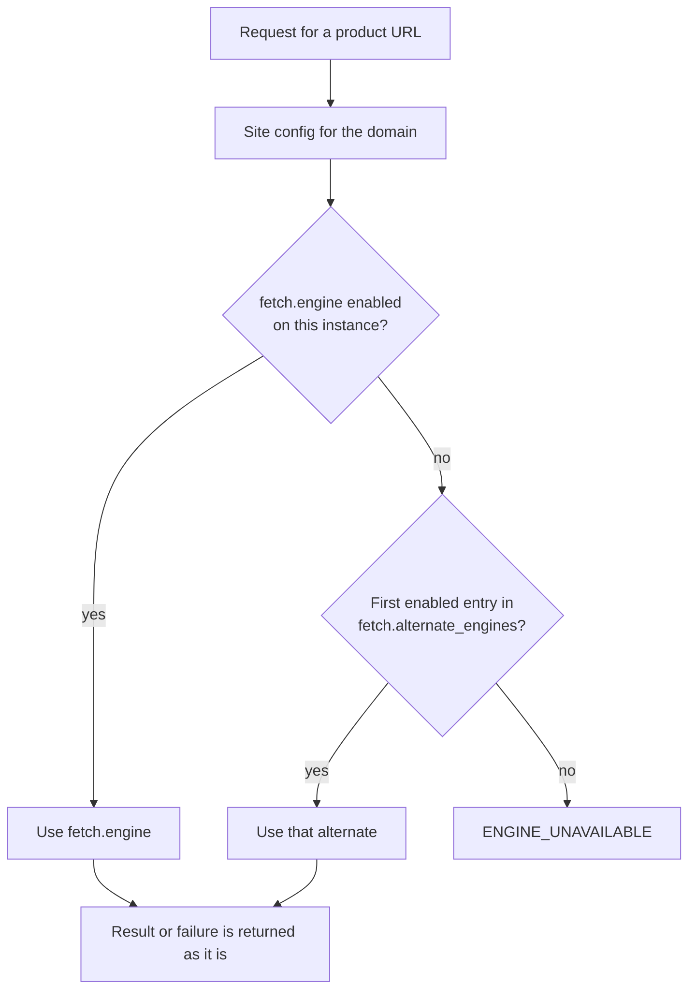

# Fetch engines

This page explains every fetch engine in the product extractor: what each one does, when to use it, how to turn it on, and which sites use it. It reflects the code and site configs as of 2026-11-15.

Engines: `http`, `browser`, `duckduckgo`, `brave`, `mojeek`, `yahoo`, `yandex`. The last three were added on 2026-11-14 ([METAWEBSEARCH_ENGINE_PROPOSAL.md](METAWEBSEARCH_ENGINE_PROPOSAL.md)).

## 1. Overview

| Engine | Kind | Contacts the product's site? | Source | API key | Product data | Speed | Instance switch |
|---|---|---|---|---|---|---|---|
| `http` (default) | Page fetch | Yes | The product page, through Colly over Go's HTTP client | No | Full (all selectors) | Under 1 s | Always on |
| `browser` | Page fetch | Yes | The product page, loaded in real Chrome through Playwright | No | Full, including JavaScript-rendered pages | 3–10 s | `APP_BROWSER_ENABLED` |
| `duckduckgo` | Search | **No** | DuckDuckGo's HTML results page (`html.duckduckgo.com/html/`) | No | Partial: title, URL, snippet | About 1 s | `APP_DUCKDUCKGO_ENABLED` |
| `brave` | Search | **No** | Brave Search API (`api.search.brave.com`) | **Yes**: `APP_BRAVE_API_KEY` | Partial: title, URL, snippet | About 1 s | `APP_BRAVE_ENABLED` |
| `mojeek` | Search | **No** | Mojeek results page, parsed by `jcalvert/metawebsearch` | No | Partial: title, URL, snippet | About 1 s | `APP_MOJEEK_ENABLED` |
| `yahoo` | Search | **No** | Yahoo results page (Bing index), parsed by `jcalvert/metawebsearch` | No | Partial: title, URL, snippet | About 1 s | `APP_YAHOO_ENABLED` |
| `yandex` | Search | **No** | Yandex results page, parsed by `jcalvert/metawebsearch` | No | Partial: title, URL, snippet | About 1 s | `APP_YANDEX_ENABLED` |

There are two kinds of engine:

- **Page fetch engines** (`http`, `browser`) download the product page and run the site's CSS selectors on it. They can return every field: title, price, stock, images, specifications.
- **Search engines** (`duckduckgo`, `brave`, `mojeek`, `yahoo`, `yandex`) never send a request to the product's site. They look the product URL up in a search engine and build the product from the matching result. A search result holds only a title, a URL and a snippet, so the response is `"completeness": "partial"`. Price, stock, images and specifications are listed in `unavailable_fields` (for example `image_url: NOT_IN_SEARCH_RESULTS`). Search engines exist for sites whose bot protection the service does not try to get past.

## 2. How an engine is chosen

- The code is the Strategy pattern. `fetch.Engine` ([internal/fetch/engine.go](../internal/fetch/engine.go)) is the interface: `Name()` and `Fetch(ctx, site, target)`. `fetch.Router` ([internal/fetch/router.go](../internal/fetch/router.go)) holds the enabled engines and picks one for each request.
- Each site chooses its engine in `fetch.engine` in `configs/sites/<domain>.json`. A site with no `fetch.engine` uses `http`.
- `fetch.alternate_engines` (search engines only, at most one entry today) is used **only when `fetch.engine` isn't enabled on the instance**. It isn't a retry: the choice is made once, before the fetch. A failure from the chosen engine is returned as it is and is never retried on another engine.
- Every engine returns the same `Page` and `Failure` types, so page checks, extraction, normalization and error reporting don't depend on the engine.
- Every engine follows the same egress rules: private, loopback and metadata addresses and blocked ports are refused, and the outbound proxy (`APP_PROXY_HOST`, `APP_PROXY_PORT`) is used when one is set.

## 3. Engines

### 3.1 `http` (default)

- **What it does:** fetches the product page with [Colly](https://github.com/gocolly/colly) over Go's HTTP client, then runs the site's selectors on the HTML. Code: [internal/fetch/fetch.go](../internal/fetch/fetch.go).
- **Use it for:** most sites. It is the fastest and lightest engine.
- **Behaviour:**
  - Honors `robots.txt` unless the site sets `respect_robots_txt: false`.
  - Retries `retries` times (default 2) with backoff, and follows `Retry-After` when the next attempt still fits in the deadline.
  - Caps the body size and detects the charset.
  - Builds a new collector for each request, so history and robots caches don't leak between requests.
- **Site config (`fetch`):** `user_agent` (default `ProductExtractor/1.0`) or `user_agents` (one picked at random per fetch), `delay_ms` (default 1000), `timeout_seconds` (default 30), `retries` (default 2), `respect_robots_txt` (default `true`).
- **Can't do:** run JavaScript or pass anti-bot challenges. A page that needs JavaScript fails with `JS_RENDERED_PAGE`. A site that blocks it answers 403 or a challenge page.

### 3.2 `browser`

- **What it does:** loads the page in real Google Chrome or Chromium, driven by [Playwright](https://github.com/playwright-community/playwright-go), and then runs the same selectors on the rendered HTML. Code: [internal/fetch/browser.go](../internal/fetch/browser.go). Full guide: [browser-engine.md](browser-engine.md).
- **Use it for:** pages rendered by JavaScript, and sites that the `http` engine can't read.
- **Behaviour:**
  - One browser runs for each server instance. Each request gets a fresh, isolated browser context.
  - Cookies are kept per site, never across sites.
  - All of Chrome's traffic goes through the in-process egress gate, which applies the same address, port and proxy rules as `http`.
  - Redirects to other domains are refused, and `robots.txt` is honored.
  - After loading, it waits for the product root selector, so a challenge page that reloads into the product is reported as the real page.
- **Instance settings:**

  | Variable | Default | Meaning |
  |---|---|---|
  | `APP_BROWSER_ENABLED` | `false` | Start the browser engine |
  | `APP_BROWSER_CHANNEL` | `chromium` | `chrome` (installed Google Chrome) or `chromium` (Playwright's build) |
  | `APP_BROWSER_HEADLESS` | `true` | `false` runs Chrome with a window on a hidden Xvfb display |
  | `APP_BROWSER_MAX_PAGES` | `3` | Pages open at the same time |
  | `PLAYWRIGHT_DRIVER_PATH` | user cache | Where the Playwright driver is installed |

- **Cost:** 3–10 s per page. About 150 MB for Chrome, plus 100–300 MB for each open page.
- **Note:** some sites' terms forbid automated browsing. Check before using it for a site (README "Responsible use").

### 3.3 `duckduckgo`

- **What it does:** posts the query to DuckDuckGo's no-JavaScript results page (`https://html.duckduckgo.com/html/`), parses the results and picks the one that matches the requested product URL. Code: [internal/fetch/search/duckduckgo.go](../internal/fetch/search/duckduckgo.go), [internal/fetch/searchengine.go](../internal/fetch/searchengine.go).
- **Use it for:** sites with bot protection that the service doesn't get past, when the product page is indexed.
- **API key:** none. The endpoint is not an API: it has no documentation or versioning, and its HTML can change. Its `robots.txt` allows every path.
- **Behaviour:**
  - Sends the honest `APP_SEARCH_USER_AGENT`.
  - HTTP 202, 403 and 429 mean DuckDuckGo is rate-limiting or checking for bots. They become `SEARCH_PROVIDER_BLOCKED` with no retry, because the service doesn't work around blocks.
  - Result pages are capped at 2 MiB.
- **Instance settings:**

  | Variable | Default | Meaning |
  |---|---|---|
  | `APP_DUCKDUCKGO_ENABLED` | `false` | Turn the engine on |
  | `APP_DUCKDUCKGO_MIN_INTERVAL_MS` | `2000` | Minimum gap between two DuckDuckGo queries from this instance |

### 3.4 `brave`

- **What it does:** calls the official [Brave Search API](https://brave.com/search/api/) (`api.search.brave.com`) and picks the result that matches the requested URL. Code: [internal/fetch/search/brave.go](../internal/fetch/search/brave.go).
- **Use it for:** the same sites as `duckduckgo`. It is a documented, versioned API, so it is more stable than scraping a results page.
- **API key:** **required.** It has a free tier, then is paid per query. How to get one: [SETUP_KEYS.md](SETUP_KEYS.md). The key is secret and never logged. The server doesn't start when Brave is enabled without a key.
- **Behaviour:** the key is sent in the `X-Subscription-Token` header. Quota and authentication errors become `SEARCH_QUOTA_EXCEEDED` and `SEARCH_PROVIDER_AUTH_FAILED`. Brave's thumbnail isn't used as `image_url`, because it is a Brave-hosted copy, not the shop's image.
- **Instance settings:**

  | Variable | Default | Meaning |
  |---|---|---|
  | `APP_BRAVE_ENABLED` | `false` | Turn the engine on |
  | `APP_BRAVE_API_KEY` | — | The key |
  | `APP_BRAVE_API_KEY_FILE` | — | A file that holds only the key, used when `APP_BRAVE_API_KEY` is empty |
  | `APP_BRAVE_MIN_INTERVAL_MS` | `1000` | Minimum gap between two Brave queries |

### 3.5 Settings shared by the search engines

**Instance (`.env`):**

| Variable | Default | Meaning |
|---|---|---|
| `APP_SEARCH_USER_AGENT` | `go-wordpress-extractor/1.0` | The honest client name sent to search providers |
| `APP_SEARCH_CACHE_TTL` | `6h` | How long a matched result is kept in memory |
| `APP_SEARCH_NO_RESULT_CACHE_TTL` | `1h` | How long a `SEARCH_NO_RESULT` answer is kept |

**Site config (`fetch.search`, allowed only for search engines):**

| Key | Default | Meaning |
|---|---|---|
| `region` | `wt-wt` | `<country>-<lang>`, for example `us-en` or `de-de`. `wt-wt` means no region |
| `queries` | `["site_slug", "url"]` | Queries to try, in order. `site_slug` is `site:<domain> <words from the URL path>`, and `url` is the product URL in quotes. At most 2 |
| `title_strip` | — | Suffixes and prefixes removed from the result title, for example `" \| Ferguson Home"` |
| `ignore_params` | — | Extra query parameters ignored when matching result URLs to the requested URL |

The service never returns data for the wrong product. If no result matches the requested URL, the request fails with `SEARCH_NO_RESULT`, and `evidence.search` lists the queries and the closest URLs.

**Search failure codes:** `SEARCH_NO_RESULT`, `SEARCH_PROVIDER_BLOCKED`, `SEARCH_QUOTA_EXCEEDED`, `SEARCH_PROVIDER_AUTH_FAILED`, `SEARCH_PROVIDER_ERROR`.

### 3.6 `mojeek`, `yahoo`, `yandex`

- **What they do:** three separate search engines that work like `duckduckgo`: each reads its search engine's HTML results page and picks the result that matches the requested URL. Their request builders and result parsers come from [`github.com/jcalvert/metawebsearch`](https://github.com/jcalvert/metawebsearch), a Go port of Python's `ddgs`, pinned at `v0.0.0-20260401212850-2b51795e5ee8`. Code: [internal/fetch/search/scraped.go](../internal/fetch/search/scraped.go). Design: [METAWEBSEARCH_ENGINE_PROPOSAL.md](METAWEBSEARCH_ENGINE_PROPOSAL.md).
- **Use them for:** the same sites as `duckduckgo`, when you want an index that is not Bing's. Mojeek and Yandex have their own crawlers; Yahoo serves Bing's results, so it mostly repeats what DuckDuckGo has.
- **API key:** none. These are not APIs: none of the three providers has approved this project, and the page markup can change without notice. Each engine has its own switch, so an operator enables only the providers whose terms fit their use.
- **Behaviour:**
  - Only the library's request builders and parsers are used. Its own HTTP client (which impersonates Chrome's TLS fingerprint and headers and retries blocks) is not: requests go through the service's egress client with the honest `APP_SEARCH_USER_AGENT`, and the browser-only headers the library adds (`Sec-Fetch-*`, `Sec-Ch-Ua*`, `Upgrade-Insecure-Requests`) are removed.
  - HTTP 202, 403 and 429 become `SEARCH_PROVIDER_BLOCKED` on the first answer. Nothing is retried. A 200 page that holds no results but a CAPTCHA or "just a moment" page (or a redirect to Yandex's `/showcaptcha`) is also `SEARCH_PROVIDER_BLOCKED`.
  - Results pages are capped at 2 MiB. A 200 page the parser cannot read is `SEARCH_PROVIDER_ERROR` ("the page layout may have changed").
  - Queries are spaced by `APP_<ENGINE>_MIN_INTERVAL_MS`, which respects the request deadline; the library's own global sleep is turned off.

| Engine | Index | `search.region` |
|---|---|---|
| `mojeek` | Its own crawler | Yes, as the `arc` (country) and `lb` (language) cookies. With `wt-wt` no region cookies are sent |
| `yahoo` | Bing | Ignored (the loader warns when one is set) |
| `yandex` | Its own (Yandex) | Ignored (the loader warns when one is set) |

- **Instance settings:**

  | Variable | Default | Meaning |
  |---|---|---|
  | `APP_MOJEEK_ENABLED`, `APP_YAHOO_ENABLED`, `APP_YANDEX_ENABLED` | `false` | Turn that engine on |
  | `APP_MOJEEK_MIN_INTERVAL_MS`, `APP_YAHOO_MIN_INTERVAL_MS`, `APP_YANDEX_MIN_INTERVAL_MS` | `3000` | Minimum gap between two queries to that engine from this instance (0–60000) |

- **Live result (2026-11-15, Ferguson sample product):** `yahoo` found it at rank 1 of the first query, like `duckduckgo`. `mojeek` and `yandex` answered the honest client with a CAPTCHA page, so they are `SEARCH_PROVIDER_BLOCKED` today. Check again before giving a site one of them.
- **Tests:** unit tests use synthetic pages in each engine's markup and the real answers saved on 2026-11-15 (`testdata/search/{mojeek,yahoo,yandex}/`); [test/e2e/scraped_search_test.go](../test/e2e/scraped_search_test.go) runs the service with the three engines pointed at the fake shop, and [test/e2e/fergusonhome_search_test.go](../test/e2e/fergusonhome_search_test.go) replays the real answers through the real Ferguson config. `SEARCH_LIVE_TEST=1 go test ./internal/fetch/search/ -run Live -v` queries the real engines and ranks them; add `SEARCH_LIVE_SAVE=<dir>` to save the raw answers.

## 4. Engine per site (configs/sites, 2026-11-14)

| Site | `fetch.engine` | `fetch.alternate_engines` |
|---|---|---|
| 3-form.com | `http` (default) | — |
| badomjip.com | `http` (default) | — |
| emtek.com | `http` (default) | — |
| fergusonhome.com | `duckduckgo` | `brave` |
| flooranddecor.com | `browser` | — |
| hafele.com.de | `browser` | — |
| hmland.ir | `http` (default) | — |
| hosseinibrothers.ir | `http` (default) | — |
| lumens.com | `duckduckgo` | `brave` |
| msisurfaces.com | `http` (default) | — |
| sherwin-williams.com | `http` (default) | — |
| shop.interface.com | `http` (default) | — |
| tilebar.com | `http` (default) | — |

## 5. Choosing an engine for a new site

1. **Start with `http`.** If the page returns product HTML, you're done.
2. **The page needs JavaScript** (`JS_RENDERED_PAGE`, or no product markup in the HTML): use `browser` and enable it on the instance.
3. **The site blocks automated requests** (403, a challenge page) and its product pages are indexed: use a search engine and accept partial data. Use `duckduckgo`, `mojeek`, `yahoo` or `yandex` for no key, or `brave` for a stable API with a key. Set another one as `alternate_engines`, so an instance that has only one of them enabled still serves the site. Choose an engine and alternate that use **different indexes**: DuckDuckGo and Yahoo both rely largely on Bing, while Mojeek, Brave and Yandex have their own. The engine order is decided per site, in its config; there is no global default.
4. **None of these work:** the site isn't supported. The service doesn't solve CAPTCHAs or get past bot protection.

Search engines are off by default on every instance. Turn one on with `sudo ./deploy.sh search enable <engine>`, or by setting `APP_<ENGINE>_ENABLED=true` in the instance's env file. The server reads only the first env file it finds: `.env.<APP_ENV>`, then `.env`.
