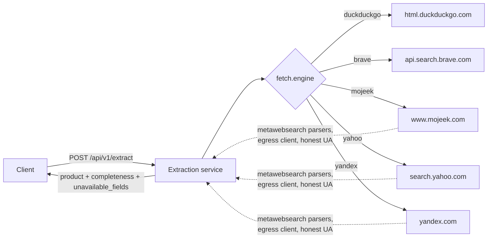

# Proposal: `mojeek`, `yahoo` and `yandex` fetch engines built on `github.com/jcalvert/metawebsearch`

Status: implemented on 2026-11-14 (see "Implementation status" below) · questions 1, 2, 3 and 5 decided; question 4 open (section 9)

## Implementation status

Built on 2026-11-14. Where the code differs from the sections below, the code and this list are what holds:

| Topic | As built |
|---|---|
| Code | `internal/fetch/search/scraped.go` (one `Scraped` provider type; `NewMojeek`, `NewYahoo`, `NewYandex`; `harden`; `limitedClient`), registered by `fetch.NewSearchEngines`; `internal/config` (`APP_MOJEEK_*`, `APP_YAHOO_*`, `APP_YANDEX_*`); `internal/siteconfig` (`EngineMojeek`, `EngineYahoo`, `EngineYandex`, `SearchEngines`, `EngineUsesRegion`, region warning); schema enums; `deploy.sh search`; `.env.example` |
| File name | `scraped.go` as planned (section 5.1), not `metasearch.go` |
| HTTP 202 | The library treats 202 as success. `limitedClient` refuses 202, 403 and 429 before the parser runs, so a bot-check page is `SEARCH_PROVIDER_BLOCKED` and never parsed as "no results" (section 5.3 only listed them as retry statuses) |
| Challenge pages with HTTP 200 | Added: a 200 page with no results that holds a CAPTCHA, "just a moment", or a redirect to a `captcha` path (Yandex's `/showcaptcha`) is `SEARCH_PROVIDER_BLOCKED` with medium confidence, like DuckDuckGo's anomaly page. A 200 page with no results and no such marker is "no results" and is logged |
| Region | Mojeek takes the region as the `arc` and `lb` cookies. With `wt-wt` (the default) those cookies are removed, because the library would otherwise default to `us-en` |
| Browser-only headers | The library adds `Sec-Fetch-*`, `Sec-Ch-Ua*` and `Upgrade-Insecure-Requests` after `BuildRequest`; `limitedClient` removes them. `Accept` and `Accept-Language` stay |
| Test hook | `fetch.Options.SearchEndpoints` (engine name → base URL) points any search engine at a fake provider. The e2e harness fills it from `Options.SearchEndpoints`; the fake shop got `HandleFunc` for Yahoo's random path and for non-200 answers |
| Fixtures | Synthetic pages in each engine's markup (`testdata/search/{mojeek,yahoo,yandex}/synthetic-fergusonhome.html`), plus real answers saved on 2026-11-15 with `SEARCH_LIVE_SAVE`: Yahoo's results page for the Ferguson query (`yahoo/fergusonhome-site-slug.html`, session crumb and guids redacted), Mojeek's and Yandex's CAPTCHA pages (`*/captcha.html`), and a Yandex page that lists other Ferguson products only (`yandex/fergusonhome-no-match.html`) |
| Live check (2026-11-15, Ferguson sample request) | `duckduckgo` and `yahoo` found the product at rank 1 of the first query; `mojeek` and `yandex` answered the honest client with a CAPTCHA (`SEARCH_PROVIDER_BLOCKED`); `brave` not tried (no key). DuckDuckGo and Yandex were reachable only through the outbound proxy on that network. The live test now uses `APP_PROXY_HOST`/`APP_PROXY_PORT` and ranks the engines. Only one site was checked, so plan step 2 is not finished |
| Dependency | `go.mod` pins `github.com/jcalvert/metawebsearch v0.0.0-20260401212850-2b51795e5ee8`. `klauspost/compress` resolves to v1.20.3 (already required by `mongo-driver`), not the library's v1.18.2. Binary size with the library linked: measured on a probe at about 10 MB for the library alone; the service's own growth is step 1 of the plan, still to be measured on a machine with full module access |
| Hit-rate check (plan step 2) and per-site engine choice (step 5) | Started with Ferguson (row above). The other search sites are not checked yet, and no site config uses the new engines yet |
| Tests | `scraped_test.go` (fixtures, honest headers, region cookies, status mapping with exactly one request, challenge pages, size cap, no global sleep, transport and endpoint errors, `ClientProfile` refused, `EngineConfig` field guard); config, siteconfig and `NewSearchEngines` tests; e2e `scraped_search_test.go` (success through each engine, headers, cache, `SEARCH_NO_RESULT` with evidence, alternates and `ENGINE_UNAVAILABLE`, 429 reported once and not cached, bad interval refused at startup) |

## 1. Summary

Add three fetch engines, `mojeek`, `yahoo` and `yandex`, next to `http`, `browser`, `duckduckgo` and `brave`. They work like the two existing search engines: none of them contacts the product's site. Each one looks the product URL up in its search engine and builds the product from the matching result. The service doesn't support these three search engines today. Their request builders and result parsers come from the Go library [`github.com/jcalvert/metawebsearch`](https://github.com/jcalvert/metawebsearch), a Go port of the Python [`ddgs`](https://pypi.org/project/ddgs/) library.

None of the three needs an API key. Each is a separate engine with its own `.env` switch and rate limit, and a site chooses it in `fetch.engine` or `fetch.alternate_engines`. That keeps the existing rule that one request uses one engine (question 2, decided). A site that DuckDuckGo can't find (hafele.com.de returns `SEARCH_NO_RESULT` today) can then use an independent index: Mojeek has its own crawler, and Yahoo serves Bing results.

The service uses only the library's request builders and result parsers. It does **not** use the library's browser-impersonation HTTP client (`NewClient`, built on `bogdanfinn/tls-client`) or its `MultiSearch` fan-out. Requests go through the service's own egress client with the honest `APP_SEARCH_USER_AGENT`, and a block is never retried. Section 5 explains how. The licence of the `tls-client` dependency was reviewed and accepted (question 1).



## 2. Background: search engines in this service today

The existing engines are described in [SEARCH_ENGINE_PROPOSAL.md](SEARCH_ENGINE_PROPOSAL.md).

- `search.Provider` ([internal/fetch/search/provider.go](../internal/fetch/search/provider.go)): `Name()` and `Search(ctx, Query) ([]Result, *diagnose.Failure)`. `Result` has `Title`, `URL`, `Snippet` and `Rank`.
- `fetch.SearchFetcher` ([internal/fetch/searchengine.go](../internal/fetch/searchengine.go)) wraps one provider as a fetch `Engine`. It builds the queries (`search.Queries`), applies the per-engine minimum interval, caches results, and matches a result to the requested URL (`search/match.go`). `NewSearchEngines` registers one `SearchFetcher` for each enabled provider.
- `fetch.NewEgressClient` gives search providers the same egress rules as page fetches: it blocks private, loopback and metadata addresses and blocked ports, and uses the outbound proxy.
- The project's stated non-goals include *bypassing anti-bot challenges on the search providers*. The DuckDuckGo provider sends `APP_SEARCH_USER_AGENT` and turns HTTP 202, 403 and 429 into `SEARCH_PROVIDER_BLOCKED` without retrying ("The service does not work around it").
- Failure codes: `SEARCH_NO_RESULT`, `SEARCH_PROVIDER_BLOCKED`, `SEARCH_QUOTA_EXCEEDED`, `SEARCH_PROVIDER_AUTH_FAILED`, `SEARCH_PROVIDER_ERROR` ([internal/diagnose/codes.go](../internal/diagnose/codes.go)).
- Site engine values are listed in [internal/siteconfig/types.go](../internal/siteconfig/types.go) and in the `fetch.engine` and `fetch.alternate_engines` enums of [configs/schema/site-config.v1.json](../configs/schema/site-config.v1.json). `alternate_engines` currently allows at most one entry.

## 3. The package

The facts below come from reading the module source (`v0.0.0-20260401212850-2b51795e5ee8`) and the GitHub repo. pkg.go.dev could not be fetched, so the importer count is unknown.

| Item | Value |
|---|---|
| Module | `github.com/jcalvert/metawebsearch` (single package `metawebsearch`, plus `cmd/search` CLI) |
| Version | No tagged release. Latest is pseudo-version `v0.0.0-20260401212850-2b51795e5ee8`, committed **2026-04-01** (about 7.5 months without a commit) |
| Maturity | 25 commits, 0 stars, 0 forks. A one-person project |
| Licence | MIT |
| Go version | `go 1.25.0` in go.mod (the README says 1.24+). This project uses `go 1.27.0`, so this is fine |
| Origin | Port of Python `ddgs`. The XPath selectors are copied from it |

### 3.1 Engines

| Engine | Endpoint | Default `MinDelay` | Spoofs a browser? | API key | Use in this proposal |
|---|---|---|---|---|---|
| `duckduckgo` | `html.duckduckgo.com/html/` (POST) | 2 s | Default Chrome UA | No | No. The service already has its own `duckduckgo` provider |
| `brave` | `search.brave.com/search` (**HTML scraping**, not the API) | 2 s | Chrome 120 UA | No | No. The service uses the official Brave Search API |
| `mojeek` | `www.mojeek.com/search` | 2 s | Chrome 120 UA | No | **Yes**: engine `mojeek` |
| `yahoo` | `search.yahoo.com/search` (unwraps `/RU=` redirects) | 2 s | Chrome 120 UA | No | **Yes**: engine `yahoo` |
| `yandex` | `yandex.com/search/site/` | 2 s | Chrome 120 UA | No | **Yes**: engine `yandex` (question 3) |
| `wikipedia`, `grokipedia` | JSON APIs | 1 s | — | No | No. They don't index shop product pages |
| `google` | Excluded from `AllEngines()`. Needs JavaScript since early 2026 and a Safari iOS TLS profile | 3 s | GSA iOS UA plus TLS profile | No | No |

Support for each search option (from the library's README):

| Option | mojeek | yahoo | yandex |
|---|---|---|---|
| `Region` | Yes | Ignored | Ignored |
| `SafeSearch` | Yes | Ignored | Ignored |
| `TimeLimit` | Ignored | Yes | Ignored |
| `Page` | Ignored | Yes | Yes |

### 3.2 API used by this proposal

```go
type Result struct { Title, URL, Snippet, Engine string }

type SearchOpts struct {
    MaxResults int; Page int; Region string // "us-en"
    SafeSearch string; TimeLimit string
}

type HTTPClient interface { Do(*http.Request) (*http.Response, error) } // any *http.Client fits

type EngineConfig struct {
    Name          string
    BuildRequest  func(query string, opts SearchOpts) (*http.Request, error)
    ParseResponse func(*http.Response) ([]Result, error)
    PostProcess   func([]Result) []Result
    ClientProfile string        // read only by MultiSearch, which then calls NewClient
    MinDelay      time.Duration // >0 turns on a package-global limiter
    MaxRetries    int           // <=0 means 3
    RetryableStatus func(int) bool // default: 202, 429, 503
}

var Mojeek, Yahoo, Yandex EngineConfig // exported values, every field public

// Execute: BuildRequest -> client.Do -> ParseResponse -> PostProcess, with rate limit and retries.
func Execute(ctx context.Context, client HTTPClient, engine EngineConfig, query string, opts SearchOpts) ([]Result, error)
```

Each engine calls `Execute` directly with the service's client. `MultiSearch` isn't used: with separate engines there is nothing to merge, and `MultiSearch` is the only code that creates a `tls-client` client on its own (through `ClientProfile`).

### 3.3 Behaviour that conflicts with this service

The library is built to avoid detection. Used as-is, it would break the project's rules in these places:

| # | Library behaviour | Where | Conflict |
|---|---|---|---|
| 1 | `NewClient` uses `bogdanfinn/tls-client` to copy Chrome's JA3/TLS, HTTP/2 SETTINGS and header order, with random TLS extension order | `client.go` | Getting around bot detection is a non-goal. It also skips `NewEgressClient`'s blocked-address and proxy rules |
| 2 | Each `BuildRequest` hard-codes a Chrome 120 `User-Agent`, and `applyDefaultHeaders` adds `Sec-Ch-Ua`, `Sec-Fetch-*` and similar headers | `mojeek.go`, `yahoo.go`, `yandex.go`, `engine.go` | The service must send `APP_SEARCH_USER_AGENT` |
| 3 | Retries 202, 429 and 503 up to 3 times with 5 s, 10 s and 20 s backoff | `engine.go` | DuckDuckGo maps these to `SEARCH_PROVIDER_BLOCKED` with no retry. Retrying a block is working around it, and the backoff alone exceeds a request's timeout |
| 4 | Package-global rate limiter that calls `time.Sleep` and **ignores `ctx`** | `enforceRateLimit` | Blocks a request goroutine past its deadline. The service already has a per-engine `MinInterval` that respects `ctx` |
| 5 | `io.ReadAll` with no size cap | `decompressBody`, parsers | The service caps result pages at 2 MiB (`maxResultsPage`) |
| 6 | Errors are plain strings (`"yahoo: HTTP 429"`), with no typed or sentinel errors | `engine.go` | Can't be mapped to `SEARCH_*` codes reliably by parsing the message |

Every `EngineConfig` field is public, so each of these can be fixed from outside the library without forking it (section 5.2).

### 3.4 Dependencies the module adds

The module's direct requirements are `andybalholm/brotli v1.2.0`, `antchfx/htmlquery v1.3.6`, `bogdanfinn/fhttp v0.6.8`, `bogdanfinn/tls-client v1.14.0` and `golang.org/x/net`. The transitive ones include `bogdanfinn/utls`, `bogdanfinn/quic-go-utls`, `bogdanfinn/websocket`, `bdandy/go-socks4`, `klauspost/compress` and `tam7t/hpkp`.

- `htmlquery` and `x/net` are already in this module graph.
- `tls-client` is imported by the same package (`client.go`), so **it is compiled and linked in even if `NewClient` is never called**. Go has no per-file imports.
- **Licence:** `bogdanfinn/tls-client` uses a BSD licence with an **advertising clause** (clause 3, "All advertising materials mentioning features or use of this software must display the following acknowledgement"). That is BSD-4-Clause style, which the FSF considers GPL-incompatible. It was reviewed and accepted for this project (question 1).
- I couldn't measure binary-size growth or the exact module count because the sandbox's Go proxy refused one download (`klauspost/compress`). Step 1 of the plan measures them.

## 4. Goals and non-goals

### Goals

- Add three engines, `mojeek`, `yahoo` and `yandex`, that return product data from that search engine's results for a product URL.
- Reuse everything the existing search engines have: queries, matching, cache, `completeness`, `unavailable_fields`, `evidence.search` and `SEARCH_*` codes.
- Send every request through `NewEgressClient` with `APP_SEARCH_USER_AGENT`.
- Let operators turn each engine on and off separately in `.env`, and let each site choose its engine.

### Non-goals

- Using `NewClient`, `MultiSearch`, TLS fingerprinting, spoofed browser headers or any other way of getting past search-engine bot checks.
- Retrying after a block (202, 403 or 429).
- Merging results from several search engines in one request. One request uses one engine, as today.
- Google. It needs JavaScript and a spoofed client.
- Replacing the existing `duckduckgo` and `brave` providers with the library's versions.

## 5. Design

### 5.1 One provider type, three engines: `internal/fetch/search/scraped.go`

The three engines differ only in which library `EngineConfig` they use, so one provider type covers them:

```go
const (
    ProviderMojeek = "mojeek"
    ProviderYahoo  = "yahoo"
    ProviderYandex = "yandex"
)

// Scraped reads one search engine's results page through a metawebsearch
// EngineConfig, hardened by harden (5.2). It needs no API key.
type Scraped struct {
    name      string
    label     string           // "Mojeek", for failure messages
    engine    mws.EngineConfig // hardened copy
    client    mws.HTTPClient   // limitedClient around the egress *http.Client
}

func NewMojeek(client *http.Client, userAgent string) *Scraped
func NewYahoo(client *http.Client, userAgent string) *Scraped
func NewYandex(client *http.Client, userAgent string) *Scraped

func (s *Scraped) Name() string { return s.name }
func (s *Scraped) Search(ctx context.Context, q Query) ([]Result, *diagnose.Failure)
```

`Search` calls `mws.Execute(ctx, s.client, s.engine, q.Text, mws.SearchOpts{Region: q.Region})`, converts the results to `search.Result` with `Rank` 1..n in the engine's order, and runs them through `cleanText`, like the other providers. `NewSearchEngines` registers a `SearchFetcher` for each enabled engine, the same way it does for `duckduckgo` and `brave`.

### 5.2 Making the library follow the service's rules

`harden(cfg mws.EngineConfig, userAgent string) mws.EngineConfig` changes a copy of `mws.Mojeek`, `mws.Yahoo` or `mws.Yandex`:

| Conflict (3.3) | Fix |
|---|---|
| 1 TLS impersonation | Never call `mws.NewClient` or `mws.MultiSearch`. Pass the egress `*http.Client` (wrapped, next rows) to `mws.Execute`. `Execute` ignores `ClientProfile`, and `harden` refuses a config that sets one, which rules out Google |
| 2 Spoofed UA | Wrap `BuildRequest`: call the original, then `req.Header.Set("User-Agent", userAgent)`. Because the UA no longer contains `Chrome/`, `applyDefaultHeaders` removes the `Sec-Ch-Ua*` headers. The client wrapper removes the `Sec-Fetch-*` and `Upgrade-Insecure-Requests` headers that `applyDefaultHeaders` adds after `BuildRequest` |
| 3 Retry on block | `RetryableStatus = func(int) bool { return false }`. The first 202 or 429 becomes an error. `MaxRetries` can't be 0, but with nothing retryable the loop runs once |
| 4 Global sleep | `MinDelay = 0`, which turns the package limiter off. Spacing comes from `SearchFetcher.MinInterval` (`APP_<ENGINE>_MIN_INTERVAL_MS`), which respects `ctx` |
| 5 No size cap | The client wrapper (`limitedClient`) wraps `resp.Body` in `io.LimitReader(…, maxResultsPage)` |
| 6 String errors | `limitedClient` records the HTTP status of the request. 5.3 maps from that status, not from the error text |

A unit test fails if a later library version adds a field to `EngineConfig` that this table doesn't cover. It checks the field count by reflection, so an upgrade has to revisit this section.

### 5.3 Failure mapping

The same mapping as the DuckDuckGo provider, for each engine on its own:

| Outcome of `mws.Execute` | Provider returns |
|---|---|
| Results | Those results, no failure |
| No results, no error | `[]Result{}` (the fetcher then gives `SEARCH_NO_RESULT`) |
| Recorded status 202, 403 or 429 | `SEARCH_PROVIDER_BLOCKED` ("Yahoo answered HTTP 429 instead of results … The service does not work around it.") |
| Recorded status ≥ 500 | `SEARCH_PROVIDER_ERROR` ("Yahoo answered HTTP 503.") |
| Other non-2xx status | `SEARCH_PROVIDER_ERROR` ("… which the service does not handle.") |
| Transport error | The existing `transportFailure(label, err)` |
| Parse error with HTTP 200 | `SEARCH_PROVIDER_ERROR`, saying the results page could not be read, which usually means the engine changed its HTML |

### 5.4 Response and evidence

Nothing new. `source.engine` and `evidence.search.engine` are `"mojeek"`, `"yahoo"` or `"yandex"`, and everything else is the same as for `duckduckgo`. `image_url` is `NOT_IN_SEARCH_RESULTS`, as for the other search engines.

### 5.5 Configuration

`.env` (and `.env.example`), one block per engine, following the `APP_DUCKDUCKGO_*` pattern:

```dotenv
# Mojeek, Yahoo and Yandex: results pages read through github.com/jcalvert/metawebsearch.
# No API key. They use APP_SEARCH_USER_AGENT and the egress rules, and never impersonate a browser.
APP_MOJEEK_ENABLED=false
APP_MOJEEK_MIN_INTERVAL_MS=3000

APP_YAHOO_ENABLED=false
APP_YAHOO_MIN_INTERVAL_MS=3000

APP_YANDEX_ENABLED=false
APP_YANDEX_MIN_INTERVAL_MS=3000
```

`config.ValidateSearch` applies the same interval limits as for `APP_DUCKDUCKGO_MIN_INTERVAL_MS`. `APP_SEARCH_CACHE_TTL` and `APP_SEARCH_NO_RESULT_CACHE_TTL` apply to all search engines, as now.

Site config: add `"mojeek"`, `"yahoo"` and `"yandex"` to the `fetch.engine` and `fetch.alternate_engines` enums (schema, `siteconfig/types.go`, loader). `fetch.search` (queries, region, ignore params) works unchanged. `siteconfig.SearchWarnings` warns when a site sets `fetch.search.region` with `yahoo` or `yandex`, because those engines ignore it (3.1). An example:

```json
"fetch": { "engine": "duckduckgo", "alternate_engines": ["mojeek"] }
```

`deploy.sh search enable mojeek|yahoo|yandex` sets the matching `APP_<ENGINE>_ENABLED=true`, like the existing subcommand.

### 5.6 Files touched

| File | Change |
|---|---|
| `go.mod`, `go.sum` | `require github.com/jcalvert/metawebsearch v0.0.0-20260401212850-2b51795e5ee8` (pinned pseudo-version) |
| `internal/fetch/search/scraped.go` (new) | `Scraped` provider, `NewMojeek`, `NewYahoo`, `NewYandex`, `harden`, `limitedClient` |
| `internal/fetch/search/scraped_test.go` (new) | Fixture tests (6) |
| `internal/fetch/search/live_test.go` | Live cases for the three engines |
| `internal/fetch/searchengine.go` | `SearchSettings.{Mojeek,Yahoo,Yandex}{Enabled,MinInterval}`; register in `NewSearchEngines` |
| `internal/config/config.go`, `validate.go`, `config_test.go` | `APP_MOJEEK_*`, `APP_YAHOO_*`, `APP_YANDEX_*` |
| `internal/siteconfig/types.go`, loader, tests, `configs/schema/site-config.v1.json` | `EngineMojeek`, `EngineYahoo`, `EngineYandex` in both enums; region warning |
| `internal/app/app.go` | Doc comment: the engines are registered only when enabled |
| `.env.example`, `.env.development`, `.env.test`, `deploy.sh`, `README.md`, swagger docs | Settings, the `fetch.engine` description and docs |

## 6. Testing

- **Fixtures:** save one real results page per engine under `testdata/search/{mojeek,yahoo,yandex}/` and serve them from `httptest.Server`. The library's `BuildRequest` URLs are fixed, so the test client rewrites the request host to the test server; the tests don't patch the library.
- **Header test (each engine):** the test server asserts that `User-Agent == APP_SEARCH_USER_AGENT` and that no `Sec-Ch-Ua*` or `Sec-Fetch-*` headers are sent.
- **No-retry test:** the server answers 429 once. The provider makes exactly one request and returns `SEARCH_PROVIDER_BLOCKED`.
- **No global sleep:** two back-to-back `Search` calls on one provider return without the library's 2 s wait (spacing is the fetcher's job).
- **Size cap:** a page larger than 2 MiB is cut off and doesn't cause an out-of-memory failure.
- **Egress:** a request to a host that resolves to a private address is refused (an existing egress test, reused).
- **Config and site config:** each engine is off by default; a site using a disabled engine gets `ENGINE_UNAVAILABLE`; the region warning works.
- **Opt-in live test:** `SEARCH_LIVE_TEST=1 go test ./internal/fetch/search/ -run Live -v` now includes the three engines.

## 7. Risks

| Risk | Likelihood | Mitigation |
|---|---|---|
| Engines block a non-browser client (honest UA, Go TLS) much more often than they block the library's spoofed client | **High**. The library adds impersonation because "without these, search engines detect us as bots immediately" | Accepted. This is the project's rule, not a defect. Step 2 of the plan measures the real hit rate for each engine. An engine that is almost always blocked is left out |
| HTML changes break a parser | High over time | Parse error plus HTTP 200 has its own message. The fixture tests catch it after a library upgrade. The pinned version means nothing changes without an upgrade |
| Library is unmaintained (one author, no tags, quiet since April 2026) | Medium | Pin the pseudo-version. Every `EngineConfig` field is public, so a parser can be replaced locally without forking. Port a parser (MIT, about 100 lines each) if upstream stops working |
| BSD-4-style licence of `tls-client` linked into the binary | Low | Accepted (question 1). Keep the library's and tls-client's licence texts with the redistributed source and binaries; Go modules already carry them in the source tree |
| Extra supply-chain surface (TLS forks, QUIC fork, websocket fork) for code that is never called | Medium | Run `govulncheck` in CI. Review `go.sum` changes on each upgrade |
| More config: three more engine values and six more `.env` settings | Low | Accepted (question 2). Same pattern as `APP_DUCKDUCKGO_*`, all off by default |
| Terms of service of Yahoo and Yandex for automated queries | Medium | Off by default. Each operator opts in to each engine, as with DuckDuckGo |
| Yandex results or traffic are a problem for some operators (jurisdiction, data residency) | Depends on operator | Its own engine and switch, off by default (question 3, decided) |

## 8. Plan

1. **Spike (½ day).** In a branch, add the dependency. Measure binary size and module count before and after, and run `go mod why` and `govulncheck`.
2. **Hit-rate check (½ day).** Run each hardened engine (5.2) with the honest UA against the 12 configured sites' sample URLs. Record the match rate and block rate for each engine. Decide which of the three to build.
3. **Provider and tests (1½ days).** Sections 5.1–5.3 and 6.
4. **Config, schema, deploy and docs (1 day).** Sections 5.5 and 5.6.
5. **Choose engines per site.** From the step 2 hit rates, set `fetch.engine` and `fetch.alternate_engines` in each search-engine site's config (question 5). Start with hafele.com.de on one instance and watch the logs for a week.

## 9. Questions

1. **Licence — decided 2026-11-14: acceptable.** The BSD-4-style `tls-client` dependency (linked, never called) is accepted. The service depends on `github.com/jcalvert/metawebsearch` directly, at a pinned version, and does not port the parsers. Porting stays available as a fallback if upstream stops working (section 7).
2. **One engine or three — decided 2026-11-14: three separate engines** (`mojeek`, `yahoo`, `yandex`). Each is a `Provider` that calls `mws.Execute`, with its own `.env` switch and rate limit. This keeps the "one engine per request" rule and means `MultiSearch` isn't used.
3. **Yandex — decided 2026-11-14: build it as its own engine**, `yandex`, with its own switch (`APP_YANDEX_ENABLED`, off by default) and rate limit (`APP_YANDEX_MIN_INTERVAL_MS`). An operator who doesn't want Yandex traffic leaves it off. A site uses it only if its config names it.
4. **`alternate_engines` length:** the schema allows at most one alternate today. With five search engines, should it allow two (for example `"engine": "duckduckgo", "alternate_engines": ["mojeek", "yahoo"]`)? The engine is still chosen once per request, before any fetch.
5. **Engine order — decided 2026-11-14: per website, in its site config.** There is no global default order. Each site's `fetch.engine` and `fetch.alternate_engines` say which search engine it uses and which comes next, as for `duckduckgo` and `brave` today. The choice for each site is made from the step 2 hit rates. Mojeek has its own index, while DuckDuckGo and Yahoo both rely largely on Bing, so a site's engine and its alternate should use different indexes where possible.
