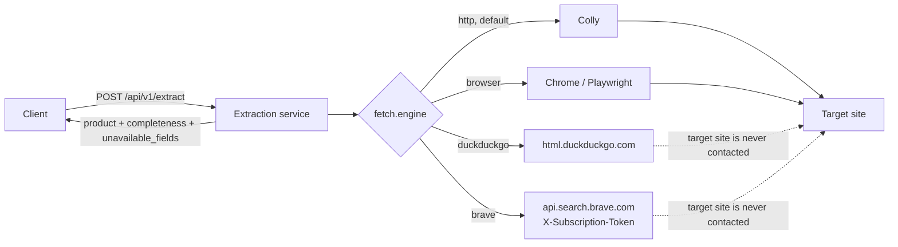

# Proposal: Search fetch engines (DuckDuckGo and Brave) and per-site engine selection

Status: implemented on 2026-11-13 (see "Implementation status" below) · all open questions decided (section 13)

## Implementation status

Built on 2026-11-13. Where the code differs from the sections below, the code and this list are what holds:

| Topic | As built |
|---|---|
| Site engines | fergusonhome.com and hafele.com.de use **`"engine": "duckduckgo"` with `"alternate_engines": ["brave"]`** (changed after section 8 was written, which says `brave` first). sherwin-williams.com stays on `http` until the challenge check in section 8 is done |
| Code | `internal/fetch/search/` (providers, matching, queries), `internal/fetch/searchengine.go` (`SearchFetcher`, egress client), `internal/fetch/router.go` (alternates), `internal/extract/fromsearch.go`, `internal/extract/unavailable.go`, `internal/config` (`APP_SEARCH_*`, `APP_DUCKDUCKGO_*`, `APP_BRAVE_*`), `internal/diagnose` (codes, `evidence.search`), `deploy.sh search`, `.env.example` |
| Brave thumbnail | Not used. A Brave thumbnail is a small Brave-hosted copy, not the shop's product image, so `image_url` is always `NOT_IN_SEARCH_RESULTS` for both engines (section 5.3 and 7.2 mention it as a possibility) |
| Warnings | Search results also carry the existing `PRICE_MISSING` warning, so clients that rely on it keep working (the example in section 10 leaves it out) |
| `source.cached` | Added: `true` when the answer came from the instance's cache |
| A title that is only the site name | Becomes empty, so `REQUIRED_FIELD_MISSING` reports it instead of returning the shop name as the product title |
| Brave | Tested only against a synthetic response (`testdata/search/brave/synthetic-fergusonhome.json`), because no key exists yet. Plan step 3's check against a real response is still open |
| Live checks | DuckDuckGo, 2026-11-13, through the running server: Ferguson `success` (rank 1, 1.1 s; the repeat came from the cache), Häfele `SEARCH_NO_RESULT` with 2 queries and 3 `closest` URLs. With both engines off: `ENGINE_UNAVAILABLE`. With Brave on and no key: the server does not start |
| Opt-in live test | `SEARCH_LIVE_TEST=1 go test ./internal/fetch/search/ -run Live -v` (add `APP_BRAVE_API_KEY` for Brave) |

## 1. Summary

The service has two fetch engines today: `http` (Colly) and `browser` (Chrome through Playwright). This proposal adds two search engines:

| Engine | Source | API key | Cost |
|---|---|---|---|
| `duckduckgo` | DuckDuckGo's HTML results page (`html.duckduckgo.com/html/`) | None | Free |
| `brave` | Brave Search API (`api.search.brave.com`) | `APP_BRAVE_API_KEY` in the `.env` file | Free tier, then paid per query |

Both are for sites whose bot protection (Cloudflare, Akamai or similar) we do not want to get past. With a search engine, the service does not fetch the site at all. It looks the product URL up in the search engine and builds the product from what the search result shows: title, URL and a description snippet.

A search result holds much less than the product page, so the response gets two new parts:

- `unavailable_fields` lists each field that could not be found, with a reason. This applies to every engine, including `http` and `browser`: whatever was found is returned, and whatever was not is listed.
- `completeness` (`full` or `partial`) says whether any field is missing.

Each site config chooses its engine in `fetch.engine`, and can name alternatives in `fetch.alternate_engines` for instances that do not run the first one. The default stays `http`. Section 8 assigns an engine to each of the 12 configured sites. Two sites move to a search engine: fergusonhome.com and hafele.com.de.



## 2. Background: how engines work today

- `fetch.Engine` ([internal/fetch/engine.go](../internal/fetch/engine.go)) is a Strategy interface: `Name()` and `Fetch(ctx, site, target) (*Page, *diagnose.Failure)`.
- `fetch.Router` ([internal/fetch/router.go](../internal/fetch/router.go)) reads `site.Fetch.Engine` on each request and hands the fetch to the matching engine. A site with no engine uses `http`. When the engine is not enabled on the instance, the router returns `ENGINE_UNAVAILABLE`.
- `siteconfig` ([internal/siteconfig/loader.go](../internal/siteconfig/loader.go)) accepts only `"http"` and `"browser"`. The JSON schema ([configs/schema/site-config.v1.json](../configs/schema/site-config.v1.json)) has the same enum.
- `extract.Service.Run` ([internal/extract/service.go](../internal/extract/service.go)) assumes every engine returns product HTML. It parses `page.Body` with goquery and runs the site's CSS selectors (`parsePage`).
- The project is open source under the MIT license ([LICENSE](../LICENSE), [github.com/mobintmu/go-wordpress-extractor](https://github.com/mobintmu/go-wordpress-extractor)). Other companies run their own instances, with the site configs from the repo and their own `.env` settings.
- `config.LoadEnv` ([internal/config/config.go](../internal/config/config.go)) reads only the first env file it finds: `.env.<APP_ENV>`, then `.env`. Variables already set in the environment take priority over the file.

The existing engine names stay as they are. `http` is the Colly engine, so this proposal adds no `colly` value. Renaming it would change every config and the API docs and gain nothing.

## 3. Goals and non-goals

### Goals

- Add two search engines, `duckduckgo` and `brave`, that return whatever product data the search result shows for a product URL.
- Keep each engine's settings, including the Brave API key, in the `.env` file, and keep the key out of git.
- Say clearly in each response which fields could not be fetched, and why.
- Never return data for the wrong product. If no search result matches the requested URL, the request fails.
- Let each site config choose its engine, with `http` as the default.
- Keep the extraction service stateless. No database or Redis is added.

### Non-goals

- Bypassing or solving anti-bot challenges or CAPTCHAs in the search engines, on target sites or on the search providers.
- Changing the `browser` engine. It stays available for pages rendered by JavaScript, such as sherwin-williams.com (section 8).
- Getting price, stock or specifications from search results. Neither provider gives them reliably (section 5.3).
- Discovering product URLs through search. The client still sends one known product URL per request.
- Changing the fetch method while a request runs. Each request uses one engine from start to finish: no fallback from `http` or `browser` to a search engine when the site blocks it, and no retry on the other search engine (open questions 3 and 4, decided). Moving a site to another engine is a site config change.
- Google, or Bing, whose Web Search API was retired on 2025-08-11.

## 4. Compliance

The reason for these engines is to respect a target site's bot protection. That affects both the target site and the search providers.

### 4.1 Target sites

The search engines send nothing to the target site: no page request, no `robots.txt` request, no image request. Every request goes only to the search provider.

fergusonhome.com is the site this is for. Today it uses the `http` engine with browser user agents, plus the client hints and `Sec-Fetch` headers those browsers send, because Akamai answers plain clients with 403. This proposal moves it to a search engine (section 8). The site is then no longer fetched at all.

hafele.com.de moves as well. It sits behind Cloudflare, which answers clients that run no JavaScript with HTTP 403 and a "Just a moment..." challenge. Today the `browser` engine gets past that challenge by loading the page in Google Chrome with a window on Xvfb ([md/browser-engine.md](browser-engine.md)). With a search engine, the site is no longer contacted at all. Which engine a site uses is set in its config, so any other site can be moved to a search engine later in the same way.

### 4.2 DuckDuckGo's rules

As of 2026-11-13:

| Source | What it says |
|---|---|
| `duckduckgo.com/robots.txt` | For `User-agent: *`: `Disallow: /html`, `Disallow: /lite`, `Disallow: /*?`, with `Allow: /?*` for the root results page. |
| `html.duckduckgo.com/robots.txt` and `lite.duckduckgo.com/robots.txt` | `Allow: /` for every agent. The file's comment says this is "so their noindex tags/headers are respected". |
| Terms of Service (updated 2025-07-01) | No clause about automated queries. Users must follow the Acceptable Use Policy, and DuckDuckGo may suspend access. |
| Acceptable Use Policy | Users may not "Sell or resell any portion of the services", "Frame, inline link, or similarly display any portion of the services within another service", or "Interfere with or disrupt the integrity or performance of the services". DuckDuckGo may also act on "the spirit of these conditions". |
| Official API | DuckDuckGo has no public web-results API and no paid plan. Its only official API is the Instant Answer API, which returned nothing for product queries when tested (section 6.4). |

From this:

- **Endpoint.** The `duckduckgo` engine calls `https://html.duckduckgo.com/html/`, whose `robots.txt` allows it. It does not call `duckduckgo.com/html`, which is disallowed, or the internal `d.js`/`i.js` endpoints.
- **Volume.** The engine sends few requests: one rate limit for each instance (`APP_DUCKDUCKGO_MIN_INTERVAL_MS`), a cache, and at most two queries per product. It sends an honest user agent that names the service. It does not rotate user agents or proxies to avoid rate limits.
- **Blocks are final.** If DuckDuckGo answers with a rate-limit or "anomaly" page (an HTTP 202 or a challenge page, not results), the engine stops and returns `SEARCH_PROVIDER_BLOCKED`. It does not retry in a way that gets around the block.
- **Reuse of results.** No DuckDuckGo term licenses passing results on to other applications. A company that runs the service commercially, or shows its output in another product, may fall under the "sell or resell" and "display ... within another service" clauses. That is a decision for each operator (section 4.4). The project keeps `duckduckgo` off by default and says this in the README.

### 4.3 Brave's rules

Brave sells the Search API for this kind of use, under a contract tied to the API key. Each operator signs up with Brave and uses their own key (section 4.4). What an operator should check before production:

- **Plan.** The free tier is reported as 1 query/s and 2,000 queries/month. Paid plans are usage-based, reported at about $4–9 per 1,000 queries. These figures come from third-party guides and must be checked on Brave's pricing page.
- **Storage rights.** Brave's FAQ says storing results "in part or whole" needs a plan that explicitly grants storage rights. The extraction service only caches results in memory for a few hours, but the client applications store each response. An operator whose clients store results needs a plan that covers that.
- **Third-party content.** Brave states that the API "does not grant any rights to third-party content such as webpages". The title and snippet are text from the retailer's page, so this is the same position as showing a search result.
- **Key handling.** The key is a secret. Section 9.2 says where it goes.

### 4.4 Open source: who agrees to the provider terms

go-wordpress-extractor is MIT-licensed and public on GitHub. The project publishes code and site configs. It does not run a search service, hold API keys, or pass anyone's search results on. Each company that deploys it is the one that calls DuckDuckGo or Brave, from its own servers, under its own account and on its own terms.

So the license question is not one the project settles once for everyone:

| Who | Responsible for |
|---|---|
| The project (this repo) | Code that follows each provider's technical rules: `robots.txt`, rate limits, an honest user agent, stopping on blocks (sections 4.2 and 4.3). Safe defaults: both search engines are off. Clear documentation of each provider's terms |
| Each operator (a company running an instance) | Choosing which engines to enable in its `.env`. For `brave`: its own Brave account, plan and key, and a plan that covers how its clients use the results. For `duckduckgo`: deciding whether its use fits DuckDuckGo's terms, or asking DuckDuckGo for permission |

What the project does about this:

- **Off by default.** `APP_DUCKDUCKGO_ENABLED` and `APP_BRAVE_ENABLED` both default to `false`. An operator turns an engine on deliberately.
- **No shared key.** The repo never contains a Brave key, and no instance uses someone else's key. The key is only ever read from that instance's `.env` or `secrets/` (section 9.2).
- **README notice.** A "Responsible use" section in the README (draft and review in section 4.5).
- **No engine lock-in in shared configs.** A site config from the repo works with whichever search engine the operator enabled, through `fetch.alternate_engines` (section 9.1). An operator who does not want DuckDuckGo is not forced to use it, and an operator without a Brave key is not forced to buy one.

The README notice is information for operators, not legal advice. Each operator should check the provider terms that apply to its own use.

### 4.5 README notice: draft and review

#### Draft

Status: accepted on 2026-11-13. This goes into `README.md` as its own section, after "Site configs", and is linked from the "Fetch engines" section.

> ## Responsible use
>
> This service downloads product pages from shop websites. When a search engine is enabled, it also sends queries to third-party search services. Whoever runs an instance decides which websites and services it contacts, and is responsible for that use.
>
> **The license covers this code only.** The MIT license ([LICENSE](LICENSE)) lets you use, copy and change the code in this repository. It gives you no rights to the websites listed in `configs/sites/` or their content, or to the services of DuckDuckGo, Brave or any other provider. Those rights can only come from the website owners and the providers, under their own terms.
>
> **Before you enable a site or an engine, check that your use is allowed by:**
>
> - **The website's terms of use.** A config in this repository shows how a site's pages are built. It does not mean the site allows automated extraction.
> - **DuckDuckGo's [Terms of Service](https://duckduckgo.com/terms) and [Acceptable Use Policy](https://duckduckgo.com/acceptable-use)**, for the `duckduckgo` engine. DuckDuckGo offers no API for web results and has not approved this project. The engine is off by default.
> - **Brave's terms for your [Brave Search API](https://brave.com/search/api) plan**, for the `brave` engine, including whether you may store results. Use your own API key. The engine is off by default.
> - **The laws that apply to you**, for example on copyright, databases and personal data.
>
> **What each engine does:**
>
> | Engine | Contacts the website | Notes |
> |---|---|---|
> | `http` | Yes, with plain HTTP requests | Follows the site's `robots.txt` unless the site config sets `respect_robots_txt` to `false` |
> | `browser` | Yes, in a real Chrome browser | Runs the page's JavaScript like a normal visitor's browser. This can get past some anti-bot checks, for example Cloudflare's "Just a moment..." page. Some websites' terms forbid this, so check before you use it for a site |
> | `duckduckgo`, `brave` | No | Sends search queries to the provider only, and builds the product from the search result |
>
> **No affiliation.** DuckDuckGo, Brave, and the shop names used in `configs/sites/` are trademarks of their owners. This project is not affiliated with or endorsed by any of them.
>
> **Not legal advice.** This section is general information, not legal advice. If you are unsure whether your use is allowed, ask a lawyer. As [LICENSE](LICENSE) states, the software is provided "as is", without warranty of any kind.

#### Review

This review was done without legal training. It checks that the notice is accurate, complete and does not promise more than the project does. Whether the notice is enough under a given country's law is outside what it can judge.

| # | Check | Result |
|---|---|---|
| 1 | **Every statement is true today.** | Fixed in the draft. The first idea was to say the project "respects bot protection". That is not true: the `browser` engine can get past challenges such as Cloudflare's, and the README presents this as a feature (hafele.com.de used it until this proposal moved it to a search engine). The draft describes what each engine does instead of claiming the project as a whole is compliant. A notice that says something false is worse than no notice |
| 2 | **No legal conclusions.** | The draft never says a use "is legal" or "is allowed". It also does not treat `robots.txt` as permission: `robots.txt` is a request from the site, not a license, and a site's terms can forbid what `robots.txt` allows |
| 3 | **No promises that create a duty.** | The draft avoids "we ensure" and "we guarantee". The only promises are the defaults, which are true in code: search engines off, no shared key, `robots.txt` honored by default (`siteconfig/loader.go` sets `respect_robots_txt` to `true` when it is missing) |
| 4 | **Covers the websites, not only the search providers.** | Added. Section 4.4 only covered DuckDuckGo and Brave, but the repo also ships configs for 12 third-party shops. Their terms matter for `http` and `browser` |
| 5 | **Does not replace the MIT license.** | The draft points to LICENSE for the warranty disclaimer and does not restate it in different words. Two versions of a disclaimer can be read against each other |
| 6 | **Trademarks and affiliation.** | Added, because the repo names DuckDuckGo, Brave and the shops in file names and configs |
| 7 | **No facts that go out of date.** | Prices, quotas and the date terms were last checked stay in this proposal, not the README. The README links to the providers' own pages |
| 8 | **DuckDuckGo status stated plainly.** | "has not approved this project" is true and tells operators what they need to know. It does not guess what DuckDuckGo would decide |

#### When a lawyer is worth it

For the project, a review by a lawyer is optional. The notice is honest and the MIT license already disclaims warranty and liability. A lawyer becomes worth the cost when one of these happens:

- A company wants to use the project commercially and asks whether it may. That is the company's own lawyer's question, not the project's.
- A website owner or provider complains, or sends a takedown or cease-and-desist letter.
- The project starts earning money, for example through hosting or paid support. The project would then be a service provider, not only a code publisher.

If a lawyer does review it, the point they will look at first is that the `browser` engine can get past challenges such as Cloudflare's (row 1), not the search engines. Search engines that never contact the site are the cautious part of this project. After this proposal, no site config in the repo uses the `browser` engine for that purpose.

## 5. Shared design

Both engines share one implementation. Only the provider differs.

### 5.1 Components

```
internal/fetch/search.go             SearchFetcher: implements fetch.Engine; one instance per provider,
                                     Name() == provider name ("duckduckgo" or "brave")
internal/fetch/search/provider.go    Provider interface, Query, Result
internal/fetch/search/duckduckgo.go  DuckDuckGo HTML provider (section 6)
internal/fetch/search/brave.go       Brave Search API provider (section 7)
internal/fetch/search/match.go       URL normalization and result matching
internal/extract/fromsearch.go       Builds Product + unavailable_fields from a search hit
```

```go
type Query struct {
    Text   string // the search text
    Region string // fetch.search.region, e.g. "us-en"
}

type Result struct {
    Title    string // result title as shown
    URL      string // destination URL
    Snippet  string // text snippet as shown, may be truncated
    ImageURL string // thumbnail, when the provider returns one (Brave may; DuckDuckGo never)
    Rank     int    // 1-based position in the results
}

type Provider interface {
    Name() string // "duckduckgo" or "brave"; also the fetch.engine value
    Search(ctx context.Context, q Query) ([]Result, *diagnose.Failure)
}
```

The router registers one `SearchFetcher` for each enabled provider:

```go
fetch.NewRouter(httpEngine, browser,
    fetch.NewSearchFetcher(duckduckgoProvider, ...), // nil when APP_DUCKDUCKGO_ENABLED=false
    fetch.NewSearchFetcher(braveProvider, ...))      // nil when APP_BRAVE_ENABLED=false
```

The router already skips nil engines, so a disabled engine gives `ENGINE_UNAVAILABLE` and nothing else changes.

### 5.2 Flow for one request

1. The router picks the engine named in `fetch.engine`. If that engine is not enabled on this instance, it takes the first engine from `fetch.alternate_engines` that is enabled (section 9.1). For a search site, that is the `SearchFetcher` for `"brave"` or `"duckduckgo"`.
2. The engine checks its cache, keyed by provider and normalized URL. The default TTL is 6 hours for a match and 1 hour for `SEARCH_NO_RESULT` (`APP_SEARCH_NO_RESULT_CACHE_TTL`), so a client that asks again for an unindexed product does not send the same queries again each time. A hit skips the next steps.
3. It waits for the provider's rate limit. Each provider has its own limit, separate from the per-site limiter, because every search site shares the same provider.
4. Query 1 is `site:<domain> <slug words>`, where the slug words come from the URL path (`site:fergusonhome.com duravit 030549 0hole`). Both providers support `site:`.
5. If no result matches, query 2 is the normalized product URL in quotes (`"fergusonhome.com/duravit-030549-0hole/s1666394"`). In the DuckDuckGo test (section 6.5) the quoted URL found nothing and the `site:` query found the product first, so `site:` goes first.
6. **Matching.** A result is used only if its normalized URL equals the normalized target URL. Normalizing means: lowercase host, strip `www.`, ignore the scheme, strip the trailing `/`, and drop tracking parameters (`utm_*`, `gclid`, `fbclid`). Query parameters that pick a variant are kept unless the config lists them in `search.ignore_params`. Ferguson lists `uid`: a request for `…/s1666394?uid=3938155` matches the indexed product URL `…/s1666394`, which is also the page's canonical URL. Results for other products are never used, even ones that look close.
7. No match: the request fails with `SEARCH_NO_RESULT` (section 11.1). That covers both cases: the provider returned no results at all, or it returned results and none is the requested product. Match found: the engine returns a `Page` whose `Search` field holds the matched result, the provider and the query used. It has no `Body`.
8. `extract.Service.Run` sees `page.Search != nil`. It skips `page_check` and the CSS selectors and calls `fromSearch()`, which maps the fields (section 5.3), runs the existing normalize and validate steps, and fills `unavailable_fields`.

### 5.3 Fields a search result can and cannot provide

| Field | `duckduckgo` | `brave` | When missing |
|---|---|---|---|
| `title` | Result title. DuckDuckGo cuts long titles and ends them with `...` (section 6.5). A cut title is returned without the `...` and with warning `SEARCH_TITLE_TRUNCATED` | `title` | Required. A missing title gives `REQUIRED_FIELD_MISSING`, as today. A site suffix, when the provider shows one, is removed using `search.title_strip`, for example `" \| Ferguson Home"` |
| `url` | Matched result URL | Matched `url` | — |
| `description` | Snippet (shortened, may be out of date) | `description`. If the plan returns `extra_snippets`, they are joined after it | `unavailable_fields`. When present, it always carries warning `SEARCH_SNIPPET` |
| `image_url` | Never. HTML results have no images, and image search (`duckduckgo.com/i.js?…`) is disallowed by `robots.txt` | Only if the result has a thumbnail (`thumbnail.src`, to be checked in step 3). A thumbnail is a small Brave-proxied copy, not the shop's product image | `unavailable_fields`, reason `NOT_IN_SEARCH_RESULTS` |
| `price.current`, `price.regular` | Never | Not used. Some Brave results may carry schema data, but it is not reliable enough to report as a price | `unavailable_fields`. `price.state` is `unknown` |
| availability (`out_of_stock`) | Never | Not used | `unavailable_fields` |
| `specs` | Never | Never | `unavailable_fields` |

So a search response usually has a title, URL and short description, and everything else is listed as unavailable. That is the most these engines can return without visiting the site.

## 6. Engine `duckduckgo`

DuckDuckGo has **no official API that returns web search results** and no paid plan. It needs no API key. The engine uses the HTML results page (6.1). The other options were checked and are not used (6.3, 6.4).

### 6.1 Connecting: HTML results page

`https://html.duckduckgo.com/html/` is DuckDuckGo's results page for browsers without JavaScript. It is not an API: there is no documentation, no versioning and no SLA, and its HTML layout can change at any time. Its `robots.txt` allows it (section 4.2). It is the only DuckDuckGo source that returns web results (title, URL and snippet) for a URL query.

```
POST https://html.duckduckgo.com/html/
Content-Type: application/x-www-form-urlencoded
User-Agent: <APP_SEARCH_USER_AGENT>

q=<query>&kl=<region>
```

| Parameter | Meaning |
|---|---|
| `q` | Search text, for example `"fergusonhome.com/duravit-030549-0hole/s1666394"` |
| `kl` | Region, for example `us-en`, `de-de`. `wt-wt` means no region. Taken from `fetch.search.region` |

The same form also works with `GET ?q=…`. The engine uses `POST`, which is what the page's own search form sends.

**Reading the response.** It is an HTML page. Each web result is a `div.result.web-result`. Ads (`div.result--ad`) and the empty-results block (`div.result--no-result`) also carry the `result` class and are skipped. Each web result contains:

| Element | Gives |
|---|---|
| `a.result__a` | Title (text) and link |
| `a.result__a[href]` | The result URL. In the test it was the direct URL. Older pages are described as using a redirect, `//duckduckgo.com/l/?uddg=<encoded URL>&rut=…`, so the parser handles both: if the link has a `uddg` parameter, the URL-decoded value is the result URL |
| `a.result__snippet` | Snippet text |
| `.result__url` | Displayed URL (only used as a fallback for checking) |
| `img.result__icon__img` | The site's favicon through DuckDuckGo's proxy (`external-content.duckduckgo.com/ip3/<host>.ico`). Not a product image, so it is never used as `image_url` |
| `div.result--no-result` with `.no-results__message` | No results: becomes `SEARCH_NO_RESULT` |

These selectors were checked against two real responses on 2026-11-13 (section 6.5).

**When DuckDuckGo refuses.** Under automated use, DuckDuckGo answers with HTTP 202, or a page with no `div.result` that asks to confirm you are human (an "anomaly" page). The engine returns `SEARCH_PROVIDER_BLOCKED` and does not solve or work around it (section 4.2).

```go
form := url.Values{"q": {q.Text}, "kl": {q.Region}}
req, _ := http.NewRequestWithContext(ctx, http.MethodPost,
    "https://html.duckduckgo.com/html/", strings.NewReader(form.Encode()))
req.Header.Set("Content-Type", "application/x-www-form-urlencoded")
req.Header.Set("User-Agent", userAgent) // honest name, APP_SEARCH_USER_AGENT
resp, err := client.Do(req)             // client uses the shared egress dialer and APP_PROXY_HOST
// resp.StatusCode == 202, or no div.result.web-result and no div.result--no-result -> SEARCH_PROVIDER_BLOCKED
// div.result--no-result -> SEARCH_NO_RESULT
// goquery: for each div.result.web-result:not(.result--ad):not(.result--no-result):
//   title   := a.result__a text
//   href    := a.result__a[href]; if it has a "uddg" query parameter, use its decoded value
//   snippet := a.result__snippet text
```

### 6.2 Settings

No API key. Only `APP_DUCKDUCKGO_ENABLED` and `APP_DUCKDUCKGO_MIN_INTERVAL_MS` (section 9.2).

### 6.3 Not used: Go library `kuhahalong/ddgsearch`

[github.com/kuhahalong/ddgsearch](https://github.com/kuhahalong/ddgsearch) is an unofficial Go client (Apache-2.0) that returns `Title`, `URL` and `Description` for each result. It is not used, for these reasons (checked 2026-11-13):

- It has two commits, both from 2024-12-05, with no releases and 0 stars. The README example does not compile: it uses `RegionUSEN`, but the code defines `RegionUS`.
- It does not use the HTML page. It first reads a `vqd` token from `duckduckgo.com/?q=…`, then calls `links.duckduckgo.com/d.js`. That is DuckDuckGo's internal JavaScript endpoint, which is not documented and is more likely to change or be blocked.
- It sends a fixed Chrome 91 user agent, so it presents itself as a browser. That is the opposite of section 4.2.

Our own provider (6.1) is about 150 lines of `net/http` and goquery, which the project already uses. Owning it lets us use the shared egress dialer, an honest user agent and our own failure codes.

### 6.4 Not used: Instant Answer API

This is DuckDuckGo's only official API. It is free and needs no key. It returns the "instant answer" box shown above the results, for example a Wikipedia summary, and not the list of result pages.

```
GET https://api.duckduckgo.com/?q=<query>&format=json&no_html=1&skip_disambig=1
```

| Parameter | Meaning |
|---|---|
| `q` | Search text (URL-encoded) |
| `format=json` | Return JSON. Without it the response is HTML |
| `no_html=1` | Remove HTML tags from text fields |
| `skip_disambig=1` | Skip disambiguation lists and go straight to a topic |
| `no_redirect=1` | Do not follow `!bang` redirects (optional) |
| `t=<app name>` | Name of the calling app (optional; this is what community docs describe) |

The response is one JSON object with these keys: `Abstract`, `AbstractText`, `AbstractSource`, `AbstractURL`, `Answer`, `AnswerType`, `Definition`, `DefinitionSource`, `DefinitionURL`, `Entity`, `Heading`, `Image`, `ImageHeight`, `ImageWidth`, `ImageIsLogo`, `Infobox`, `Redirect`, `RelatedTopics`, `Results`, `Type` and `meta`.

**Tested on 2026-11-13:**

| Query | Result |
|---|---|
| `Duravit Starck 3` (product name) | Every field empty: `Heading` `""`, `Results` `[]`, `RelatedTopics` `[]` |
| `fergusonhome.com/duravit-030549-0hole/s1666394` (product URL) | Every field empty |
| `https://www.fergusonhome.com/duravit-030549-0hole/s1666394` (full URL) | Every field empty |
| `Duravit 0305490017` (brand + SKU) | Every field empty |
| `Duravit Starck 3 undermount sink` (descriptive name) | Every field empty |
| `site:fergusonhome.com duravit` (site search) | Every field empty |
| `Ferguson Home` (the retailer itself) | `Type` `"N"`, every other field empty |
| `Duravit` (brand) | `Type` `"A"`, a Wikipedia `Abstract`, a logo `Image`, and `Results` = the brand's own site (`https://www.duravit.com/`) |

It is not a web search. It looks a query up in a knowledge base built from sources such as Wikipedia, so it only knows well-known things such as brands, places and people. It has no index of shop pages, so it has nothing on single products or retailer pages, and it never returns the product URL we need to match (section 5.2). The JSON format and the official status do not help when every field is empty.

### 6.5 Real test: the Ferguson product

Run on 2026-11-13 against `html.duckduckgo.com/html/` for the requested URL `https://www.fergusonhome.com/duravit-030549-0hole/s1666394?uid=3938155`, with an honest user agent, two queries 3 seconds apart. fergusonhome.com was not contacted.

| Query | Response |
|---|---|
| `"fergusonhome.com/duravit-030549-0hole/s1666394"` (quoted URL) | HTTP 200, 9 KB, **no results** (`div.result--no-result`, "No results") |
| `site:fergusonhome.com duravit 030549 0hole` | HTTP 200, 31 KB, **10 results**, all on fergusonhome.com |

Matching: result 1 was `https://www.fergusonhome.com/duravit-030549-0hole/s1666394`. That equals the requested URL once `uid` is ignored (`search.ignore_params`), so it is used. Result 3, `…/duravit-030543-0hole/s1666393`, is a different size of the same sink with an almost identical slug and snippet. The exact URL match is what keeps it out.

What the engine would have returned from result 1:

| Field | Value | Note |
|---|---|---|
| `title` | `Duravit 0305490017 Starck 3 20-7/8" Rectangular Ceramic Undermount` | DuckDuckGo cut it and added `...`. Warning `SEARCH_TITLE_TRUNCATED`. The page title continues "Bathroom Sink with Overflow and" |
| `url` | `https://www.fergusonhome.com/duravit-030549-0hole/s1666394` | Same as the page's canonical URL |
| `description` | `Duravit 030549-0HOLE Features: Covered under Duravit's 5 year warranty and 5 year commercial warranty Constructed of ceramic Coordinates with products from the Starck 3 line Undermount installation Equipped with overflow Mounting hardware included Duravit 030549-0HOLE Specifications: Overall Length: 20-7/8" (left to right of sink)` | 332 characters, cut mid-list. Warning `SEARCH_SNIPPET` |
| `image_url` | — | Only a favicon. `unavailable_fields` |
| `price` | — | `unavailable_fields` |
| `specs` | — | The snippet starts the spec list ("Overall Length: 20-7/8\"") but stops after one value. It stays in the description and is not parsed into `specs` |

What the test changed in this document: the query order (`site:` first), the no-results selector (`div.result--no-result`, not `div.no-results`), the result link (direct URL, with `uddg` decoding kept as a fallback), and the new `SEARCH_TITLE_TRUNCATED` warning. Both responses are saved as fixtures for step 2 of the plan.

### 6.6 Real test: the Häfele product

Run on 2026-11-13 against `html.duckduckgo.com/html/` with region `de-de`, for the sample product `https://www.hafele.com.de/de/product/universalverbinder-haefele-ixconnect-uc-16-64/P-01901571/`. hafele.com.de was not contacted.

| Query | Response |
|---|---|
| `site:hafele.com.de universalverbinder haefele ixconnect uc 16 64` | 10 results, all Häfele pages: other Ixconnect connectors (RC 40/22 T, Tab 18), shelf supports and a category page. **None is P-01901571** |
| `"hafele.com.de/de/product/universalverbinder-haefele-ixconnect-uc-16-64/P-01901571"` (quoted URL) | **No results** |
| `site:hafele.com.de P-01901571` (product ID, an extra check) | 10 unrelated Häfele products (screws, cover caps, tracks) |

Result: with `duckduckgo`, this request fails with `SEARCH_NO_RESULT`. That is the correct outcome: the exact-URL rule turned down ten Häfele connectors that look similar, so the engine did not return the wrong product. But it means the switch depends on the search index. DuckDuckGo has indexed many Häfele product pages, but not every one.

What the results show about Häfele titles: they come in several forms (`… - Häfele`, `… | HÄFELE`, `… | online at HÄFELE`, or no suffix), and German and English pages (`/de/` and `/en/`) are both indexed. So the Häfele config needs:

```json
"search": {
  "region": "de-de",
  "title_strip": [" | online at HÄFELE", " | HÄFELE", " - Häfele"],
  "queries": ["site_slug", "url"]
}
```

Matching already keeps `/de/` and `/en/` apart, because the path is part of the URL. The responses are saved as fixtures in `testdata/search/duckduckgo/hafele-*.html`.

Before the switch goes to production, Brave should be tested with the same product. If Brave also lacks it, hafele.com.de requests will often fail, and the choice is between partial data for some products (search) and full data for all (`browser`).

## 7. Engine `brave`

The Brave Search API is an official, documented JSON API backed by Brave's own index. It needs an API key, set in the `.env` file as `APP_BRAVE_API_KEY` (section 9.2).

### 7.1 Getting a key

1. Sign up at the Brave Search API dashboard (linked from [brave.com/search/api](https://brave.com/search/api)).
2. Subscribe to a plan. Start with the free tier for development. For production, choose a paid plan whose terms cover storage (section 4.3).
3. Create an API key in the dashboard and copy it.
4. Put it in the `.env` file for that instance, as section 9.2 describes. Never put it in a site config, a commit or a log line.

### 7.2 Connecting

```
GET https://api.search.brave.com/res/v1/web/search?q=<query>&country=<cc>&search_lang=<lang>&count=10
Accept: application/json
Accept-Encoding: gzip
X-Subscription-Token: <APP_BRAVE_API_KEY>
User-Agent: <APP_SEARCH_USER_AGENT>
```

| Parameter | Meaning |
|---|---|
| `q` | Search text, the same queries as DuckDuckGo (section 5.2) |
| `country` | Two-letter country, for example `US`. Taken from the country part of `fetch.search.region` (`us-en` → `US`) |
| `search_lang` | Language, for example `en`. Taken from the language part of `fetch.search.region` |
| `count` | Number of results, at most 20. The engine asks for 10 |

**Reading the response.** JSON. The web results are in `web.results[]`:

| Field | Gives |
|---|---|
| `title` | Title |
| `url` | Result URL (direct, no redirect to decode) |
| `description` | Snippet. It can contain `<strong>` highlight tags, which the engine removes |
| `extra_snippets[]` | More snippet text, only on plans that include it |
| `thumbnail.src` | Thumbnail image, when the result has one |

No `web` key, or an empty `web.results`, means no results and gives `SEARCH_NO_RESULT`.

**HTTP status codes:**

| Status | Meaning | Failure code |
|---|---|---|
| 200 | Results | — |
| 401, 403 | Missing, wrong or revoked key, or the plan does not include web search | `SEARCH_PROVIDER_AUTH_FAILED` |
| 422 | Invalid parameter | `SEARCH_PROVIDER_ERROR` |
| 429 | Rate limit (queries per second) or monthly quota reached | `SEARCH_QUOTA_EXCEEDED` |
| 5xx | Brave error | `SEARCH_PROVIDER_ERROR` |

The engine also logs Brave's rate-limit headers (`X-RateLimit-Limit`, `X-RateLimit-Remaining`, `X-RateLimit-Reset`), so an operator can see the remaining quota.

```go
q := url.Values{"q": {query.Text}, "country": {country}, "search_lang": {lang}, "count": {"10"}}
req, _ := http.NewRequestWithContext(ctx, http.MethodGet,
    "https://api.search.brave.com/res/v1/web/search?"+q.Encode(), nil)
req.Header.Set("Accept", "application/json")
req.Header.Set("X-Subscription-Token", cfg.BraveAPIKey) // from APP_BRAVE_API_KEY; never logged
req.Header.Set("User-Agent", userAgent)
resp, err := client.Do(req) // shared egress dialer and APP_PROXY_HOST
// 401/403 -> SEARCH_PROVIDER_AUTH_FAILED, 429 -> SEARCH_QUOTA_EXCEEDED
var body struct {
    Web struct {
        Results []struct {
            Title         string   `json:"title"`
            URL           string   `json:"url"`
            Description   string   `json:"description"`
            ExtraSnippets []string `json:"extra_snippets"`
            Thumbnail     struct{ Src string `json:"src"` } `json:"thumbnail"`
        } `json:"results"`
    } `json:"web"`
}
```

The endpoint, header and field names come from third-party guides, because Brave's own documentation pages refused automated access during this review. Step 3 of the plan checks them against Brave's documentation and a real response before the provider is written.

## 8. Engine for each site

Default: `http`. Only sites that need another engine set `fetch.engine`.

| Site | Engine | Reason |
|---|---|---|
| 3-form.com | `http` (default) | Product markup is in the server HTML. JavaScript only fills the spec headings, which are not configured |
| badomjip.com | `http` (default) | WooCommerce, server-rendered |
| emtek.com | `http` (default) | Server-rendered |
| flooranddecor.com | `http` (default) | Salesforce Commerce Cloud, server-rendered |
| hmland.ir | `http` (default) | WooCommerce, server-rendered |
| hosseinibrothers.ir | `http` (default) | PrestaShop, server-rendered |
| msisurfaces.com | `http` (default) | Server-rendered |
| shop.interface.com | `http` (default) | Server-rendered |
| tilebar.com | `http` (default) | Magento 2. Only the cart button is enabled by JavaScript, and the config does not depend on it |
| sherwin-williams.com | **`browser`** (decided, now `http`) | Price, stock and gallery are filled by JavaScript (`<sw-product-pricing>`), so `http` always returns `PRICE_MISSING`. The extra 3–10 s and about 300 MB per request are accepted for the price. Before switching, check that the site does not serve a challenge to the browser. If it does, the site stays on `http` |
| hafele.com.de | **`duckduckgo`**, alternate `brave` (was `browser`) | Behind Cloudflare (section 4.1). Prices are already hidden from anonymous visitors, so the change loses the specs, the image and the full description. **Coverage risk:** DuckDuckGo has not indexed the sample product, so that request fails with `SEARCH_NO_RESULT` (section 6.6). Region `de-de` |
| fergusonhome.com | **`duckduckgo`**, alternate `brave` (was `http`) | Behind Akamai, which answers plain clients with 403 (section 4.1). An instance without DuckDuckGo enabled uses `brave` if its operator enabled it. Either way, the change loses price, specs and the full image, and the description becomes the search snippet |

New sites: use `http` by default. Use `browser` when the page is rendered by JavaScript. Use `"engine": "brave"` with `"alternate_engines": ["duckduckgo"]` for a site behind bot protection that should not be fetched at all. The `add-site` skill should follow the same rule.

## 9. Configuration

### 9.1 Site config (`configs/sites/<domain>.json`)

Both search engines use the same `search` block. Only the `engine` value differs.

```json
"fetch": {
  "engine": "brave",
  "alternate_engines": ["duckduckgo"],
  "timeout_seconds": 20,
  "search": {
    "region": "us-en",
    "title_strip": [" | Ferguson Home"],
    "ignore_params": ["uid"],
    "queries": ["site_slug", "url"]
  }
}
```

| Key | Default | Meaning |
|---|---|---|
| `fetch.engine` | `"http"` | `"http"`, `"browser"`, `"duckduckgo"` or `"brave"` |
| `fetch.alternate_engines` | `[]` | Engines to use, in order, when `engine` is not enabled on this instance. Chosen once per request, by what the instance has enabled. There is no retry on another engine after a failed fetch (open question 3, decided) |
| `fetch.search.region` | `"wt-wt"` (no region) | Region as `<country>-<lang>`. Sent as `kl` to DuckDuckGo, and as `country` + `search_lang` to Brave |
| `fetch.search.title_strip` | `[]` | Suffixes and prefixes removed from the result title |
| `fetch.search.ignore_params` | `[]` | Extra query parameters to ignore when matching URLs |
| `fetch.search.queries` | `["site_slug", "url"]` | Queries to try, in order. At most 2 |

A site config never holds an API key. Keys are instance settings (9.2), so the same config from the repo works on every operator's instance. When neither `engine` nor any alternate is enabled, the request fails with `ENGINE_UNAVAILABLE`, which lists the engines the config accepts.

Validation in `siteconfig/loader.go`:

- `engine` accepts `"duckduckgo"` and `"brave"`.
- `alternate_engines` may only list search engines, and only when `engine` is a search engine, because the `search` block must fit all of them. It must not repeat `engine`.
- A `search` block on a site whose engine is not a search engine is rejected, so a config never contains settings that are silently ignored.
- `user_agents`, `delay_ms` and `respect_robots_txt` have no effect with a search engine, because the site is never fetched. `sitectl validate` warns when they are set.

The schema file gets the same changes.

### 9.2 Instance settings (`.env` file)

**Shared by both search engines:**

| Variable | Default | Meaning |
|---|---|---|
| `APP_SEARCH_CACHE_TTL` | `6h` | How long a matched result is kept in memory. `0` turns the cache off |
| `APP_SEARCH_NO_RESULT_CACHE_TTL` | `1h` | How long a `SEARCH_NO_RESULT` is kept in memory, so repeated requests for an unindexed product do not query the provider again. `0` turns it off |
| `APP_SEARCH_USER_AGENT` | `go-wordpress-extractor/<version>` | Honest client name. It must not contain personal contact details |

**`duckduckgo` (no API key):**

| Variable | Default | Meaning |
|---|---|---|
| `APP_DUCKDUCKGO_ENABLED` | `false` | Turns the engine on. When it is off, `duckduckgo` sites fail with `ENGINE_UNAVAILABLE` |
| `APP_DUCKDUCKGO_MIN_INTERVAL_MS` | `2000` | Minimum time between two DuckDuckGo queries from this instance, across all sites |

**`brave` (needs an API key):**

| Variable | Default | Meaning |
|---|---|---|
| `APP_BRAVE_ENABLED` | `false` | Turns the engine on. When it is off, `brave` sites fail with `ENGINE_UNAVAILABLE` |
| `APP_BRAVE_API_KEY` | — | **Secret.** The Brave Search API key, sent as `X-Subscription-Token`. Required when `APP_BRAVE_ENABLED=true` |
| `APP_BRAVE_API_KEY_FILE` | — | Path to a file that holds only the key, for example `secrets/brave_api_key`. Used when `APP_BRAVE_API_KEY` is empty |
| `APP_BRAVE_MIN_INTERVAL_MS` | `1000` | Minimum time between two Brave queries from this instance. 1000 fits the free tier's 1 query/s. Lower it on a paid plan that allows more |

When `APP_BRAVE_ENABLED=true` and no key is found, the server does not start. `config/validate.go` reports `APP_BRAVE_API_KEY or APP_BRAVE_API_KEY_FILE is required when APP_BRAVE_ENABLED is true`, so a missing key shows up at deploy time and not as failed requests. The key is never logged, and it is not included in `/health`, `/ready` or error evidence.

**Where the key goes.** `.gitignore` excludes `.env`, `.env.production` and `secrets/`, but `.env.development` and `.env.test` **are committed**. So:

| Environment | Put the key in | Committed? |
|---|---|---|
| Production | `.env.production`: `APP_BRAVE_API_KEY=<key>` | No |
| Development | `secrets/brave_api_key` (the key only), with `APP_BRAVE_API_KEY_FILE=secrets/brave_api_key` in `.env.development`. Or export `APP_BRAVE_API_KEY` in your shell, which takes priority over the file | No (the file path is committed, the key is not) |
| Tests | No key. Unit tests use a fake provider, and the Brave e2e test is skipped without `APP_BRAVE_API_KEY` | — |

Never write the key itself into `.env.development` or `.env.test`. A `.env` file is not an option for development either, because `LoadEnv` reads only the first file it finds and `.env.development` exists.

Example `.env.production`:

```bash
# Search engines
APP_SEARCH_USER_AGENT=go-wordpress-extractor/1.0
APP_SEARCH_CACHE_TTL=6h

APP_DUCKDUCKGO_ENABLED=false        # no key needed; enable only if your use fits DuckDuckGo's terms (section 4.4)

APP_BRAVE_ENABLED=true
APP_BRAVE_API_KEY=<key from the Brave dashboard>
APP_BRAVE_MIN_INTERVAL_MS=1000
```

Example `.env.development` (committed, so no key in it):

```bash
APP_DUCKDUCKGO_ENABLED=true
APP_DUCKDUCKGO_MIN_INTERVAL_MS=2000

APP_BRAVE_ENABLED=false             # set true after creating secrets/brave_api_key
APP_BRAVE_API_KEY_FILE=secrets/brave_api_key
```

`deploy.sh` gets a `search` subcommand like `browser`. `sudo ./deploy.sh search brave enable` asks for the key without echoing it, writes it to `.env.production` with mode `600`, and restarts the service. `sudo ./deploy.sh search` shows which search engines are enabled, and whether a key is set, without showing the key.

Requests to both providers go through the same egress dialer and `APP_PROXY_HOST` as the other engines.

## 10. Response format

These changes only add fields, so existing clients keep working.

**The rule, for every engine (`http`, `browser`, `duckduckgo`, `brave`):** the response returns whatever product data was found, and lists every field that could not be found in `unavailable_fields`. A missing field never hides the fields that were found.

`unavailable_fields` is a field in the JSON body, not an HTTP status code. The HTTP status stays as it is today: `200` for every extraction result, whether `status` is `success` or `failed`. `400`, `429` and `503` are still used only for requests the service rejects before extracting (invalid body, capacity, shutting down).

- `completeness` (new, set on success): `full` when `unavailable_fields` is empty, `partial` when it lists at least one field. This depends on what was found, not on the engine: an `http` result with no image is `partial`, and a search result is almost always `partial`.
- `source` (new, always set once a fetch was attempted): the engine that produced the data, and for search engines the query and the result's rank. When an alternate engine was used, `source.engine` names it, so the client can tell `brave` and `duckduckgo` results apart.
- `unavailable_fields` (new, always an array): one entry for each product field that is not in the response. The fields checked are `image_url`, `description`, `price`, `availability` and `specs`, for every site, so a client can rely on the same list everywhere. A field the site config does not extract is listed with reason `NOT_CONFIGURED`. It is set on success, and also on a failed result that carries `partial.product` (`REQUIRED_FIELD_MISSING`, `PRICE_PARSE_FAILED`), where it lists `title` too when the title is the missing field.
- `warnings` keeps its current entries (`FIELD_MISSING`, `PRICE_MISSING`) unchanged for existing clients, and adds `SEARCH_SNIPPET` and `SEARCH_TITLE_TRUNCATED`. `FIELD_MISSING` and `PRICE_MISSING` say the same as `unavailable_fields`. New clients should read `unavailable_fields`, which is complete and has a reason for each field.

Reasons in `unavailable_fields`:

| Reason | Meaning |
|---|---|
| `NOT_ON_PAGE` | The page was fetched, but the field was not found on it (`http`, `browser`; the same case as `FIELD_MISSING` today) |
| `NOT_IN_SEARCH_RESULTS` | The search engine cannot provide this field, or the result did not include it (`duckduckgo`, `brave`) |
| `NOT_CONFIGURED` | The site config does not extract this field for this site (any engine) |

Example with the `http` engine: sherwin-williams.com today. Its config extracts `title`, `image_url` and `description`, and the price is filled in by JavaScript, so it is not configured. The product comes back with the fields that were found:

```json
{
  "status": "success",
  "completeness": "partial",
  "source": { "engine": "http", "site_contacted": true },
  "product": {
    "title": "…",
    "url": "https://www.sherwin-williams.com/…",
    "image_url": "https://…",
    "description": "…",
    "price": { "current": null, "regular": null, "currency": "USD", "raw": "", "state": "unknown" }
  },
  "unavailable_fields": [
    { "field": "price",        "reason": "NOT_CONFIGURED", "message": "The site config does not extract the price for this site." },
    { "field": "availability", "reason": "NOT_CONFIGURED", "message": "The site config does not extract stock status for this site." },
    { "field": "specs",        "reason": "NOT_CONFIGURED", "message": "The site config does not extract specifications for this site." }
  ],
  "warnings": [
    { "code": "PRICE_MISSING", "field": "price", "message": "…" }
  ]
}
```

If the image were also missing on one product page, `image_url` would be `null` and the list would gain `{ "field": "image_url", "reason": "NOT_ON_PAGE", … }`.

Example: fergusonhome.com with the `duckduckgo` engine. The client sends the variant URL `https://www.fergusonhome.com/duravit-030549-0hole/s1666394?uid=3938155`. The title and description are the real values from the test in section 6.5:

```json
{
  "status": "success",
  "request_id": "client-generated-id-123",
  "url": "https://www.fergusonhome.com/duravit-030549-0hole/s1666394?uid=3938155",
  "site_id": "fergusonhome",
  "config_version": "2026-11-13.1",
  "completeness": "partial",
  "source": {
    "engine": "duckduckgo",
    "query": "site:fergusonhome.com duravit 030549 0hole",
    "result_rank": 1,
    "site_contacted": false
  },
  "product": {
    "title": "Duravit 0305490017 Starck 3 20-7/8\" Rectangular Ceramic Undermount",
    "url": "https://www.fergusonhome.com/duravit-030549-0hole/s1666394",
    "image_url": null,
    "description": "Duravit 030549-0HOLE Features: Covered under Duravit's 5 year warranty and 5 year commercial warranty Constructed of ceramic Coordinates with products from the Starck 3 line Undermount installation Equipped with overflow Mounting hardware included Duravit 030549-0HOLE Specifications: Overall Length: 20-7/8\" (left to right of sink)",
    "price": { "current": null, "regular": null, "currency": "USD", "raw": "", "state": "unknown" }
  },
  "unavailable_fields": [
    { "field": "image_url",    "reason": "NOT_IN_SEARCH_RESULTS", "message": "The search result has no product image." },
    { "field": "price",        "reason": "NOT_IN_SEARCH_RESULTS", "message": "Search results do not include prices." },
    { "field": "specs",        "reason": "NOT_IN_SEARCH_RESULTS", "message": "Search results do not include specifications." },
    { "field": "availability", "reason": "NOT_CONFIGURED",        "message": "The site config does not extract stock status for this site." }
  ],
  "warnings": [
    { "code": "SEARCH_TITLE_TRUNCATED", "field": "title",       "message": "The search engine shortened the title. The full product title is longer." },
    { "code": "SEARCH_SNIPPET",         "field": "description", "message": "The description is the search result snippet. It may be shortened or out of date." }
  ],
  "started_at": "2026-11-13T10:00:00Z",
  "finished_at": "2026-11-13T10:00:05Z",
  "duration_ms": 5200
}
```

`duration_ms` includes the first query (no match), the 2-second rate-limit wait and the second query. With `brave` the shape is the same, with `"engine": "brave"`; Brave's title and description for this product have not been tested. `availability` has reason `NOT_CONFIGURED`, because the Ferguson config has never extracted it, with any engine.

## 11. New failure codes

These are added to the table in [internal/diagnose/codes.go](../internal/diagnose/codes.go). They apply to both search engines unless noted.

| Code | Stage | Owner | Retryable | Meaning / action |
|---|---|---|---|---|
| `SEARCH_NO_RESULT` | fetch | source_site | no | The search engine has no result for this product URL: either no results at all, or results that are all other pages. The page is probably not indexed yet. Action: retry in a few days. An operator can also switch the instance to the other search engine; the request itself never tries a second engine. Details and example in section 11.1 |
| `SEARCH_PROVIDER_BLOCKED` | fetch | service | yes | DuckDuckGo answered with a rate-limit or challenge page. Action: retry later, and raise `APP_DUCKDUCKGO_MIN_INTERVAL_MS` if it happens often |
| `SEARCH_QUOTA_EXCEEDED` | fetch | service | yes | Brave answered 429: the per-second limit or the monthly quota is used up. Action: retry later, raise `APP_BRAVE_MIN_INTERVAL_MS`, or move to a larger plan |
| `SEARCH_PROVIDER_AUTH_FAILED` | fetch | service | no | Brave answered 401 or 403: the key is wrong or revoked, or the plan does not include web search. Action: check `APP_BRAVE_API_KEY` and the plan in the Brave dashboard |
| `SEARCH_PROVIDER_ERROR` | fetch | service | yes | The provider failed (network error, 5xx, 422, or a response the parser cannot read). Action: retry. If it persists for DuckDuckGo, the HTML layout may have changed and `duckduckgo.go` needs an update |

`ENGINE_UNAVAILABLE` also gets action text for the new engines (`APP_DUCKDUCKGO_ENABLED=true`, or `APP_BRAVE_ENABLED=true` with a key).

For `BOT_PROTECTION` and `ACCESS_DENIED`, the action text changes to: *"Set fetch.engine to \"brave\" (or \"duckduckgo\") in the site config to return the data available from search results."*

### 11.1 `SEARCH_NO_RESULT` response

When a search engine cannot find the requested product, the response is a normal failed result: `status` `"failed"`, `error.code` `"SEARCH_NO_RESULT"`, no `product`, and no `partial`. Nothing from a non-matching result is ever returned as product data.

`error.root_cause` says which of the two cases happened:

| Case | `root_cause` |
|---|---|
| The provider returned no results for any query | `"<engine> returned no results for the 2 queries tried."` |
| The provider returned results, but none is the requested URL | `"<engine> returned <n> results for the 2 queries tried, but none is the requested product URL."` |

`evidence.search` (new, set only for search engines) lists what was searched, so a client or operator can see why:

| Field | Meaning |
|---|---|
| `engine` | The engine that ran the queries |
| `queries[]` | Each query, in order, with `results` (how many web results came back) and `matched` (always `false` here) |
| `closest[]` | Up to 3 result URLs on the same site, as candidates for a person to check. They are evidence only: the service never uses them as the product, and the client must not either |
| `cached` | `true` when this answer came from the no-result cache (`APP_SEARCH_NO_RESULT_CACHE_TTL`), so no queries were sent for this request |

Example: the real Häfele test from section 6.6, with the `duckduckgo` engine:

```json
{
  "status": "failed",
  "request_id": "client-generated-id-456",
  "url": "https://www.hafele.com.de/de/product/universalverbinder-haefele-ixconnect-uc-16-64/P-01901571/",
  "site_id": "hafele",
  "config_version": "2026-11-13.1",
  "source": {
    "engine": "duckduckgo",
    "site_contacted": false
  },
  "error": {
    "code": "SEARCH_NO_RESULT",
    "stage": "fetch",
    "owner": "source_site",
    "retryable": false,
    "confidence": "high",
    "message": "The search engine has no result for this product URL.",
    "root_cause": "duckduckgo returned 10 results for the 2 queries tried, but none is the requested product URL.",
    "suggested_action": "Retry in a few days, when the page may be indexed."
  },
  "evidence": {
    "failed_url": "https://www.hafele.com.de/de/product/universalverbinder-haefele-ixconnect-uc-16-64/P-01901571/",
    "redirects": [],
    "search": {
      "engine": "duckduckgo",
      "cached": false,
      "queries": [
        { "query": "site:hafele.com.de universalverbinder haefele ixconnect uc 16 64", "results": 10, "matched": false },
        { "query": "\"hafele.com.de/de/product/universalverbinder-haefele-ixconnect-uc-16-64/P-01901571\"", "results": 0, "matched": false }
      ],
      "closest": [
        "https://www.hafele.com.de/de/product/korpusverbinder-haefele-ixconnect-rc-40-22-t-mit-rastfunktion-oberteil/P-00861403/",
        "https://www.hafele.com.de/de/product/tablarverbinder-haefele-ixconnect-tab-18-mit-verriegelung/P-00861453/",
        "https://www.hafele.com.de/de/product/universal-eckverbinder-kunststoff-mit-abdeckkappe-breite-44-mm/P-00861385/"
      ]
    }
  },
  "started_at": "2026-11-13T10:00:00Z",
  "finished_at": "2026-11-13T10:00:05Z",
  "duration_ms": 5100
}
```

`closest` keeps the provider's order, limited to product pages on the site's domains (`pages.product.match`), so category pages such as `/en/products/-/50/` are left out.

`retryable` is `false` because retrying straight away gives the same answer, and the no-result cache answers it anyway. Indexes change over days, which is why `suggested_action` says to retry later. The service does not try the other search engine (open question 3, decided). A client that keeps a list of products can retry `SEARCH_NO_RESULT` items on a slow schedule, for example once a week.

## 12. Implementation plan

| Step | Change | Files |
|---|---|---|
| 1 | Add the `duckduckgo` and `brave` engine constants, the `Search` config struct, validation and schema | `siteconfig/types.go`, `siteconfig/loader.go`, `configs/schema/site-config.v1.json` |
| 2 | Add the provider interface, URL matching, and the DuckDuckGo HTML parser, with unit tests on saved result pages | `fetch/search/provider.go`, `fetch/search/match.go`, `fetch/search/duckduckgo.go`, `testdata/search/duckduckgo/*.html` |
| 3 | Check the Brave details against Brave's documentation and one real response, then add the Brave provider with unit tests on saved JSON responses | `fetch/search/brave.go`, `testdata/search/brave/*.json` |
| 4 | Add `SearchFetcher`: rate limit per provider, cache, query order, provider failure mapping. Add `Page.Search`. Teach the router `alternate_engines` | `fetch/search.go`, `fetch/fetch.go`, `fetch/engine.go`, `fetch/router.go` |
| 5 | Add the env settings, key loading (`APP_BRAVE_API_KEY`, `APP_BRAVE_API_KEY_FILE`), startup validation, and register both engines with the router through fx | `config/config.go`, `config/validate.go`, `app/app.go`, `.env.development` (no key) |
| 6 | Add the search branch in `Service.Run`, `fromSearch()`, and the `completeness`, `source` and `unavailable_fields` response fields, filled for every engine, including on failed results that carry `partial.product` | `extract/service.go`, `extract/fromsearch.go`, `extract/types.go`, `extract/parse.go` |
| 7 | Add the failure codes and action texts, and `evidence.search` (section 11.1) | `diagnose/codes.go`, `diagnose/evidence.go` |
| 8 | Add `deploy.sh search` (enable or disable each engine, prompt for the Brave key) | `deploy.sh` |
| 9 | Update Swagger, the README (including the "Responsible use" notice from section 4.5) and `websites.md` (engine column) | `README.md`, `docs/`, `md/` |
| 10 | Switch fergusonhome.com and hafele.com.de to `brave` with alternate `duckduckgo`, and sherwin-williams.com to `browser` (section 8). Update their `$comment`s, the README's Xvfb section (which uses hafele.com.de as its example), and the e2e tests. `test/e2e/hafele_test.go` already uses the `http` engine on the saved page, so it keeps testing the selectors; only its comment changes | `configs/sites/fergusonhome.com.json`, `configs/sites/hafele.com.de.json`, `configs/sites/sherwin-williams.com.json`, `README.md`, `test/e2e/*` |

Tests:

- Both providers are tested only on saved responses (HTML for DuckDuckGo, JSON for Brave). Unit tests never call the real providers and never need a key.
- Brave status mapping: 200, empty results, 401, 403, 422, 429, 500.
- Router: `engine` enabled; `engine` disabled and the alternate enabled; neither enabled (`ENGINE_UNAVAILABLE`).
- Matching cases: exact URL, `www.` against no `www.`, trailing slash, tracking parameters, variant parameters, a result for another product with a similar slug (must not match), and no results.
- Config: `APP_BRAVE_ENABLED=true` without a key stops startup. The key from `APP_BRAVE_API_KEY_FILE` is used when `APP_BRAVE_API_KEY` is empty. The key never appears in logs or error evidence.
- `SEARCH_NO_RESULT`: no results at all; results that are all other pages (using the saved Häfele fixtures); `closest` limited to 3 product pages; a second request answered from the no-result cache with `cached: true`.
- `unavailable_fields` for `http`: every field found (`completeness` `full`, empty list); an image missing on the page (`NOT_ON_PAGE`); a field the config does not extract (`NOT_CONFIGURED`); a missing title, which fails with `partial.product` and lists `title`. Existing `FIELD_MISSING` and `PRICE_MISSING` warnings stay unchanged.
- Service tests use a fake provider: success, missing title, `SEARCH_NO_RESULT`, `SEARCH_PROVIDER_BLOCKED`, `SEARCH_QUOTA_EXCEEDED`.
- One e2e test for each search engine. It is skipped unless that engine is enabled (and, for Brave, a key is set), the same way the browser e2e tests are handled.

## 13. Decisions

1. **README notice.** Decided 2026-11-13: the draft in section 4.5 is accepted as written. It goes into `README.md` in plan step 9. A lawyer's review is needed only in the situations listed at the end of section 4.5.
2. **Häfele coverage.** Decided: products a search engine has not indexed return `SEARCH_NO_RESULT` with the evidence in section 11.1. Still to do: test Brave with the Häfele sample product once a key exists, to see whether its coverage is better than DuckDuckGo's.
3. **Retry on the other search engine.** Decided 2026-11-13: no. A request uses exactly one search engine. `alternate_engines` only picks which engine runs, by what the instance has enabled. When that engine returns `SEARCH_NO_RESULT` or `SEARCH_QUOTA_EXCEEDED`, the request fails with that code and the other engine is not tried.
4. **Fallback from `http`.** Decided 2026-11-13: no. While a request runs, the service never changes the fetch method. It uses the one engine chosen at the start (section 5.2, step 1) from start to finish. If the site blocks an `http` request, the request fails with `BOT_PROTECTION` or `ACCESS_DENIED`. Moving a site to another engine is a change to its site config, made by a person.
5. **Sherwin-Williams on `browser`.** Decided 2026-11-13: yes. Getting the price is worth 3–10 s and about 300 MB per request. Before the switch, check that the site does not send Chrome a challenge page (section 8). If it does, the site stays on `http`.
6. **`unavailable_fields` for `http` and `browser`.** Decided 2026-11-13: yes, for every engine. Whatever was found is returned, and every field that was not found is listed in `unavailable_fields` in the JSON body, with a reason. The HTTP status does not change (section 10).

## Sources

Checked 2026-11-13:

- DuckDuckGo: direct calls to `api.duckduckgo.com` (section 6.4); `duckduckgo.com/robots.txt`, `html.duckduckgo.com/robots.txt`, `duckduckgo.com/terms`, `duckduckgo.com/acceptable-use`. DuckDuckGo's own Instant Answer documentation page did not load.
- Instant Answer parameters: [duckduckr R package docs](https://search.r-project.org/CRAN/refmans/duckduckr/html/duckduck_answer.html).
- No official DuckDuckGo web-results API: [WebSearchAPIs, "Is there a DuckDuckGo search API?"](https://websearchapi.space/blog/duckduckgo-search-api) and several similar sources.
- [kuhahalong/ddgsearch source](https://github.com/kuhahalong/ddgsearch).
- Brave: [Brave Search API](https://brave.com/search/api); endpoint, header and pricing from third-party guides: [Brave Search API in 2026](https://blog.laozhang.ai/en/posts/brave-search-api) and [Brave Search API pricing](https://www.activepieces.com/blog/brave-search-api-pricing-plans-limits-cost-2026). Brave's own documentation refused automated access.
- [Microsoft: Bing Search API retirement](https://learn.microsoft.com/en-us/lifecycle/announcements/bing-search-api-retirement).
