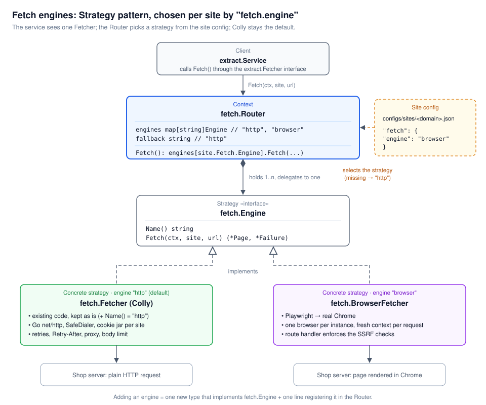

# Browser fetch engine

The browser engine loads a product page in a real Google Chrome (or Chromium) browser, driven by Playwright, instead of fetching it with a plain HTTP request. Use it for sites that the default HTTP engine cannot read:

- **Anti-bot challenges.** For example hafele.com.de: Cloudflare answers a plain request with HTTP 403 "Just a moment...". Chrome runs the challenge and gets the real page.
- **Pages rendered by JavaScript.** The HTML has no product markup until scripts run (failure code `JS_RENDERED_PAGE`).

Every other site keeps using the HTTP engine (Colly), which is faster and lighter.

| | HTTP engine | Browser engine |
|---|---|---|
| Time per page | under 1 s | 3-10 s (first visit to a challenge site ~11 s, later ~5 s) |
| Memory | a few MB | ~150 MB for Chrome + 100-300 MB per open page |
| Runs JavaScript | no | yes |
| Passes Cloudflare challenges | no | yes, with Chrome in a window |

## How it works

The fetch layer uses the Strategy pattern. `fetch.Engine` is the interface, and there are two engines:

- `fetch.Fetcher` (`"http"`, the default): Colly over Go's HTTP client.
- `fetch.BrowserFetcher` (`"browser"`): Playwright driving Chrome.

`fetch.Router` reads the site config's `fetch.engine` on every request and hands the fetch to that engine. Extraction, normalization and error reporting work the same for both.



**Inside the browser engine:**

- **One browser per server instance.** Chrome starts when the server starts. Each request gets a fresh, isolated browser context (like a new incognito window), which is closed afterwards.
- **Cookies are kept per site.** For example, Cloudflare's clearance cookie is reused on the next request to the same site, which is why later requests are faster. Cookies never cross to another site.
- **Same security rules as the HTTP engine.** All of Chrome's traffic goes through a small proxy inside the server (the "egress gate"). It refuses private, loopback and metadata addresses and blocked ports, and it uses the outbound proxy (`APP_PROXY_HOST`) when one is set. Redirects to other domains are refused, and `robots.txt` is honored.
- **Challenge pages are waited out.** After loading, the engine waits until the product root selector appears. If a challenge page reloads itself into the product, the engine reports the real page, not the 403.

## Turning it on

Two switches must both be on: the server setting, and each site that should use the browser.

**1. Server: `.env.development` locally, `.env.production` on a server.**

| Variable | Default | Meaning |
|---|---|---|
| `APP_BROWSER_ENABLED` | `false` | Start the browser engine. Without it, browser sites fail with `ENGINE_UNAVAILABLE` |
| `APP_BROWSER_CHANNEL` | `chromium` | `chrome` = installed Google Chrome (x86_64), `chromium` = Playwright's build |
| `APP_BROWSER_HEADLESS` | `true` | `false` = Chrome runs with a window, drawn on a hidden Xvfb display (see below) |
| `APP_BROWSER_MAX_PAGES` | `3` | Pages open at the same time on this instance |
| `PLAYWRIGHT_DRIVER_PATH` | user cache | Where the Playwright driver is installed (deploy.sh sets it) |

The server reads only the first env file it finds: `.env.<APP_ENV>`, then `.env`. Locally that is `.env.development`, so settings put in `.env` are ignored while `.env.development` exists.

**2. Site: `configs/sites/<domain>.json`.**

```json
"fetch": {
  "engine": "browser",
  "timeout_seconds": 60
}
```

Leave `engine` out, or set it to `"http"`, for the HTTP engine. The server reloads site configs every 30 seconds, so no restart is needed for this part.

### Which browser mode a site needs

| Mode | Settings | Works for |
|---|---|---|
| Headless | `APP_BROWSER_HEADLESS=true` | Pages that only need JavaScript |
| Chrome in a window on Xvfb | `APP_BROWSER_CHANNEL=chrome`, `APP_BROWSER_HEADLESS=false` | Cloudflare challenges (hafele.com.de) |

Checked against hafele.com.de on 2026-11-12: headless Chromium and headless Google Chrome both stayed on the challenge for 60 s (`BOT_PROTECTION`). Google Chrome with a window succeeded in 5-11 s.

The window never needs to appear on screen. **Xvfb** is a virtual display that exists only in memory: Chrome draws its window there, and to the site it looks the same as a normal desktop browser. It needs no monitor or GPU, and about 20-50 MB of RAM.

## Installing

The engine needs Node.js, the Playwright driver version that matches `go.mod` (Playwright 1.57.0), a browser, and Xvfb for window mode. The README section "Installing Playwright (browser engine)" has the full manual steps. With `deploy.sh`:

```bash
# Behind a proxy, export it first and keep it through sudo with -E
export https_proxy=http://127.0.0.1:3067 http_proxy=http://127.0.0.1:3067

sudo -E ./deploy.sh browser enable   # installs Node.js, driver, browser, Xvfb; asks for channel and window mode
sudo ./deploy.sh xvfb                # only Xvfb (same as: sudo apt-get install -y xvfb)
sudo ./deploy.sh browser             # status
```

Do not use `go run github.com/playwright-community/playwright-go/cmd/playwright install`: the driver it downloads is no longer hosted. See the README for the npm-based install.

## Start and stop

### Development (your machine)

Start the server on a hidden display, so no Chrome window opens on your desktop:

```bash
./deploy.sh dev                      # = xvfb-run -a go run ./cmd/server (installs Xvfb with sudo if missing)
# or directly:
xvfb-run -a go run ./cmd/server
```

Run it as your own user, not with sudo. Settings come from `.env.development`. The log shows the engine starting:

```
"msg":"browser engine started","channel":"chrome","version":"152.0.7977.82","headless":false,"max_pages":3
```

Plain `go run ./cmd/server` also works, but on a desktop Chrome then opens a visible window for every request.

**Stop:** press `Ctrl+C` in that terminal. The server finishes running requests, closes Chrome, and `xvfb-run` removes the hidden display. If the server was started in the background:

```bash
pkill -f "exe/server"                # or find it: ss -ltnp | grep :4000, then kill <pid>
```

### Server (systemd, installed by deploy.sh)

With window mode on, `deploy.sh` installs two units:

- `go-wordpress-extractor`: the API server, with `DISPLAY=:99`.
- `go-wordpress-extractor-xvfb`: the hidden display `:99`. It starts before the server and stops with it.

```bash
sudo ./deploy.sh restart                       # start or restart both, then wait until /ready answers
sudo systemctl stop go-wordpress-extractor     # stop (the Xvfb unit stops with it)
sudo systemctl start go-wordpress-extractor    # start (starts the Xvfb unit first)
sudo ./deploy.sh status                        # status of both units
sudo ./deploy.sh logs                          # follow the log
```

On stop, the server gets SIGTERM, finishes running requests (up to `APP_MAX_REQUEST_DURATION`), then closes Chrome.

Foreground on a server, without systemd: `sudo ./deploy.sh run`. It uses `.env.production` and puts Chrome on a hidden display when `APP_BROWSER_HEADLESS=false`.

### Docker

```bash
docker build --target runtime-browser -t go-wordpress-extractor:browser .
docker run -p 4000:4000 ... go-wordpress-extractor:browser     # start
docker stop <container>                                         # stop
```

The browser image runs Chromium headless. A challenge site such as Hafele needs window mode, which the image does not run yet.

### Turning the engine off

Turn it off for one site by setting `"engine": "http"` (or removing it) in the site config. It takes effect within 30 seconds; requests are then fetched without a browser.

Turn it off for the whole instance:

```bash
sudo ./deploy.sh browser disable && sudo ./deploy.sh restart   # server
# development: set APP_BROWSER_ENABLED=false in .env.development, then restart the server
```

Sites that still select `"browser"` then fail with `ENGINE_UNAVAILABLE` instead of silently using HTTP.

## Checking that it works

```bash
curl -s -X POST http://127.0.0.1:4000/api/v1/extract \
  -H "X-API-Key: <your key>" -H "Content-Type: application/json" \
  -d '{"url":"https://www.hafele.com.de/de/product/universalverbinder-haefele-ixconnect-uc-16-64/P-01901571/"}'
```

Expect `"status": "success"`, the product title, and `image_url` ending in `ppic-04786994.jpg`. Tests:

```bash
go test ./internal/fetch/ ./test/e2e/ -run 'Browser|Gate|Router|Engine' -v   # skip when Playwright is not installed
```

## Troubleshooting

| What you see | Cause | Fix |
|---|---|---|
| `ENGINE_UNAVAILABLE`, "not enabled on this instance (enabled: [http])" | `APP_BROWSER_ENABLED` is not `true` in the env file the server actually reads | Set it in `.env.development` (local) or `.env.production`, then restart |
| `BOT_PROTECTION` after ~60 s, page title "Nur einen Moment…" / "Just a moment..." | Cloudflare did not let headless Chrome through, or scores the server's IP address | Use `APP_BROWSER_CHANNEL=chrome` and `APP_BROWSER_HEADLESS=false`; test from the server itself, since data-center IPs are challenged harder |
| Server does not start: "please install the driver (v1.57.0) first" | Playwright driver missing | `sudo -E ./deploy.sh browser install`, or the npm steps in the README |
| Server does not start: "Executable doesn't exist at ..." | Browser build missing for the driver version | Install it with the driver (`cli.js install chromium chromium-headless-shell`), or use `APP_BROWSER_CHANNEL=chrome` |
| "Missing X server or $DISPLAY" | Window mode without a display | Start with `xvfb-run -a` / `./deploy.sh dev`, or `sudo ./deploy.sh xvfb` on a server |
| A Chrome window pops up on the desktop | Server started with plain `go run` while `DISPLAY` is set | Start with `./deploy.sh dev` instead |
| `URL_NOT_ALLOWED` | The page or a redirect points to a private or loopback address | Expected; the egress gate refuses it |
