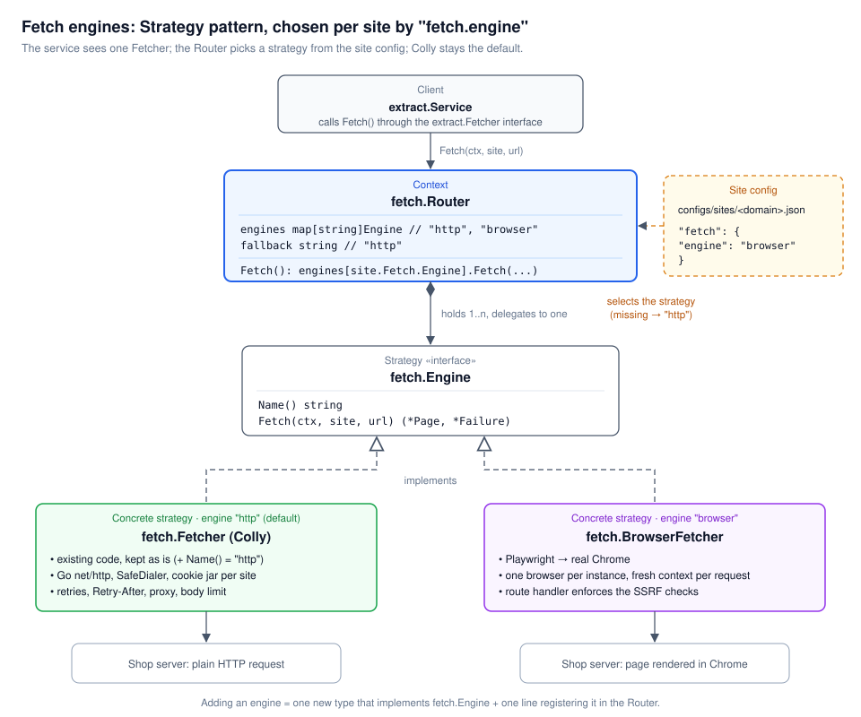

# Proposal: Real Chrome (Playwright) fetch engine

**Date:** 2026-11-12
**Status:** Implemented (see "Implementation status" at the end)

## Summary

We propose adding a second fetch engine to the product extractor. It loads pages in a real Chrome browser, driven by Playwright. Sites opt in one at a time with `"fetch": {"engine": "browser"}`, and every other site keeps the current HTTP fetcher unchanged.

**The ask:** approve about 6–8 engineering days to build it behind a feature flag. The first site to use it is Hafele (`hafele.com.de`), which the HTTP fetcher cannot read today.

## Problem

The service fetches pages with Colly over Go's HTTP client and makes requests look like a browser by setting headers (`internal/fetch/headers.go`). That works for most shops, but fails in two cases:

1. **Anti-bot challenges.** Hafele sits behind Cloudflare. A client that runs no JavaScript gets HTTP 403 with `cf-mitigated: challenge` ("Just a moment..."), so every request ends in `BOT_PROTECTION`. Headers alone cannot fix this: the challenge checks JavaScript execution and the TLS fingerprint.
2. **Client-rendered content.** Some shops fill in price, stock or gallery with JavaScript after load. The raw HTML has empty containers, so fields come back missing.

Today the only workaround is to save the page by hand from a browser, which is how the Hafele fixture was made. That does not scale and cannot serve live requests.

## Goals and non-goals

**Goals**

- Fetch pages from sites that need a real browser, through the same `/extract` API and the same site configs.
- Keep the HTTP fetcher as the default; the browser is opt-in per site.
- Keep the security guarantees of the HTTP path: SSRF checks, domain-limited redirects, body size limit, request deadline, outbound proxy.
- Return the same `fetch.Page` and `diagnose.Failure` types, so extraction, normalization and diagnostics need no change.

**Non-goals**

- Solving interactive challenges (Cloudflare Turnstile "click to verify", CAPTCHAs).
- Clicking, scrolling or logging in on product pages.
- Replacing the HTTP fetcher.

## Proposed design

The fetch layer uses the **Strategy design pattern** (required by this proposal). Each way of fetching a page is a strategy behind one interface. A context object picks the strategy for each request from the site's config. The existing Colly fetcher is kept unchanged as the default strategy.



### Strategy pattern roles

| Pattern role | Type in this codebase | Responsibility |
|---|---|---|
| Strategy (interface) | `fetch.Engine` (new) | The common contract: `Name()` and `Fetch(ctx, site, url) (*Page, *diagnose.Failure)` |
| Concrete strategy | `fetch.Fetcher` (existing, Colly) | Engine `"http"`. Today's code, kept as is; only gains a `Name()` method |
| Concrete strategy | `fetch.BrowserFetcher` (new) | Engine `"browser"`. Loads the page in real Chrome through Playwright |
| Context | `fetch.Router` (new) | Holds the registered engines and delegates each request to the one named by `site.Fetch.Engine` |
| Client | `extract.Service` (existing) | Calls `Fetch()` through `extract.Fetcher`; never knows which engine ran |
| Selector | `"fetch": {"engine": "..."}` in `configs/sites/<domain>.json` | Chooses the strategy per site; missing means `"http"` |

```go
// internal/fetch/engine.go

// Engine is the Strategy: one way of retrieving a product page.
type Engine interface {
    // Name is the value a site config uses to select this engine.
    Name() string
    Fetch(ctx context.Context, site *siteconfig.Site, target *url.URL) (*Page, *diagnose.Failure)
}

const (
    EngineHTTP    = "http"
    EngineBrowser = "browser"
)

// The existing Colly fetcher becomes the "http" strategy. Nothing else in it changes.
func (f *Fetcher) Name() string { return EngineHTTP }

// Compile-time checks that both concrete strategies satisfy the interface.
var (
    _ Engine = (*Fetcher)(nil)
    _ Engine = (*BrowserFetcher)(nil)
)
```

Why Strategy fits here:

- **Open for extension.** A third engine (for example chromedp or an external rendering API) is one new type implementing `Engine` plus one registration line. `extract.Service`, the Colly fetcher and the other engines do not change.
- **Selected at runtime by data.** The engine is chosen per request from the site config, so changing a site's engine is a config edit, picked up by the existing config reloader without a deploy.
- **Shared result types.** Every strategy returns `fetch.Page` and `diagnose.Failure`, so extraction, normalization and diagnostics work the same for every engine.
- **Testable in isolation.** Each strategy has its own tests, and the Router is tested with fake engines.

### 1. Site config opt-in

Add one field to `Fetch` in `internal/siteconfig/types.go` and to `configs/schema/site-config.v1.json`:

```go
Engine string `json:"engine"` // "http" (default) | "browser"
```

```json
"engine": { "enum": ["http", "browser"], "default": "http" }
```

Example for Hafele:

```json
"fetch": { "engine": "browser", "timeout_seconds": 60 }
```

### 2. `BrowserFetcher` (`internal/fetch/browser.go`)

- Uses `github.com/playwright-community/playwright-go`.
- Starts **one long-lived browser** per service instance (`Channel: "chrome"` for Google Chrome, or the bundled Chromium).
- Each request gets a **fresh browser context** (an isolated incognito window), closed when the request ends.
- A semaphore caps open pages per instance (default 3), so a burst of requests cannot exhaust memory.
- Steps per fetch:
  1. Acquire a slot, respecting the request context.
  2. New context with the site's user agent and locale.
  3. Install a route handler that allows only http(s) and keeps main-frame navigations on the site's domains; every connection also goes through the egress gate (see Security).
  4. `page.Goto(target)` with the site's timeout, waiting for `domcontentloaded`.
  5. Wait for the product root selector (`pages.product.root`), which also covers a challenge page that reloads itself.
  6. Read `page.Content()`, final URL, and status, and build a `fetch.Page`.
  7. Classify with the existing `classifyStatus` / `classifyError`, plus a new `ENGINE_UNAVAILABLE` code.
- **Status after a challenge:** the first response is 403 and the real page arrives after a JS reload. When the product root appears, the page is treated as 200.
- **Cookies:** optionally keep each site's `StorageState` (cookies such as `cf_clearance`) in memory and reuse it, the way `cookieJar` does for the HTTP path. Later contexts then skip the challenge.

```go
func (b *BrowserFetcher) Fetch(ctx context.Context, site *siteconfig.Site, target *url.URL) (*Page, *diagnose.Failure) {
    page := &Page{RequestedURL: target.String(), Attempts: 1}
    // acquire slot ...
    bctx, err := b.browser.NewContext(playwright.BrowserNewContextOptions{
        UserAgent: playwright.String(site.PickUserAgent()),
    })
    if err != nil { /* ENGINE_UNAVAILABLE */ }
    defer bctx.Close()

    bctx.Route("**/*", func(r playwright.Route) {
        u, _ := url.Parse(r.Request().URL())
        if err := b.dialer.CheckDestination(ctx, u.Hostname(), portOf(u)); err != nil {
            r.Abort()
            return
        }
        r.Continue()
    })

    p, _ := bctx.NewPage()
    resp, err := p.Goto(target.String(), playwright.PageGotoOptions{
        WaitUntil: playwright.WaitUntilStateDomcontentloaded,
        Timeout:   playwright.Float(float64(site.Timeout().Milliseconds())),
    })
    if err != nil {
        return page, classifyError(ctx, err, page)
    }
    _ = p.Locator(site.Pages.Product.Root).WaitFor()

    html, _ := p.Content()
    page.Status = resp.Status() // overridden to 200 when the root appeared after a challenge
    page.FinalURL, _ = url.Parse(p.URL())
    page.Headers = http.Header{"Content-Type": {"text/html; charset=utf-8"}}
    page.Body = []byte(html)
    page.BodyLength = int64(len(html))
    return page, classifyStatus(page)
}
```

### 3. Router (the Strategy context) and wiring

The Router keeps a registry of strategies by name. It has no `if engine == "browser"` branches, so adding an engine never changes it.

```go
// internal/fetch/router.go

// Router is the Strategy context: it picks the engine named in the site
// config and delegates the fetch to it.
type Router struct {
    engines  map[string]Engine
    fallback string
}

// NewRouter registers the available engines. "http" (Colly) is always there;
// the browser engine is registered only when APP_BROWSER_ENABLED is on.
func NewRouter(engines ...Engine) *Router {
    r := &Router{engines: make(map[string]Engine), fallback: EngineHTTP}
    for _, e := range engines {
        if e != nil {
            r.engines[e.Name()] = e
        }
    }
    return r
}

func (r *Router) Fetch(ctx context.Context, s *siteconfig.Site, u *url.URL) (*Page, *diagnose.Failure) {
    name := s.Fetch.Engine
    if name == "" {
        name = r.fallback
    }
    engine, ok := r.engines[name]
    if !ok {
        return &Page{RequestedURL: u.String()}, diagnose.New(diagnose.EngineUnavailable, diagnose.ConfidenceHigh,
            "The site config selects fetch engine %q, which is not enabled on this instance.", name)
    }
    return engine.Fetch(ctx, s, u)
}
```

- The Router itself satisfies `extract.Fetcher`, so `extract.Service` receives it in place of `*fetch.Fetcher`.
- `extract.NewService` takes the `extract.Fetcher` interface instead of `*fetch.Fetcher`.
- The config loader rejects an unknown engine name at validation time (`sitectl validate`), so a typo fails early instead of on a live request.
- `internal/app/app.go` provides `fetch.NewBrowserFetcher` with an `fx.Lifecycle` hook: launch Chrome in `OnStart`, close the browser and stop Playwright in `OnStop`.
- New settings: `APP_BROWSER_ENABLED` (default `false`), `APP_BROWSER_CHANNEL` (`chrome` | `chromium`), `APP_BROWSER_MAX_PAGES` (default 3).
- Chrome launches in `OnStart`, so an instance with the browser enabled but no working Chrome does not start. A browser that crashes later is relaunched on the next fetch.
- The existing per-site limiter (`AcquireSite`, `Throttle`) still applies, because it runs in `extract.Service` before the fetch.

## Security

The HTTP path's guarantees come from `SafeDialer`. Chrome resolves DNS and opens sockets itself, so it bypasses that dialer. The browser path restores each guarantee explicitly:

| Guarantee | HTTP path today | Browser path |
|---|---|---|
| No requests to private / loopback / blocked ports (SSRF) | `SafeDialer` | Chrome's only proxy is an in-process egress gate on 127.0.0.1 that dials every connection (page, subresources, iframes, WebSockets) with the same `SafeDialer`. Playwright proxies loopback too, and WebRTC is limited to proxied traffic |
| DNS rebinding | Dial checks the resolved IP | Covered: Chrome resolves nothing itself; the gate resolves and checks the IP it dials |
| Redirects stay on the site's domains | Redirect handler | Main-frame navigations to other domains are aborted; final URL checked with `site.HasDomain` |
| Body size limit | `MaxBodyBytes` | `page.Content()` length checked against the same limit |
| Request deadline | `ctx` | Navigation timeout = min(site timeout, time left on `ctx`); context closed on cancel |
| Outbound proxy | `Options.Proxy` | Passed to `Launch` as `Proxy.Server` |
| No downloads, no file access | n/a | `AcceptDownloads: false`; `file:`, `data:` and `chrome:` URLs blocked in the route handler |

Chrome runs as the unprivileged `appuser`. Playwright launches Chromium without its own sandbox by default (`chromiumSandbox: false`), so the container is the isolation boundary; enabling the Chrome sandbox needs a seccomp profile that allows user namespaces.

## Operations

| | HTTP engine | Browser engine |
|---|---|---|
| Latency per page | ~0.3–1 s | ~3–10 s (more with a challenge) |
| Memory | a few MB per request | ~100–300 MB per open page, plus ~150 MB for the browser |
| Concurrency per instance | limited by site limiter | capped at `APP_BROWSER_MAX_PAGES` (default 3) |
| Runtime image | `alpine`, ~20 MB | Debian / Playwright base with Chrome, ~1 GB |

**Docker.** Chrome needs glibc, so it cannot run on the current `alpine:3.22` runtime stage. Two options:

1. Switch the runtime stage to `mcr.microsoft.com/playwright:<version>-noble`, or Debian slim with `playwright install --with-deps chromium`. One image for everything.
2. **(Recommended)** Build two images from the same Dockerfile: the current small `alpine` image, and a `-browser` variant. Only instances that serve browser sites need the large image and more memory.

The Go binary itself stays `CGO_ENABLED=0`. playwright-go needs its Node driver and the browser at runtime, installed at image build time, never downloaded on start.

**Observability.** New metrics: `fetch_engine_total{engine}`, `browser_pages_open`, `browser_fetch_seconds`, `browser_launch_failures_total`. A crashed browser is relaunched on the next fetch; requests in flight fail with `ENGINE_UNAVAILABLE`.

## Alternatives considered

| Option | Pros | Cons | Verdict |
|---|---|---|---|
| **Playwright (playwright-go)** | Mature API, auto-waiting, routing, works with real Chrome | Needs a Node driver at runtime; Go port is community-maintained | **Proposed** |
| chromedp (pure Go, Chrome DevTools Protocol) | No Node; small dependency; fits a Go-only service | Lower-level API; more code for waits and request interception | Good fallback if the Node driver is a problem |
| External scraping API (rendering / unblocking service) | No browser to run; handles hard challenges | Per-request cost; page content goes to a third party; another vendor | Not now |
| Separate browser sidecar service (e.g. a Browserless-style container) | Isolates Chrome from the API process; scales separately | Another service to deploy and secure | Revisit if browser load grows |
| Do nothing | No cost | Hafele and similar sites stay unsupported | Rejected |

## Risks and open questions

**Risks**

- **It may still be blocked.** Cloudflare can flag headless Chrome, especially from datacenter IPs. Mitigation: test against Hafele from the production network before rollout; consider headful Chrome under Xvfb or a residential proxy only if needed.
- **Site terms.** A challenge is the site deliberately blocking automated clients. Each browser site needs a check that scraping it is allowed before it is enabled.
- **Resource use.** A slow or hanging page holds ~200 MB until the timeout. Mitigated by the page cap, per-request contexts, and hard timeouts.
- **Dependency upkeep.** Chrome and Playwright versions must be updated together; a Chrome update can change fingerprinting behavior.

**Open questions**

- Should a site be able to choose `engine: "auto"` (try HTTP, fall back to browser on `BOT_PROTECTION`)? This doubles worst-case latency but needs less config.
- Do we persist `cf_clearance` cookies across instances, or keep them in memory per instance?
- Which hosting target runs the browser image, and how much memory per instance can we have?
- Should `sitectl` get a `--engine browser` flag to test a config against a live page?

## Rollout plan and effort

| Phase | Work | Effort |
|---|---|---|
| 1. Foundation | Schema field, `Router`, `extract.Fetcher` in `NewService`, settings, feature flag off | 1 day |
| 2. BrowserFetcher | Launch / lifecycle, contexts, route-based SSRF guard, timeouts, size limit, failure codes | 2–3 days |
| 3. Tests | Unit tests with a local test server (redirects, private IPs, timeouts); e2e for Hafele that skips when Chrome is absent | 1–2 days |
| 4. Packaging | `-browser` Docker image, metrics, `/ready` check, docs in the `add-site` skill | 1 day |
| 5. Rollout | Enable for Hafele on one instance; watch success rate and latency for a week; then open to other sites | 1 day + monitoring |

**Total: about 6–8 engineering days**, plus a week of monitoring.

**Success criteria:** Hafele product requests succeed at least 90% of the time with p95 latency under 15 s, with no change in error rate or latency for HTTP-engine sites.

## Implementation status

Implemented on 2026-11-12. What was built:

| Area | Files |
|---|---|
| Strategy interface, engine names | `internal/fetch/engine.go` |
| Strategy context (Router) | `internal/fetch/router.go` |
| Browser strategy (Playwright → Chrome) | `internal/fetch/browser.go` |
| Egress gate (SSRF-safe forward proxy for Chrome) | `internal/fetch/gate.go` |
| HTTP strategy (Colly) | `internal/fetch/fetch.go`, unchanged apart from `Name()` in `engine.go` |
| `fetch.engine` field and validation | `internal/siteconfig/types.go`, `internal/siteconfig/loader.go`, `configs/schema/site-config.v1.json` |
| Settings `APP_BROWSER_ENABLED`, `APP_BROWSER_CHANNEL`, `APP_BROWSER_HEADLESS`, `APP_BROWSER_MAX_PAGES` | `internal/config/config.go`, `internal/config/validate.go` |
| fx wiring (browser lifecycle, Router as `extract.Fetcher`) | `internal/app/app.go`, `internal/extract/service.go` |
| `sitectl check --live` uses the site's engine | `internal/sitectl/sitectl.go` |
| `ENGINE_UNAVAILABLE` failure code | `internal/diagnose/codes.go`, regenerated `docs/` |
| Browser Docker image | `Dockerfile` target `runtime-browser` |
| Tests | `internal/fetch/router_test.go`, `gate_test.go`, `browser_test.go`, `internal/siteconfig/loader_test.go`, `test/e2e/browser_engine_test.go` |

Differences from the design above:

- **Egress gate instead of per-request destination checks.** All Chrome traffic goes through an in-process proxy that dials with `SafeDialer`. This also closes the DNS-rebinding gap and lets tests use a fake resolver.
- **One failure code**, `ENGINE_UNAVAILABLE`, both for an engine that is not enabled and for a browser that fails.
- **No `/ready` change and no new metrics yet.** The app does not start when the browser is enabled but cannot launch.
- **User agent:** the browser engine keeps Chrome's own user agent (which matches its TLS fingerprint) unless the site config lists `user_agents`.
- **robots.txt** is honored by the browser engine too, fetched through the same SSRF-safe transport and cached for an hour.

Still open: switching `hafele.com.de` to `"engine": "browser"` and checking it from the production network; `engine: "auto"` fallback; metrics.
